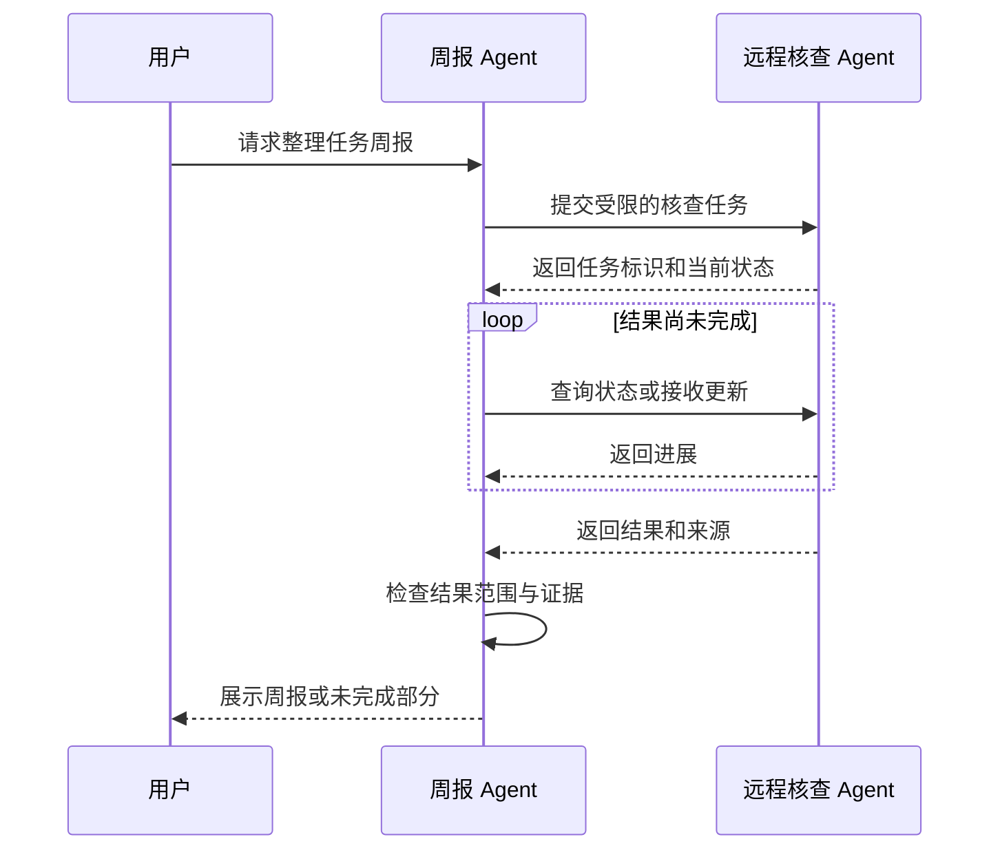

# A2A 怎样连接不同服务中的 Agent

[← AI Agent 学习路线](README.md)

一个 Agent 负责整理周报，另一个独立服务擅长核查任务数据。两者可能由不同团队维护，各自有身份、工具和运行环境。要把核查工作交给远程 Agent，需要约定怎样发现能力、提交任务以及查看结果。

A2A 即 Agent2Agent，是用于 Agent 之间通信的协议。MCP 常用于 Agent 应用连接工具与上下文服务；A2A 面向不同 Agent 之间交换消息和任务结果。它们可以一起使用，边界由具体系统设计决定。[A2A 官方规范](https://a2a-protocol.org/latest/specification/)定义了能力描述、消息和任务等概念，具体字段应按接入版本核对。

## 先知道对方能做什么

远程服务可以通过 Agent Card 描述能力、接口和认证要求。调用方读取描述后，判断对方是否适合核查任务。描述是声明，需要结合来源、身份和实际权限核验，不能因为 Card 写了支持某项功能就信任它处理了所有风险。

例如一个虚构的核查 Agent 声明可以读取任务状态并返回核查结果。主 Agent 仍需要明确传入任务范围，不能默认对方能读取用户的全部任务。服务地址应来自可信配置或经过验证的发现过程，避免把敏感内容发送给伪造的服务。

## 提交任务与取得结果

接收方确认收到请求，只说明通信或受理成功。核查可能继续运行、等待补充信息、失败或被取消；调用方应根据协议版本区分这些状态。图里任务标识、轮询和更新是示意交互，不限定每个实现必须使用相同传输方式。

有些请求可以直接返回完成消息或结果，不一定产生需要后续轮询的任务。只有接收方给出可查询任务且双方支持相应操作时，调用方才能按任务标识继续查询；不能将图中的异步流程当成所有 A2A 请求的必经步骤。

## 跨服务需要明确哪些约定

| 事项 | 需要确认的内容 |
|---|---|
| 身份 | 谁发起请求，远程服务如何验证调用方 |
| 授权 | 用户允许查询哪些资源，凭证能否安全委托 |
| 结果 | 哪些字段和证据需要返回，能否暴露给当前用户 |
| 时限 | 连接超时与任务执行超时各怎样处理 |
| 取消 | 取消请求是否生效，已产生的副作用如何核对 |
| 重复 | 网络重试能否复用同一业务请求标识 |

不应把用户的长期凭证直接放进任务文本或日志。传输身份、范围受限的授权和资源级权限检查需要两边共同落实。远程返回的文本和文件同样是不可信输入，引用地址与下载范围也要检查。

## 失败不等于任务不存在

请求超时可能发生在对方已受理之后。发起方应先按约定查询任务状态，或使用双方支持的幂等机制处理重试，不能默认重新提交一定安全。取消请求被接受后，也要看任务最终状态，不能保证已发出的外部动作可以撤回。

测试应覆盖能力描述过期、鉴权失败、请求成功但任务失败、重复提交、超时后完成和取消竞争。验收还要检查最终结果是否符合用户授权与任务要求。若两个角色只在同一进程协作，不一定需要引入远程协议；先把任务边界和结果契约定义清楚即可。
