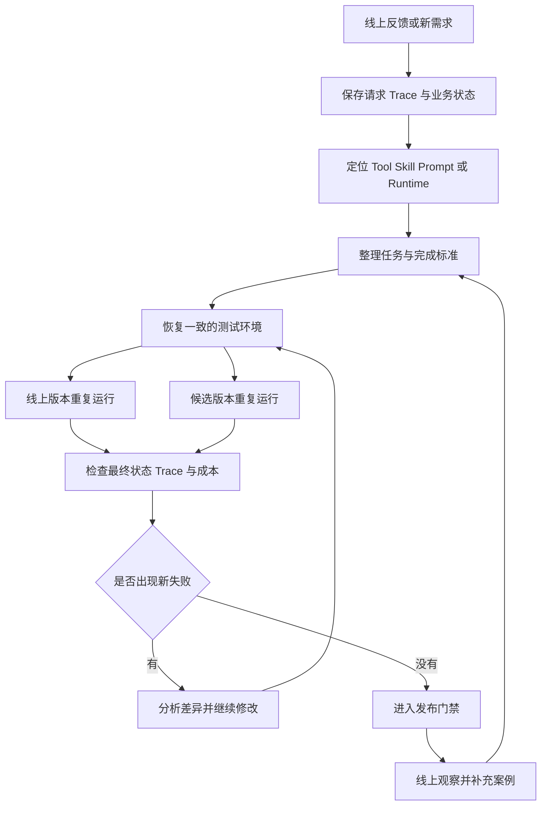

# Agent 评测怎样判断一次修改有没有真的变好

[← AI Agent 学习路线](README.md)

一个客服 Agent 取消错了订单，开发人员查完 Trace，发现它在会话中途丢掉了用户最后确认的订单编号。团队补了一段 Skill，再把原请求跑一遍，这次成功了。

修复工作还没有结束。新增的说明可能影响模型选择工具，也可能让原本正常的订单查询变慢。即使什么都没改，同一个任务再次执行也可能得到不同结果。只复跑用户投诉的那一次请求，能够确认眼前的问题，却回答不了整个版本有没有变好。

## 先定义任务怎样算完成

假设用户有订单 A 和订单 B。他先要求取消 A，Agent 执行前又改成了 B。这个案例的完成标准应当落到业务状态上。订单 B 已取消，订单 A 保持原样，系统也留下符合要求的操作记录。

Agent 最后回复“订单 B 已取消”，只能说明它生成了这句话。Trace 显示它调用了取消接口，只能说明执行过程走到了这里。接口返回成功也可能发生在写库失败以前。最终是否完成，需要查询订单系统中的状态，并确认没有产生额外副作用。

[Anthropic 的 Agent 评测指南](https://www.anthropic.com/engineering/demystifying-evals-for-ai-agents)把一次完整执行称为 trial，把执行中的消息、工具调用和中间结果称为 transcript 或 trace，把执行结束后的环境状态称为 outcome。这个区分很实用。Trace 帮助团队找到哪里出了错，outcome 回答任务有没有完成。

| 检查对象 | 能说明什么 | 不能单独证明什么 |
| --- | --- | --- |
| 最终回复 | Agent 向用户表达了什么 | 业务操作已经成功 |
| 工具调用 | 选择了哪个工具并传入哪些参数 | 下游系统已经接受并保存结果 |
| Trace | 执行经过哪些步骤，失败从哪里开始 | 用户目标已经完成 |
| 业务最终状态 | 数据和副作用是否符合预期 | 交互过程是否清楚、合规 |

一次评测通常要同时检查最终状态和执行过程。只看状态，可能放过越权调用和多余副作用。只看过程，又可能把“调用姿势正确”误当成任务成功。

## 把线上问题整理成可重复的案例

评测案例不能只保存一句用户原话。订单取消依赖用户身份、订单状态、前文确认和工具返回，这些条件少一项，下一次运行就无法复现原问题。

一个可执行的案例至少要留下这些内容。

| 内容 | 订单案例中的含义 |
| --- | --- |
| 任务输入 | 用户完整对话和最后确认的目标 |
| 初始状态 | 两个订单在运行前的状态与所属用户 |
| 可用工具 | 查询、取消和规则检查接口及其版本 |
| 允许行为 | 查询订单，在条件满足时取消目标订单 |
| 禁止行为 | 修改其他订单，跳过权限与取消条件 |
| 预期结果 | B 被取消，A 不变，操作记录完整 |
| 评分方法 | 数据库状态检查、Trace 规则和交互质量评分 |
| 运行版本 | 模型、Prompt、Skill、工具和 Runtime 版本 |

每次运行前都要恢复相同的初始状态。旧版本已经把 B 取消，新版本再接着执行，两个结果没有可比性。外部服务会变化时，可以准备隔离环境或可控制的测试替身，并记录它们的版本。

模型输出带有波动，同一个案例还要重复运行。Anthropic 将同一任务的一次执行称为一次 trial，建议通过多次 trial 观察稳定性。报告应保留每次成功和失败，不能只挑最好的一次，也不能把五次中偶然成功的一次写成能力已经具备。

## 评分先交给能直接检查的规则

订单状态、文件是否生成、参数是否越权和工具有没有产生多余写操作，都可以由代码判断。这类结果明确，运行稳定，失败以后也容易定位。

回复是否解释清楚，语气是否合适，研究报告有没有覆盖关键材料，这些问题需要理解语义。团队可以使用人工量规，也可以让模型按照量规评分。模型评分需要用一批人工结论校准，评委模型、提示词和量规都要登记版本。分数异常时，还要回到原始输出和 Trace 查看。

一项任务可以同时使用几种评分方式。取消订单案例可以用代码检查两个订单的状态，用规则检查是否调用了禁止工具，再用语义评分判断解释是否清楚。[Phoenix 的评测文档](https://arize.com/docs/phoenix/evaluation/llm-evals/evaluator-traces)也把确定性检查和模型评分作为不同手段，并记录评分过程本身的 Trace。评分器同样可能出错，它也需要被检查。

## 一次修改要放回整组任务里检查

修复订单取消问题以后，受影响的范围通常大于这个案例。新的 Skill 会参与模型判断，订单查询、退款和改签等相邻任务都可能发生变化。团队要保留核心任务，再补上本次失败和相似边界，用同一套环境分别运行线上版本与候选版本。

比较时先看具体任务的变化。哪些失败变成了成功，哪些原本正常的任务开始失败，同一个任务的多次执行是否稳定。整体平均分可以保留，却不能盖住高风险任务的退化。涉及付款、删除和权限修改的任务，即使使用频率不高，也可以设置更严格的发布条件。

耗时、Token 用量和工具调用次数也要一起保存。候选版本可能完成得更好，却多调用了十次工具，让用户等待更久。这个变化是否值得，需要结合任务风险和产品要求判断。

测试环境本身的错误要单独记录。订单服务不可用、测试数据没有成功恢复、评分器超时，都不应直接算成 Agent 能力失败。把环境故障混进失败率，团队会去修改一个没有出错的 Prompt。

## 评测集也会被用旧

固定回归集保存已经确认且长期有效的核心任务。滚动困难集吸收近期线上失败和新边界。还要留一部分没有参与 Prompt、Skill 和阈值调整的案例，用来检查修改能否处理同类问题。

团队反复看着同一批答案修改 Agent，那批案例会越来越容易通过。此时分数上涨，可能只说明系统已经适应了这份题单。新的表达、不同业务状态和未参与调优的案例，才能帮助团队判断能力有没有扩展到相邻场景。

案例也需要版本和来路。线上反馈经过确认以后才能进入回归集，标准发生变化时保留旧结论和修改原因。样本怎样从反馈进入审核、评测和发布流程，可以继续阅读[数据反馈怎样进入评测与迭代](../enterprise-ai-platform/data-foundation/data-feedback-evaluation.md)。

安全类任务还要同时保留攻击样本和正常请求，检查系统有没有为了提高拦截率而大量误伤用户。账号风险、权限边界和安全样本的处理方法放在[Agent 服务怎样防止能力被批量提取](agent-service-security.md)中单独讨论。

Agent 评测最后留下的是一组可以重复回答的问题。这次修改解决了哪些任务，旧能力有没有退化，失败发生在哪一步，代价增加了多少。团队拿着这些结果决定是否发布，比“我刚才试了一下，感觉好多了”可靠得多。
