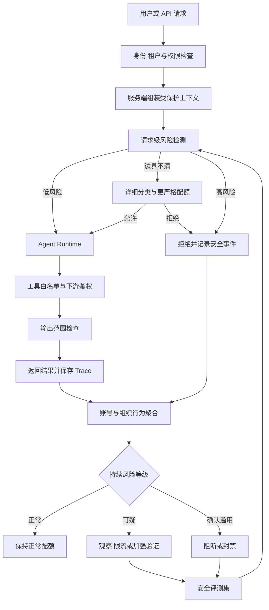

# Agent 服务怎样防止能力被批量提取

[← AI Agent 学习路线](README.md)

一个请求要求 Agent 总结资料，另一个请求询问工具怎样使用，单独看都很普通。成千上万个相似请求分散在不同账号里，持续试探系统提示词、Skill、受限知识和工具行为，事情就变了。攻击者可以把返回结果整理成训练数据，也可以借这些请求摸清系统边界。

单次内容检测很难处理这种问题。服务需要同时看请求、会话、账号和组织，还要知道哪些内部内容允许返回，哪些业务能力只能在特定身份和权限下调用。

## 先分清正在防什么

模型蒸馏本身是一种训练方法。模型所有者可以让能力更强的教师模型生成数据，再训练较小的学生模型。未经授权地规模化收集其他服务的输出，用来复制其能力，属于能力提取或蒸馏攻击。

普通爬取更关注页面、文档和公开内容。业务滥用可能利用 Agent 批量发消息、查询数据或执行操作。几类行为会重叠，处置依据却不相同。把它们全叫作蒸馏，团队很难写清规则，也容易把正常的批量客户误伤。

[Anthropic 对蒸馏攻击的公开说明](https://www.anthropic.com/research/distillation-defenses)关注基础模型的推理内容和模型能力。普通 Agent 团队还要保护自己添加的那一层，包括系统提示词、Skill、知识内容、工具配置、会话状态和业务权限。调用第三方模型时，团队无法控制供应商模型内部怎样保存推理，只能管理自己持有的内容和调用边界。

| 需要保护的对象 | 泄露或滥用后的影响 | 主要边界 |
| --- | --- | --- |
| 系统提示词与 Skill | 业务规则和防护条件被持续试探 | 由服务端保存，按版本装载 |
| 知识内容 | 受限文档被批量搬走或跨租户返回 | 权限过滤、租户隔离与输出检查 |
| 工具描述与参数 | 攻击者摸清可调用能力和输入边界 | 只暴露当前任务需要的工具 |
| 会话与长期记忆 | 其他用户信息泄露，恶意内容长期残留 | 用户与组织范围隔离，写入前校验 |
| 工具凭证与业务权限 | Agent 代替攻击者读取或修改系统 | 最小权限，下游再次鉴权 |
| 模型与 Agent 输出 | 被规模化收集后用于复制能力 | 配额、行为检测和渐进处置 |

## 内部上下文要由服务端管理

系统提示词、Skill、工具定义和内部状态应当由服务端按版本组装。客户端可以提交用户内容，不能直接改写内部消息，也不能把一个组织的受保护状态带进另一个组织。需要在多轮请求间延续的状态，可以保存不可变标识、版本和完整性校验信息，再由服务端重新取回。

Anthropic 的案例里，攻击者会利用跨会话、跨模型和跨账号的上下文流转获取受保护推理。它采用了限制旧上下文被编辑、约束推理内容可见组织等措施。Agent 应用未必拥有同样的推理接口，设计原则仍然有用。内部状态从哪里产生，可以流向哪里，谁能修改，都应由代码和权限系统决定。

只在 Prompt 里写一句“不要泄露系统提示词”，约束很弱。服务还需要在模型调用前裁剪上下文，在返回用户前检查受限内容，并避免把密钥、服务端连接信息和完整工具结果交给模型。模型没有看到的内容，也就少了一条被带出系统的路径。

## 请求检测与长期行为解决不同问题

请求级检测适合处理明显的提取意图、上下文篡改和越权请求。它需要在模型执行前给出快速判断。边界不清的请求可以进入更严格的分类器，减少把复杂判断全压在一个低成本规则上。

Anthropic 公布的方案使用两阶段分类器，并通过内部和外部红队测试持续寻找绕过方式。文章没有公开分类器的全部实现细节，企业也不需要照着猜。工程上可以保留两层职责。快速规则和轻量模型先处理明确情况，详细分类器再结合请求内容、账号历史与目标资产判断。

长期行为检测关注另一组信号。同一账号是否持续围绕少数能力生成大量变体请求，多个账号是否出现高度相似的调用节奏，被拒绝后是否马上更换账号继续。这些信号单独看都可能来自正常客户，需要结合时间窗口、产品套餐、组织关系和历史基线判断。

采集行为特征时仍要遵守最小化原则。账号、组织、API Key 和请求指纹通常已经能够支持一部分关联分析。设备、网络和支付信息涉及更强的隐私与合规要求，只有业务确有需要并具备合法依据时才使用，访问和保存时间也要受限。

## 防御要覆盖 Agent 的完整执行过程

身份检查要发生在模型以前，工具执行时还要再做一次。模型选中了某个工具，不代表当前用户有权调用。下游系统应当使用用户或任务自己的身份与最小权限，不能让所有 Agent 请求共享一个高权限账号。[OWASP 关于 Excessive Agency 的说明](https://genai.owasp.org/llmrisk/llm062025-excessive-agency/)同样建议缩小工具功能和权限，并在下游系统中执行授权检查。

输出检查也不能只搜几个敏感词。知识查询要检查返回片段是否属于当前租户，工具结果要裁掉内部字段，文件下载要再次验证访问范围。高风险写操作可以要求用户确认，确认对象和最终执行对象必须一致。

## 处置需要逐步增加摩擦

一次分类结果不适合直接决定永久封禁。正常客户做批量评测、迁移或压力测试，也可能产生高频和重复请求。系统可以按证据强度逐步增加限制。

| 状态 | 系统动作 | 需要保存的依据 |
| --- | --- | --- |
| 正常 | 按套餐和权限提供服务 | 基础调用与成本记录 |
| 观察 | 增加采样和行为聚合 | 命中规则、目标能力和时间窗口 |
| 限制 | 降低速率、并发或可访问能力 | 风险分数、历史处置和版本 |
| 加强验证 | 重新验证身份或组织关系 | 验证原因、结果和有效期 |
| 阻断 | 拒绝当前请求或冻结相关凭证 | 决策证据、影响范围和恢复条件 |

状态变更要幂等并留下审计记录。多个检测任务同时处理同一账号时，不能重复扣减配额或反复切换状态。封禁和恢复也要带版本，策略改错以后才能找到受影响的账号并撤回。

## 安全评测要同时放攻击和正常请求

安全测试集只收攻击样本，分类器很快会学会一遇到长请求或重复调用就拒绝。评测集还要加入正常的批量任务、研究请求、长上下文和管理员操作。这些样本专门检查误报。

每次红队测试、线上确认的攻击和申诉成功的误判，都可以成为候选样本。进入固定回归集以前要经过审核，记录适用策略、目标资产和期望处置。具体版本怎样比较，可以继续阅读[Agent 评测怎样判断一次修改有没有真的变好](agent-evaluation.md)。样本的审核、版本和发布过程则可以复用[数据反馈怎样进入评测与迭代](../enterprise-ai-platform/data-foundation/data-feedback-evaluation.md)中的方法。

指标至少覆盖检测和业务两边。团队需要看攻击样本拦截率、正常请求误报率、从首次异常到限制生效的时间、仍然返回了多少受保护内容，还要看增加了多少延迟、成本和用户申诉。只统计封禁账号数量，很容易把激进误伤当成防御能力。

Anthropic 在自己的服务中用被提取的推理 Token 数量衡量攻击产出，并报告新措施上线后下降了 10 到 100 倍，同时披露分类器误报和合法集成改造的代价。这是特定模型服务的公开结果。Agent 产品应当根据自己保护的对象定义产出指标，例如受限文档片段、内部规则或高价值工具结果的异常返回量。

Agent 服务的安全边界最终要落到几个普通问题上。内部内容由谁装载，工具以谁的身份执行，一次请求被拒绝以后系统还记得什么，多个账号一起行动时谁能看出它们的关系。模型可以参与判断，权限、状态和处置仍要由确定的服务规则承担。
