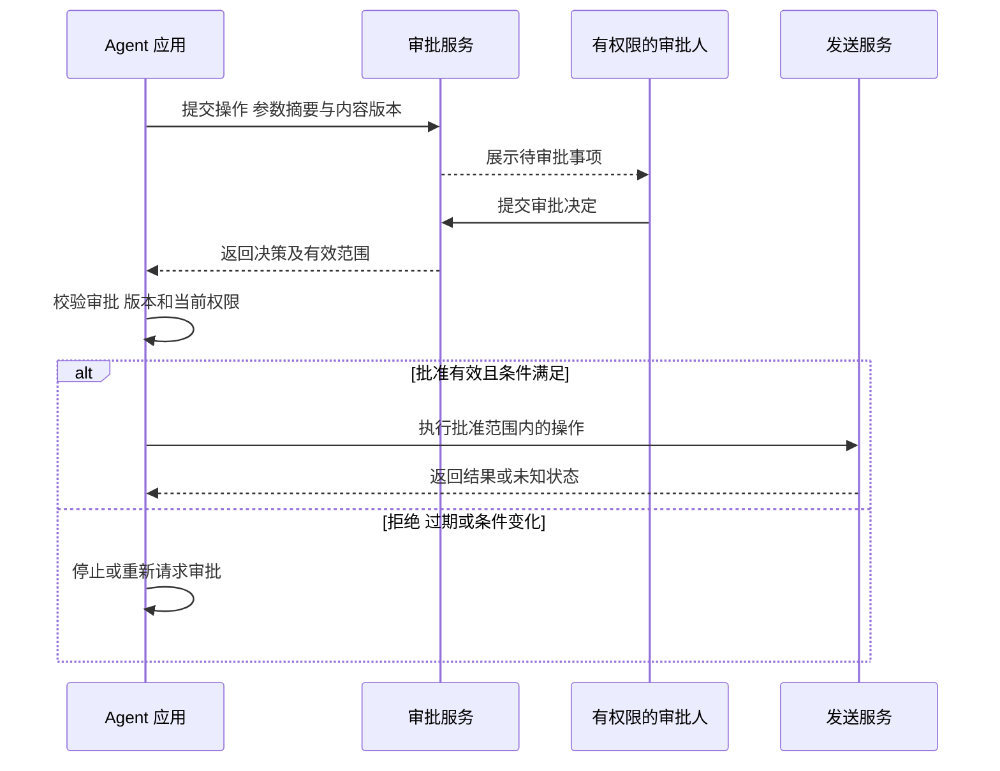

# 审批门禁怎样约束高风险工具

[← AI Agent 学习路线](README.md)

Agent 完成周报草稿后，用户可能要求将它发送到外部系统。发送对象、内容和影响范围都需要明确。系统在执行前可以展示具体操作，等待有权限的人批准，再继续调用发送工具。

审批等待的是对具体行动的授权。[澄清提问](clarification-and-resume.md)解决的是信息不足；用户回答了时间范围，并不意味着同意发送给所有人。本文使用虚构周报作为示例。

## 审批什么内容

审批记录可以绑定任务、操作者、工具、目标资源、参数摘要、内容版本、有效期限和审批人。用户应能看见要发送给谁、发送什么、操作有什么影响，再决定是否批准。

批准“发送当前草稿给指定接收人”，不等于批准 Agent 随意更换接收人或修改草稿。内容或参数发生实质变化时，原审批应失效并重新请求。

操作风险可以按产品规则分级。读取用户已有权限的公开资料，可能直接执行；修改共享内容、向外发送或删除数据，可能需要额外确认。等级取决于资源、接收范围和后果，不能只按工具名称决定。同一个发送工具在发送给自己和发送给外部组织时，影响范围就可能不同。

## 恢复后重新检查

批准结果到达时，应用要检查审批是否属于当前任务和具体操作、是否过期、审批人是否具备权限、内容与参数是否仍一致。原本有权限的用户后来被撤销权限，也不能只凭旧审批继续执行。

例如审批时保存草稿版本和接收人列表的摘要。执行前从权威存储重新取得二者并比较，发现草稿在等待期间被修改，就停在待重新审批状态。摘要只能帮助检测变化，不代替审批人身份校验或业务资源授权。

超时、拒绝或审批内容无法确认时停止执行，并向用户说明状态。审批被重复提交时，状态更新应能去重；审批与取消同时发生时，使用受控的状态转换，执行前再次检查最终状态。

## 批准不等于执行成功

审批通过以后，工具可能失败或超时。应用要分别记录审批结果与业务执行结果。超时后先按业务标识对账；若需要重试，应使用业务支持的稳定幂等键。不能因为审批通过就向用户声称周报已经发送。

有些产品支持会话内重复使用授权，但范围、次数、有效期与撤销方式都需要明确设计。一次高风险操作的批准不能自动延伸到其他资源或未来会话。

## 评测要覆盖变化和竞争

测试审批通过、拒绝、超时、审批人无权、内容变化、权限撤销及重复回复。还要模拟批准后执行前用户取消，确认工具入口检查最终状态。对于无法撤回的外部操作，测试应核对是否重复执行以及未知结果如何呈现。

更完整的身份与授权架构见[身份、权限和 Guardrail](../ai-native/agent-identity-policy-guardrail.md)。
