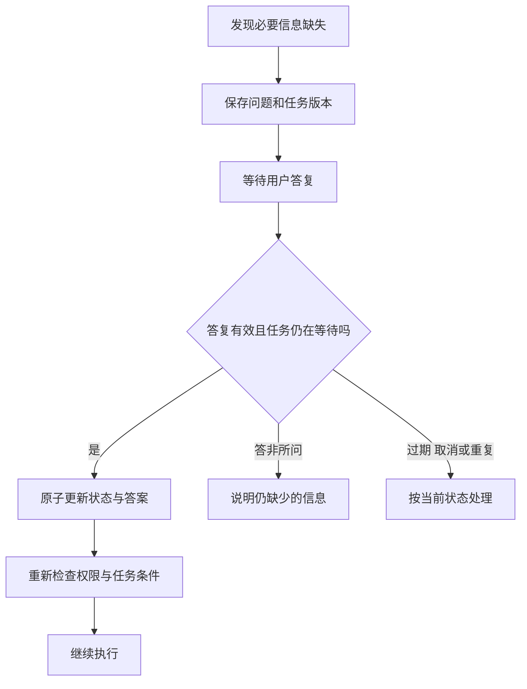

# 澄清提问怎样挂起并恢复任务

[← AI Agent 学习路线](README.md)

用户要求“整理最近的任务周报”，没有说明时间范围。系统可以先问“最近一周还是一个月”，然后等待答复。等待期间进程可能重启，用户也可能重复回复或取消任务，不能只靠一条聊天消息记住当前执行位置。

澄清等待的是完成任务需要的信息。是否允许执行某项操作属于授权问题，另见[审批门禁](approval-gates.md)。本文使用虚构的周报任务说明一种设计。

## 保存一个可恢复的等待状态

应用提出问题时，可以保存任务标识、问题标识、需要填写的字段、当前任务版本、提问内容和过期时间。提示用户选择时间范围，同时记录任务处于等待答复状态。

```text
任务：生成周报
等待字段：时间范围
已确认：当前用户身份
尚未执行：任务查询和草稿生成
```

内容只是示例，生产系统还要保存用户授权范围和必要的关联标识。模型可以生成提问，应用应检查问题是否指向确实缺失的信息，避免反复询问已经确认过的条件。

## 答复到达时先验证

用户回答“最近一周”，应用解析成明确的起止时间和时区；无法确定时区时继续询问或使用经过确认的产品规则。“好的”没有提供范围，不能当作有效答案。

例如系统在一个明确时区里将“最近一周”解析为一个具体起止区间，可以先向用户展示这一区间，再按产品约定确认。只保存“最近一周”这个相对表达，任务隔天恢复时可能算出不同时间；保存已确认的绝对范围，才能让查询与用户原意保持一致。



两个相同答复同时到达时，可以用问题标识和状态版本进行条件更新，只有一个处理成功；另一个读取现有结果，不重复启动后续查询。用户取消与答复并发时，也要由同一状态转换规则决定哪个先生效。

如果用户先答“最近一周”，随后又改成“最近一个月”，第二条内容不能作为第一次答复的重复消息直接丢弃。系统需要区分同一回复的重复投递与用户后来主动修改条件；若任务已经开始查询，应按产品规则更新任务版本，并判断是否需要重新查询。

## 等待期间环境可能变化

用户有权查询的任务范围可能变化，原计划也可能被修改。恢复前重新检查身份、授权、任务版本和工具可用性。过期问题的答复不能写入新任务；若内容已经不适用，应重新提出问题。

模型生成的答复摘要可以帮助理解上下文，但正式的等待字段与已确认答案应保存在任务状态中。状态恢复与外部副作用的处理见[事件记录](event-state-recovery.md)。

## 怎样验证

准备时间范围完整、答非所问、重复答复、超时后答复、用户取消和进程重启等测试。检查用户身份与任务归属，确认重复答复不会产生两次后续操作，也检查时间解析和夏令时等日期边界。具体等待时间和自动过期策略由产品决定。
