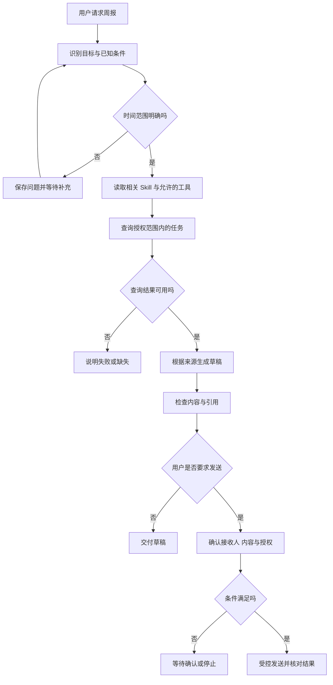

# 一个完整任务怎样串起 Agent 的各项机制

[← AI Agent 学习路线](README.md)

用户希望整理一份任务周报，并在确认后发送给指定接收人。这个请求包含查询、生成和外部发送。我们可以把前面介绍的能力放进一条任务流程，检查每一步需要什么证据、什么情况下应停下来。

下面是一份虚构的设计示例，用来说明机制之间的衔接。它没有调用真实系统，也不代表已经完成生产验证。

## 先定义任务的完成条件

生成草稿与发送周报是两个不同结果。草稿需要有明确的时间范围和来源，任务数据只能来自用户有权访问的范围；发送需要明确接收人、草稿版本以及应用规定的授权。

如果用户只要求“整理”，完成草稿即可，不自动发送。用户说“最近”但没有时间范围时，先澄清；若任务系统无法查询，就说明缺失部分，不把失败写成没有任务。

## 一次任务的可能路径

这张图展示一种受控流程。条件可用固定代码或状态机表达；模型用于理解请求、选择合适的工具以及组织草稿。系统不需要为了覆盖概念而在每次任务中调用所有组件。

## 上下文、知识和工具各提供什么

当前上下文包含用户的请求、已确认的时间范围、必要的工具说明和本次查询结果。长期记忆如果保存了用户认可的排版偏好，可以在授权范围内读取；它不能覆盖本轮明确的要求。

Skill 提供周报的组织方法。工具注册表维护查询与发送能力，MCP 可以作为连接外部任务服务的一种方式。若需要解释某个任务状态的业务含义，RAG 可以查找有效规则；实时任务状态仍应查询业务服务。

应用根据本轮需要选择材料和工具。引用规则需要能回到允许访问的来源，工具结果中的外部文本应作为不可信数据处理。

## 执行、等待和恢复

运行时记录模型与工具步骤，限制调用次数和总时限。用户需要补充时间范围时，保存问题标识和任务版本；答复到达后先校验并重新检查权限。

发送动作如果需要审批，应把接收人、内容版本和操作范围作为具体审批内容。草稿修改后重新核对审批是否仍有效。外部发送超时后状态可能未知，系统应根据业务标识查询或对账，不能直接再发一次。

进程重启后，事件记录和检查点帮助恢复当前任务。重建状态不等于重放外部写操作，恢复后还要确认当前业务状态与授权。

## 逐项验收而不是只看文字

| 场景 | 预期结果 |
|---|---|
| 时间范围完整且查询成功 | 生成有来源的草稿，说明未确认内容 |
| 用户只要求整理 | 不发送周报 |
| 用户没有任务访问权限 | 不读取或展示越权数据 |
| 查询结果部分失败 | 标记缺失，不当作零条任务 |
| 来源规则过期或冲突 | 不把冲突内容写成确定结论 |
| 用户拒绝审批或取消 | 不启动后续发送 |
| 发送超时、结果未知 | 保留未知状态，先对账再决定是否重试 |
| 重启后恢复 | 不因为重建状态重复执行外部操作 |

测试时可以用固定的假模型输出和假服务检查状态转换，再在隔离环境中使用真实模型观察工具选择和回答质量。离线评测应记录完成率、错误工具调用与缺失证据，也要跟踪延迟和成本。最终用户能否看懂结果、是否可以核对数据，与流程是否走完同样需要检查。
