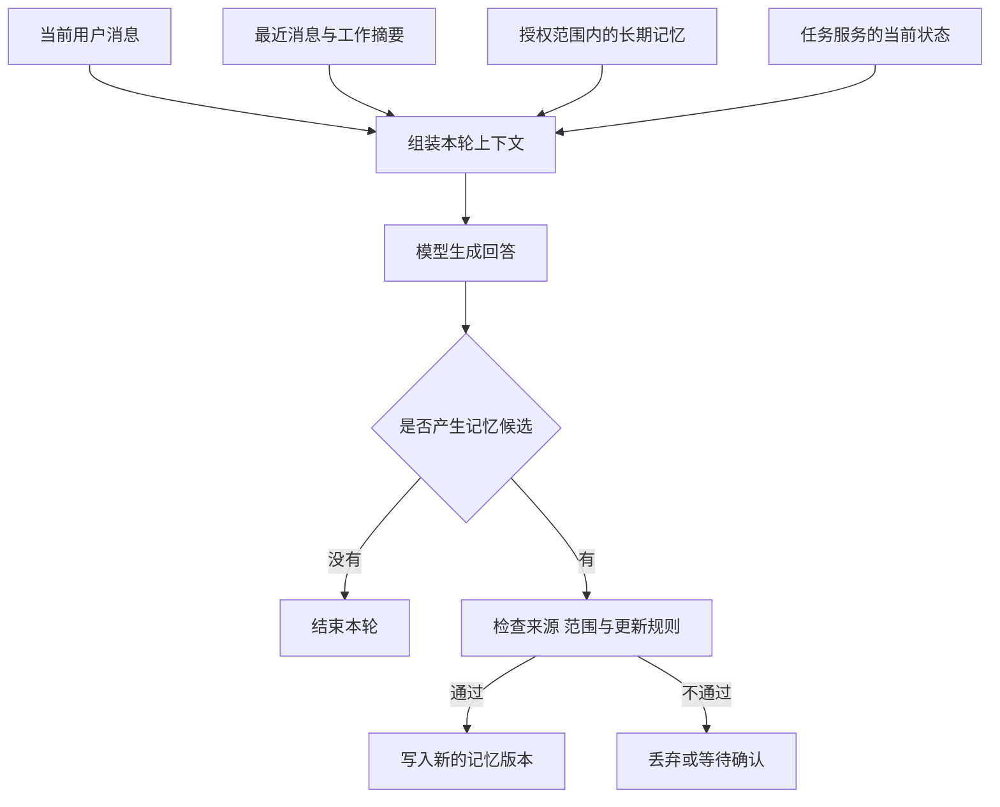

# Agent 怎样管理上下文与长期记忆

[← AI Agent 学习路线](README.md)

用户和 Agent 讨论一个任务时，后一句常常会省略前面已经说过的信息。用户先说“查询 `TASK-1002`”，随后问“它的阻塞原因是什么”，Agent 需要从当前对话中知道“它”指哪项任务。

同一个用户过几天再次使用系统时，可能希望 Agent 记住长期有效的回答偏好。但这不意味着要把每次对话全部塞进新请求。系统需要区分当前会话、任务状态和跨会话保留的信息，再按本轮需要组装给模型。

本文沿用虚构的任务查询例子。示例数据只用于说明设计，不代表真实用户或已运行的系统。

## 模型看到的是本次请求的上下文

上下文是模型在当前推理中可使用的信息，通常包括应用规则、用户消息、近期对话、工具定义和结果。某条信息曾经出现在旧对话中，并不保证它还在这一次请求里。

上下文窗口有容量限制。输入消息、工具说明和结果会占据空间，输出也需要预留预算。支持的长度和计算方式依模型及接口而异，应按所用接口的规则统计。[上下文窗口说明](https://platform.claude.com/docs/en/build-with-claude/context-windows)介绍了消息和工具结果随会话增长而占用窗口的情况。

假设一轮任务查询需要这些内容。

| 内容 | 本轮用途 | 处理原则 |
|---|---|---|
| 产品规则与当前用户请求 | 确定约束和本轮目标 | 保留有效规则与当前请求 |
| 最近几轮对话 | 理解“它”等省略指代 | 保留必要原文及角色顺序 |
| 工具定义 | 让模型知道允许调用什么 | 按需要提供并校验权限 |
| 任务查询结果 | 作为回答的当前依据 | 保留必要字段和来源 |
| 跨会话偏好 | 调整回答方式 | 只读取当前用户授权的相关内容 |
| 早期对话摘要 | 补充还未解决的问题 | 标明摘要来源和不确定内容 |

可用窗口不是全部都留给历史记录。应用可以分别为规则、当前任务、工具结果和回答预留空间，再根据具体模型估算 Token 使用量。内容超过预算时，应优先处理冗长的历史与无关结果，不能悄悄移除必要安全规则，也不能截掉当前任务的关键条件。

## 长对话怎样裁剪和压缩

用户围绕同一个任务多次追问，最早的几轮可能仍有用，但重复讨论不必一直保留原文。一种做法是保留最近消息，把较早内容整理成工作摘要，再与当前请求一起提供给模型。

例如，某次会话的摘要可以记下已确认的任务编号、查询过的状态，以及尚未解决的问题。它应保留“阻塞原因查询失败”这样的不确定信息，不能写成“任务没有阻塞原因”。

```text
当前任务：查询 TASK-1002
已确认：状态服务返回 blocked
未确认：阻塞原因查询失败
下一步：若用户仍需原因，在允许的预算内重新查询
```

这段内容是虚构摘要，用于说明应保留哪些信息。摘要生成本身也会出错，压缩后需要检查关键编号、否定条件和未确认状态。系统应保留原始记录或可追溯引用，具体保留时间按产品规则执行。使用摘要继续回答时，旧的任务状态还可能发生变化，需要查实时状态的场景应重新查询。

工具调用消息也不能随意按单条裁剪。某些模型接口要求 assistant 的工具调用与对应工具结果配对；压缩或裁剪历史时，应遵守具体接口的消息规则，避免只留下无法对应的调用或结果。

摘要可以由模型生成，但它仍是对历史内容的加工，并非权威事实记录。用户在会话中说过一项操作已经完成，业务系统的结果与之冲突时，需要重新核实，不能让摘要覆盖业务状态。

## 会话摘要和长期记忆解决不同问题

当前会话摘要帮助 Agent 继续眼前的任务；长期记忆是经过选择后，在后续会话中仍可能有用的信息。例如用户明确表示希望查询结果先展示状态，再展示原因，这种偏好可能适合保留。

一次任务暂时受阻属于变化中的业务状态，应由任务服务保存。一次聊天里出现的临时说法，也不应自动变成永久用户特征。系统可以给每条候选记忆记录来源、用途、确认状态和更新时间，之后按用户和任务范围读取。



图里从任务服务读取当前状态是一种示例方案，实际可以通过工具按需查询。长期记忆和工具结果都属于有来源的数据，不能因为进入上下文就改变系统规则或扩大工具权限。

## 记忆可以放在哪里

存储方式取决于信息规模和访问方式。如果应用已经知道用户身份，而偏好很少，数据库中的一条结构化记录或一份受控 Markdown 文件就能满足读取与修改。Markdown 便于人查看，但仍需要用户隔离、版本管理和受控存储；文件格式本身不提供权限。

当内容数量很大、需要从大量历史材料中发现相关信息时，可以考虑关键词或向量检索。检索只是找候选，仍需检查归属、来源、时效和是否有权读取。已经知道具体用户和明确记录时，直接按标识读取通常更容易判断结果来自哪里。

教育场景中的具体设计见[学生档案怎样成为长期记忆](../education-solutions/digital-teacher/student-profile-memory.md)。那篇围绕教学档案、学习事件与 Markdown 更新展开，本篇讨论可用于不同 Agent 的通用规则。

## 写入、纠错与删除都要有入口

长期记忆可以由用户明确要求保存，也可以由应用从会话中提出候选。用户主动设置回答格式时，系统可以按产品授权和规则更新；模型从一次偶然对话推断出的偏好，则应先标记待确认，不能默认当作事实。

一次可控更新可以包含以下步骤。

1. 生成候选内容并附上来源，说明是用户明确设置还是模型推断。
2. 检查是否属于允许保存的范围，是否有当前用户的授权。
3. 根据当前记忆版本判断新增、修改还是删除，遇到版本冲突时重新读取并检查。
4. 写入新版本，记录变更来源；写入失败时不把候选当作已经保存。

如果用户说“以后不用先展示状态了”，系统需要能够更新或删除旧偏好。删除之后，后续请求不应继续从缓存、会话摘要或检索索引中带回被删除的信息。历史版本和备份的清理或到期，需要按系统的保存策略处理；不能只删除主记录就声称所有副本已经清理。

并发更新也需要控制。两个会话同时修改同一条偏好时，可以使用版本比较等方式发现冲突，再根据最新记录重新处理，避免后写入的旧内容覆盖新选择。

## 别让摘要承担任务恢复

应用为了继续回答，可以保存工作摘要。要在进程重启后恢复一个实际任务，还需要独立保存可靠的任务状态，例如任务标识、当前步骤、已完成的业务操作和仍在等待的结果。

尤其是写操作，摘要里一句“已经创建”不足以证明业务操作成功。恢复时应查询或核对业务系统的正式结果，并依据业务幂等策略判断能否重试。不能让摘要里的模型推测触发一次重复创建。事件记录与恢复机制留给[后续的可靠性文章](README.md)展开。

## 怎样检查记忆有没有帮上忙

评测要覆盖有用的记忆，也要故意放入过期和错误信息。下面是设计样本时可检查的行为，不代表这些场景已经在真实系统中测试通过。

| 场景 | 应检查的行为 |
|---|---|
| 用户继续追问“它” | 从当前会话找回正确任务，不串到其他任务 |
| 摘要把失败写成成功 | 检测关键信息错误，不据此声称业务已完成 |
| 长期偏好与用户本轮明确要求冲突 | 按适用的指令和产品规则处理当前要求 |
| 查询到其他用户的记忆 | 拒绝读取或使用，检查身份隔离 |
| 用户修改或删除记忆 | 新会话不再使用旧内容 |
| 两个会话同时更新 | 检出版本冲突，避免覆盖新结果 |
| 工具结果含有改变规则的文字 | 保持数据边界，不扩大调用权限 |

评测可以记录错误记忆是否影响了回答、用户修正是否生效，以及上下文预算是否挤掉当前任务需要的证据。记忆应当能被解释、修改和删除，才适合长期参与用户的任务。
