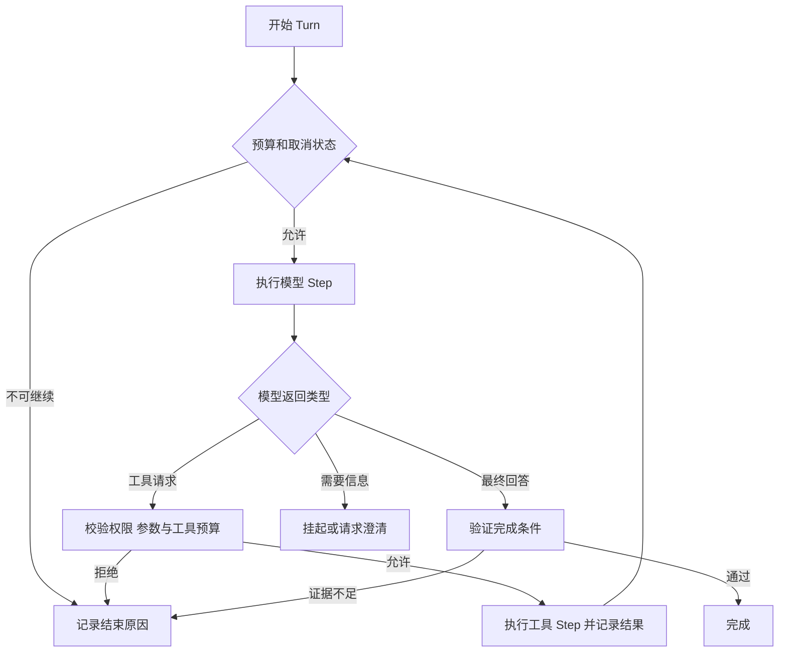

# 受控运行时怎样管理回合与执行步骤

[← AI Agent 学习路线](README.md)

[ReAct](react-observation-loop.md)解释了模型怎样根据工具结果决定下一步。实际运行时还要回答，模型最多请求几次工具，用户取消以后如何停止，模型说“完成”时依据什么结束。

运行时是承载这些步骤的程序。它接收用户请求、组织模型和工具调用、检查预算并记录结束原因。本文用虚构的任务状态查询说明一种设计，Turn 和 Step 的名称在不同框架中可能有不同含义。

## 区分一轮请求和其中的步骤

这里把用户的一次请求及其处理称为一个 Turn，把一次模型调用或一次工具执行称为一个 Step。

| 层次 | 示例 | 需要记录 |
|---|---|---|
| Turn | 回答任务是否受阻 | 目标、开始时间、预算、结束原因 |
| 模型 Step | 判断是否查询状态 | 输入版本、输出类型、耗时 |
| 工具 Step | 查询任务状态 | 工具标识、参数摘要、结果或错误 |

一次 Turn 可以包含多个模型和工具 Step。模型返回工具调用后，运行时校验并执行，再将结果交回模型；模型直接回答时，运行时检查必要证据后结束。

## 预算和结束原因由程序维护

运行时可以限制模型调用次数、工具调用次数、总时限和输入输出 Token 预算。调用前检查剩余预算，工具重试也计入次数。用户取消后不再启动新步骤；已发送的远程请求可能仍在执行，需要继续记录和核对。

结束原因可以区分已完成、等待补充、权限拒绝、工具失败、预算耗尽和用户取消。模型输出“完成”只是一个信号；需要实时查询的任务，如果没有成功的查询证据，不能标记为已确认完成。

例如某个演示配置允许三次工具调用，第一次查状态成功，第二次查原因超时，第三次是应用允许的有限重试。如果第三次仍失败，运行时可以保留“状态已确认、原因未确认”的部分结果，并以工具失败或预算耗尽结束，具体分类取决于哪项条件先触发。不能为了凑满答案，在预算外再调用一次，也不能把工具超时写成没有阻塞原因。

上下文不足时可以裁剪或压缩较早内容，保留当前任务、工具调用与结果的必要对应关系。压缩摘要不是任务状态的唯一事实来源，详见[上下文与长期记忆](context-and-long-term-memory.md)。

## 错误、重试和副作用

模型调用失败、参数不合法、业务服务超时和权限拒绝应分别记录。可重试的只读查询可以在预算内重试；参数错误需要修正，权限拒绝不能通过不断换参数绕过。

写操作超时后结果可能未知。运行时应保存稳定的业务请求标识，先查询外部状态，再按业务支持的幂等策略决定是否重试。模型调用失败不意味着上一个工具没执行，不能直接重做写操作。[Temporal 的状态与恢复说明](https://docs.temporal.io/ai/featured/memory-state-stripe)也区分了有记录的结果和中断时尚未确认的步骤。

## 怎样检查运行时

用固定的假模型响应和假工具，检查正常查询、连续重复调用、工具超时、用户取消和上下文超限。验证结束原因与实际执行记录一致，检查被拒绝的工具没有触发处理器。随后用真实模型在隔离的测试环境评估选择质量，两类验证不能互相替代。

检查点、事件持久化和重启恢复需要额外设计，见[事件记录怎样支持状态恢复](event-state-recovery.md)。更广的研发架构见 [Agent Harness](../ai-native/agent-harness-long-running-task.md)。
