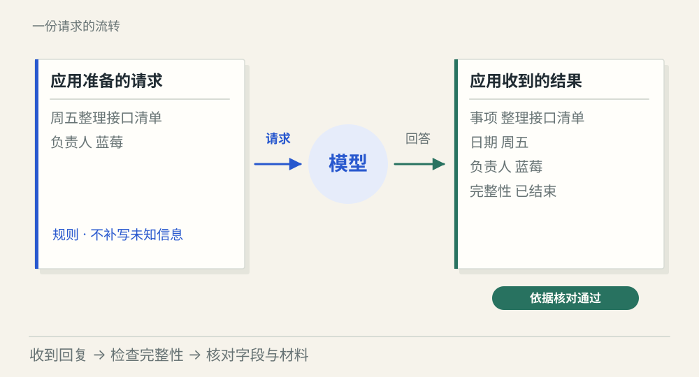
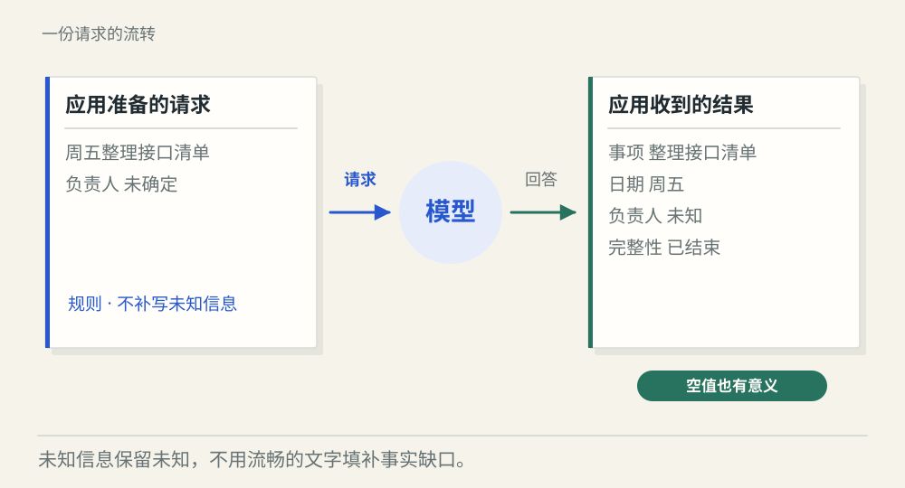
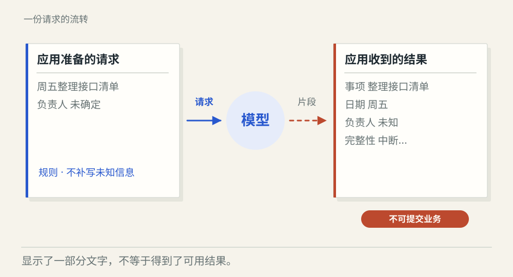

# 一次模型调用怎样从请求走到可用结果

[← 图解目录](../README.md#01) · [工程文章](../../model-calls-and-messages.md)

**收到回答，就算做完了吗？**

你把会议记录交给模型，让它找出待办。屏幕开始出现文字，可负责人原本就没确定。我们沿着这一份请求，看看应用究竟要检查什么。

> 像请人填一张表。表格寄回来了，还得看看有没有填完、有没有凭空编一格。

## 信息齐全

**可以采用**。记录写明周五整理接口清单，负责人蓝莓。回答保持这些事实，通过本例检查。

## 负责人缺失

**保留未知**。原文没有负责人，模型也要保留未知。填上一个听起来合理的名字，会让可解析的结果变成错误事实。

## 输出中断

**等待完整结果**。字已经显示到页面，连接却断了。这段内容只是未完成草稿，不能触发下一项业务操作。

## 先装好这一轮的信封

应用把任务规则、用户材料和必要历史放进消息列表。消息角色标明来源，不能让材料中的一句话冒充系统规则。模型看到的是这一轮实际收到的内容；应用漏带历史，模型就没有那段依据。

## 生成是逐步发生的

流式输出会把片段陆续送回来，读起来更快开始。应用还需要处理结束信号、中断和格式检查。接口成功、生成结束、业务可用，是三次不同的判断。

## 让未知留在表格里

结构化结果只是把回答装进规定字段。能读成 JSON，不保证字段真实。负责人缺失时可以用空值表达，再由应用检查原文依据；超时是否重试，也要看错误性质与重试预算。

## 模型说“已创建”呢？

文字不证明业务已经发生。本篇只生成待办草稿；真正创建任务需要工具执行记录。

## 停一下，自己判断

连接断开前已经收到半段 JSON，可以当成功结果吗？

- A. 可以，文字已经回来了
- B. 不可以，先检查完整性与字段

查看解释

答案为 B。传输中出现文字，只能证明收到了一部分内容。

[阅读工程文章](../../model-calls-and-messages.md) · [返回图解目录](../README.md#01)

> 图片、例子与结果均为教学示意，不代表真实服务运行或性能测试。
