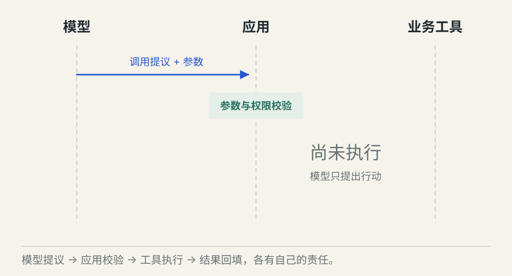
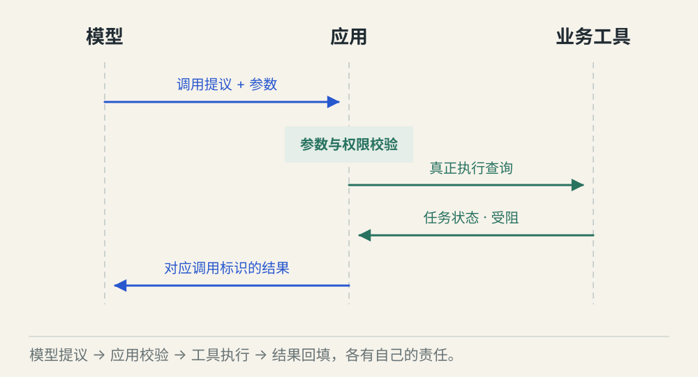
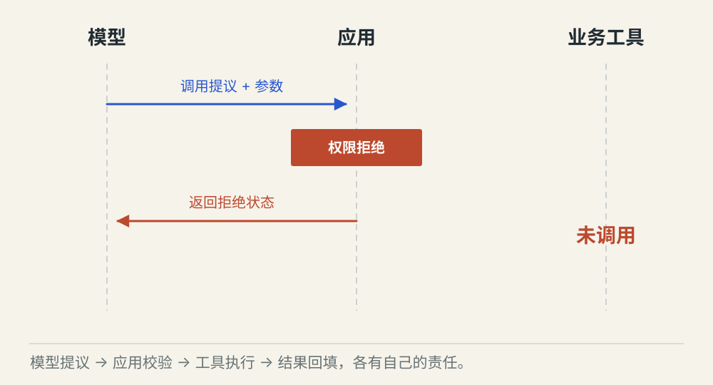

# Function Calling 怎样完成一次工具调用

[← 图解目录](../README.md#03) · [工程文章](../../function-calling.md)

**模型开清单，程序来动手。**

学生问一项任务是否完成。模型不知道数据库里的实时状态，于是提出查询请求。注意观察谁提出请求、谁真正执行，以及结果怎样返回。

> 像服务员写好点菜单，厨房按单做菜。菜单写出来时，菜还没做好。

## 提出调用

**请求已生成**。模型选中 get_task_status，并给出 task_id。此时只有一份行动提议，数据库尚未被查询。

## 执行并回填

**取得真实结果**。应用校验参数和权限，再查询业务服务。结果带着对应调用标识回填，模型据此组织回答。

## 权限不通过

**处理器未执行**。参数格式正确，但用户无权访问该任务。应用拒绝调用，并把拒绝状态交回，不能编造任务信息。

## 工具说明先进入模型请求

应用告诉模型工具叫什么、能做什么、参数怎么填。Function Calling 是模型接口表达工具请求的能力。工具声明就像菜单，真正的处理器和数据库连接仍在应用或工具服务中。

## 请求和结果需要配对

模型可以连续或同时提出多个调用。每个结果都要回到自己的调用标识，避免把甲任务的状态贴到乙任务上。调用标识负责配对，并不等于防止业务重复写入的幂等键。

## 工具错误也要送回去

查到“受阻”和“查询超时”含义不同。应用应保留错误类型，让模型解释缺少哪些证据。对于写操作，超时后先确认外部状态，不能把重发模型请求当成安全重试。

## 工具能由模型直接运行吗？

本例由应用接收请求并执行。不同产品可以封装这段过程，但授权、执行与结果仍然要落在真实系统中。

## 停一下，自己判断

模型输出一份工具调用，说明数据库已经查过了吗？

- A. 已经查过
- B. 还没有，应用还要校验并执行

查看解释

答案为 B。提出行动与完成行动之间，隔着实际执行边界。

[阅读工程文章](../../function-calling.md) · [返回图解目录](../README.md#03)

> 图片、例子与结果均为教学示意，不代表真实服务运行或性能测试。
