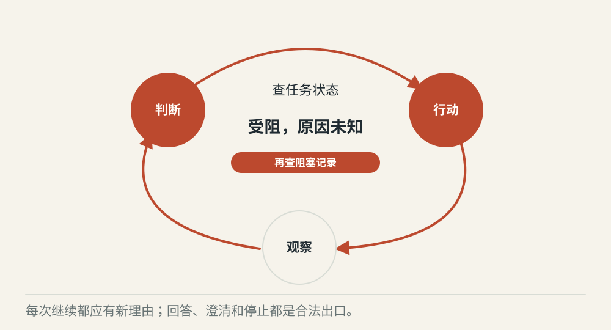
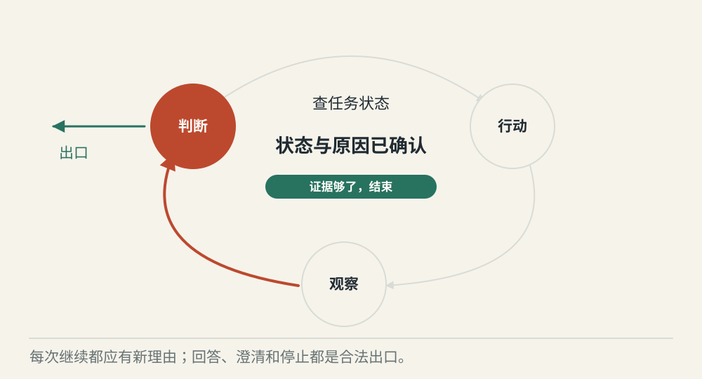
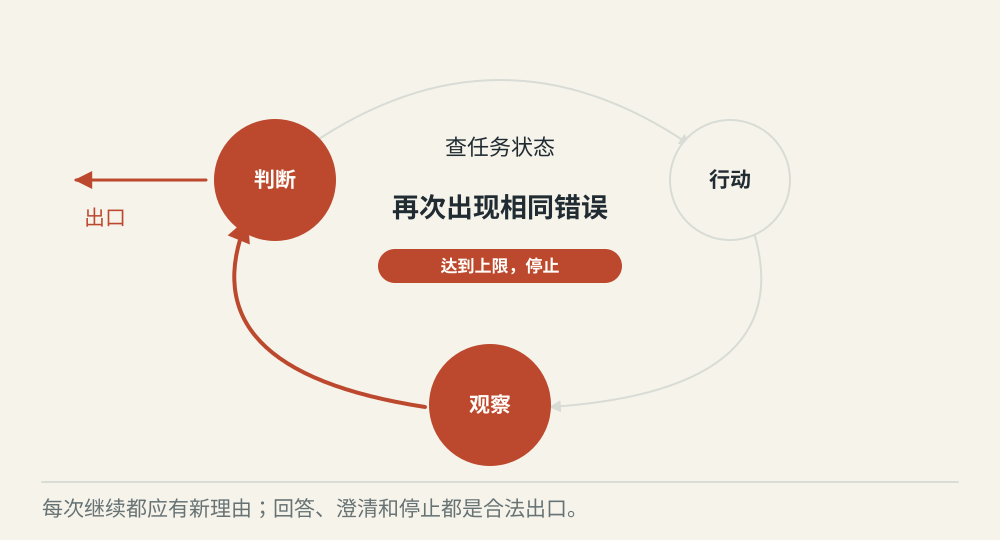

# ReAct 怎样根据观察结果继续行动

[← 图解目录](../README.md#04) · [工程文章](../../react-observation-loop.md)

**做一步，再看下一步。**

查询任务时发现它“受阻”，这还不足以回答原因。Agent 可以再查阻塞记录；如果第一次就拿到完整答案，就该停下来。

> 像找一本书。先查书架，再看空位旁的借阅卡；新线索决定下一步去哪里。

## 只拿到状态

**继续有用的一步**。查到任务受阻，原因仍未知。下一步查阻塞记录，与当前目标有关。

## 证据已经够了

**结束并回答**。状态和阻塞原因都有来源。可以组织回答，不需要为了多走几步继续调用。

## 连续相同错误

**停止重复尝试**。重复同一个失败查询没有新信息。达到尝试上限后结束，说明已知与未知。

## 观察就是行动后的真实反馈

工具返回的数据、错误或环境变化，都是下一次判断的材料。ReAct 把选择行动与观察结果交替组织起来。这里展示的是可见决策和工具记录，不要求展示模型内部的完整思维过程。

## 循环需要应用来推进

应用调用模型，执行允许的工具，把结果送回，再请求下一轮。模型没有自行接管一条无限循环。重复动作、时间上限和取消状态，都应该由承载流程的程序处理。

## 三个出口同样重要

证据够了就回答；缺少关键信息就询问；权限被拒或预算耗尽就停止。工具结果中即使出现新指令，也只是外部材料，不能改变原任务或增加权限。

## 每项任务都要循环吗？

一步能完成的查询可以直接返回。只有下一步依赖刚得到的结果时，行动循环才有必要。

## 停一下，自己判断

工具连续返回相同错误，最合理的下一步是什么？

- A. 一直重试到成功
- B. 检查错误与预算，必要时停止

查看解释

答案为 B。再次尝试应该有理由，也要付出预算；循环次数不是完成质量。

[阅读工程文章](../../react-observation-loop.md) · [返回图解目录](../README.md#04)

> 图片、例子与结果均为教学示意，不代表真实服务运行或性能测试。
