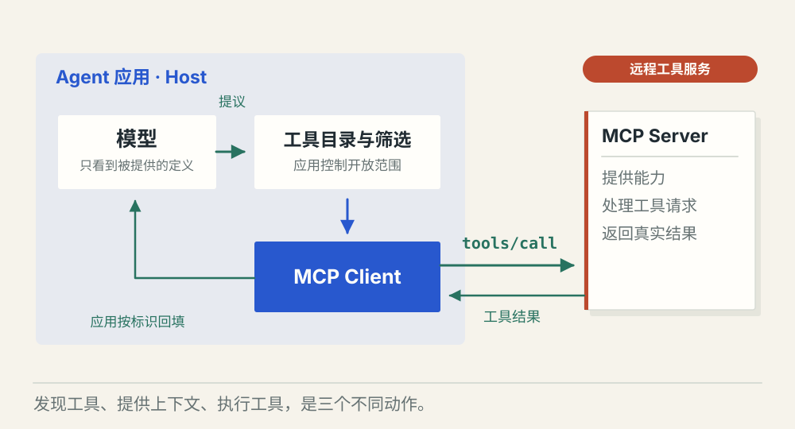
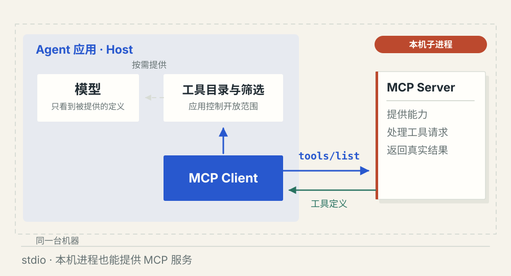

# MCP 怎样接入外部工具

[← 图解目录](../README.md#05) · [工程文章](../../mcp-external-tools.md)

**接上工具，模型怎样用起来？**

任务、日历、文档都有各自的接口。MCP 约定应用怎样发现和调用它们。我们把连接、提供工具说明和实际调用拆开看。

> 像通用插座约定了怎么接电。接好插头以后，开哪台机器、允许它做什么，仍要有人决定。

## 发现工具

**拿到能力目录**。应用里的 MCP Client 请求 tools/list，拿到名称、描述和参数结构。此时还没有任务数据，也不代表清单全部进入模型上下文。

## 实际调用

**两段接口接起来**。应用选择向模型提供哪些工具。模型提出查询后，应用校验并通过 tools/call 请求服务，才取得真实结果。

## 本地连接

**位置可以不同**。Server 也可以是本机子进程，通过标准输入输出通信。MCP 不要求所有工具部署到远程服务器。

## 先分清三个人的位置

Host 是用户使用的 Agent 应用；Client 是应用内负责协议连接的一侧；Server 提供工具等能力。模型通常通过应用给出的工具声明提出请求，并不直接持有这条 MCP 连接。

## 清单、上下文、数据是三件事

tools/list 获得工具目录。应用可以缓存目录，再根据任务和权限提供部分定义，也可以一次提供；这是产品策略。tools/call 才请求执行。发现工具不会自动把服务里的所有数据灌进上下文。

## JSON 是消息的写法

MCP 使用 JSON-RPC 组织方法名、参数和请求标识。Function Calling 表达模型的工具提议；MCP 承担应用与服务的协议通信。两侧标识需要关联，权限则要在应用与业务服务中继续检查。

## MCP 全量加载，Skill 按需加载？

这不是二者的固定分界。MCP 负责通信，Skill 组织任务做法。应用可以对两者都使用按需加载策略，自动匹配也不保证每次命中。

## 停一下，自己判断

tools/list 返回后，模型一定看到了全部工具定义吗？

- A. 一定，协议会自动注入
- B. 不一定，应用决定向模型提供哪些定义

查看解释

答案为 B。发现发生在客户端，提供上下文发生在应用组织模型请求时。

[阅读工程文章](../../mcp-external-tools.md) · [返回图解目录](../README.md#05)

> 图片、例子与结果均为教学示意，不代表真实服务运行或性能测试。
