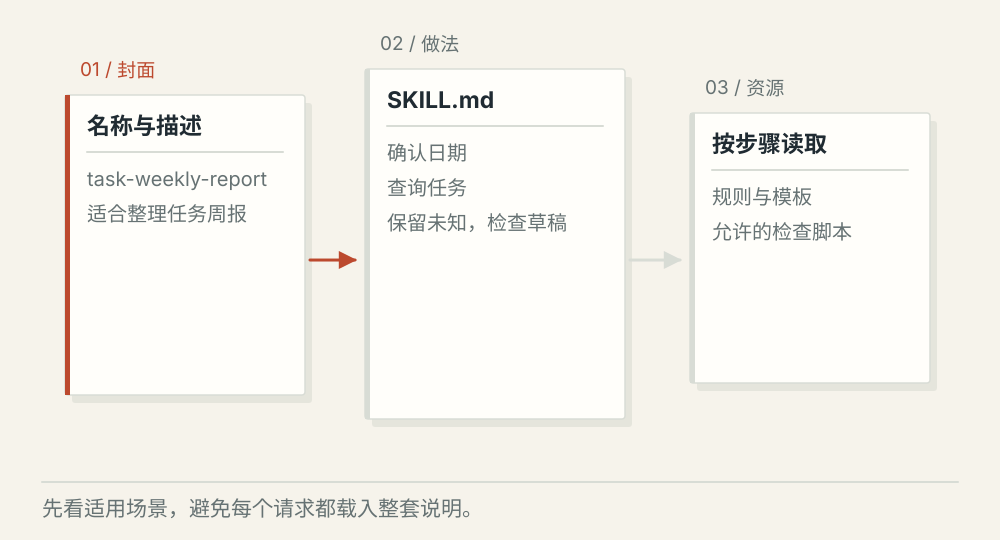
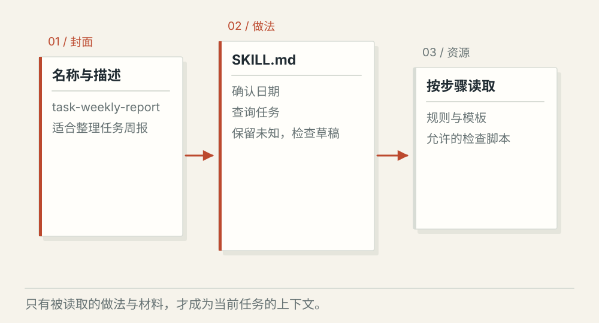
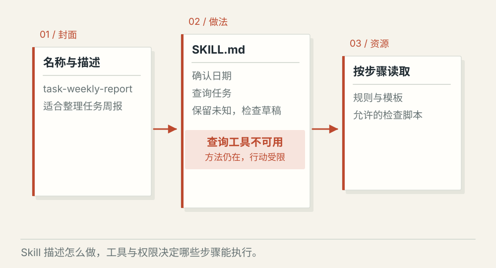

# Skill 怎样加载和参与执行

[← 图解目录](../README.md#06) · [工程文章](../../skill-loading-and-execution.md)

**会用工具，还要知道怎么做。**

“整理周报”总要确认日期、查询任务、保留未知、检查格式。把这些反复出现的做法写成 Skill，Agent 就有一份可复用的工作说明。

> 像做菜时先找菜谱，再翻到需要的一页。菜谱告诉你做法，厨房工具负责真实操作。

## 先看封面

**选择合适的 Skill**。名称和简短描述帮助判断是否适用。只问一项任务状态，不必把整套周报方法加载进来。

## 翻开做法

**逐步取得说明**。选中以后读取 SKILL.md 正文，再按当前步骤读取模板或参考材料。

## 工具不可用

**方法不授予权限**。说明要求查询任务，但当前没有相应工具权限。Skill 不能让这一步自动完成，应该说明限制。

## 一份 Skill 可以装什么

入口文件提供适用场景和执行说明，可选的参考资料、模板和脚本帮忙完成具体步骤。它们是可维护的资源，读取后影响当前工作，不会直接改变模型权重。

## 按需加载节省的是上下文

先看描述，选中后读正文，遇到需要的文件再读文件。不同客户端可能使用不同策略。用户点名是一种选择方式；自动选择依赖描述、任务和产品实现，不能保证一定选对。

## 把它放回一次周报任务

Skill 规定草稿要包含进展与阻塞；查询工具取得事实；模板安排章节；应用检查权限和结果。发送周报是另一项操作，需要它自己的授权，不能凭做法说明直接执行。

## Skill 和固定工作流怎么分？

Skill 给出可复用的方法。必须经过的校验与审批适合落实在程序中，不能只写一句“请记得检查”。

## 停一下，自己判断

Skill 写了“发送周报”，就代表用户已经授权发送吗？

- A. 是，照着说明做就行
- B. 否，还要检查本次任务的授权

查看解释

答案为 B。可复用方法没有替当前用户批准具体外部操作。

[阅读工程文章](../../skill-loading-and-execution.md) · [返回图解目录](../README.md#06)

> 图片、例子与结果均为教学示意，不代表真实服务运行或性能测试。
