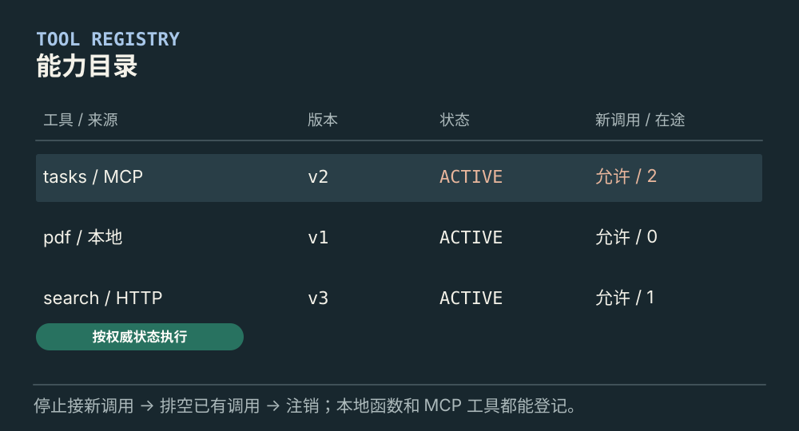
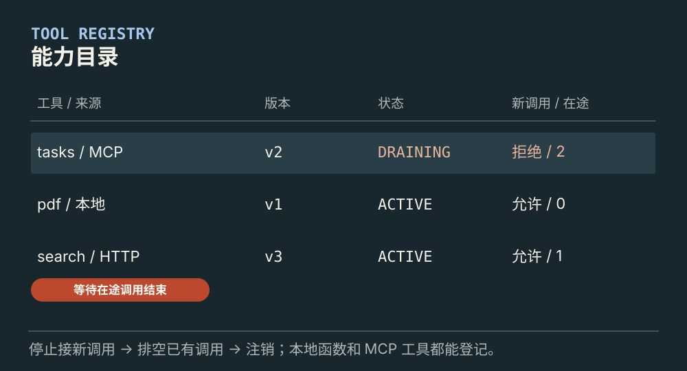
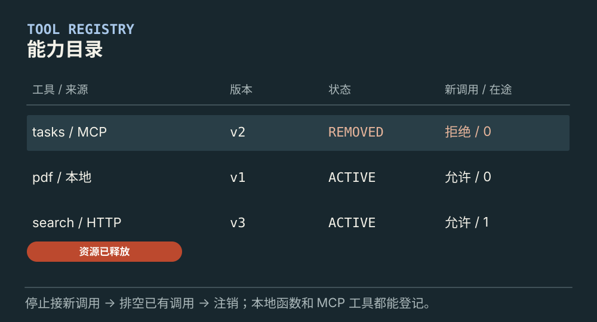

# 工具注册表怎样管理能力生命周期

[← 图解目录](../README.md#07) · [工程文章](../../tool-registry-lifecycle.md)

**工具下线了，旧调用怎么办？**

工具多起来，不能只记一个名字。应用要知道它来自哪里、使用哪一版、还能否接新调用，以及下线时哪些调用还没结束。

> 像图书馆的借阅目录。停止借出一本书，不会让已经借走的书立刻回到书架。

## 可接新调用

**ACTIVE**。注册表把唯一名称关联到参数约定、版本、来源和执行入口。查到记录后，执行前仍检查状态和权限。

## 开始停用

**DRAINING**。进入排空状态，拒绝新调用，等待已有调用结束或按规则取消。直接删除记录会丢掉管理这些调用的线索。

## 完成注销

**REMOVED**。在途调用已处理，再释放连接和资源。旧缓存里的名称也不能绕过权威状态重新执行。

## 目录里不仅有内置工具

文档处理函数、HTTP 适配器、MCP 工具都可以登记。注册表统一管理应用可用的能力；MCP 提供接入协议；Skill 说明怎么组合使用。三者可以配合，不能简单按本地或远程分类。

## 同名不等于同一个工具

两个服务都叫 search 时，应用需要区分来源。版本升级也要检查参数与结果是否兼容。已经开始的任务应能追溯所用版本，避免执行到一半悄悄切换语义。

## 下线是一段过程

先关闭新入口，再处理在途调用，最后注销资源。调用可能正在远程执行，不能只在本地删记录就声称已经停止。缓存帮助发现，执行时的权威状态决定是否继续。

## 只用一个字典可以吗？

小型应用可以从字典开始。需要更新、并发调用和停用时，再补上明确状态与版本，不必一开始做复杂平台。

## 停一下，自己判断

工具从目录消失，远程正在执行的请求就会终止吗？

- A. 会，名字已经没了
- B. 不会，还需要取消或等待与核对

查看解释

答案为 B。目录状态与实际执行状态需要分别管理。

[阅读工程文章](../../tool-registry-lifecycle.md) · [返回图解目录](../README.md#07)

> 图片、例子与结果均为教学示意，不代表真实服务运行或性能测试。
