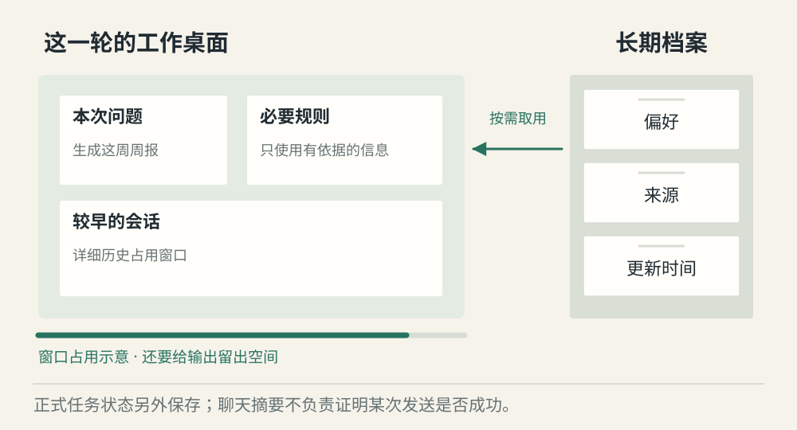
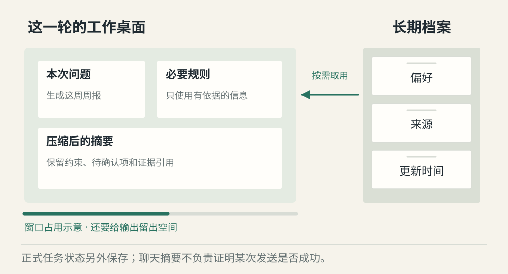
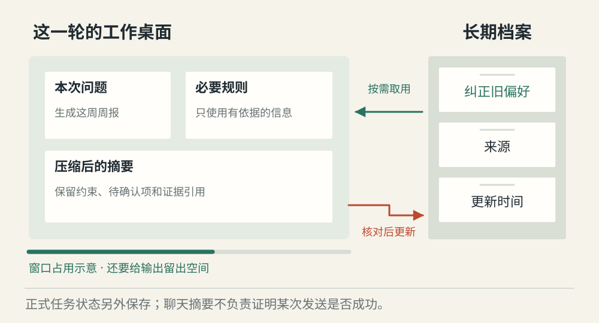

# Agent 怎样管理上下文与长期记忆

[← 图解目录](../README.md#08) · [工程文章](../../context-and-long-term-memory.md)

**记住很多，每次只带需要的。**

你已经聊了很久，又希望下次还能记住学习偏好。这涉及两种空间——本轮模型能看的上下文，以及跨会话保存的长期记忆。

> 像一张书桌和旁边的档案柜。桌面放当前要用的材料，柜子保存以后可能要用的资料。

## 开始新任务

**按需读取**。从档案中取出与本次任务相关的偏好，连同问题与必要规则放到上下文里。柜子里的全部内容不必搬上桌。

## 桌面快满了

**压缩与保留**。较早历史可以压缩成摘要，保留关键约束、待确认事项和必要工具结果。摘要有损，原始证据要能查回。

## 纠正旧记忆

**记忆可以纠错**。用户说明旧偏好已改变。更新对应档案并记录来源，不应把新旧两条冲突偏好无区别地一起载入。

## 上下文是这一轮的工作材料

模型每次调用能处理的输入有长度限制，还要给输出留空间。应用决定保留哪些历史、工具结果和资料。窗口越长也不代表该放的都放进去，重复与无关内容会占用预算。

## 长期记忆先解决可信与可改

长期偏好可以存 Markdown、数据库或其他存储。是否需要向量检索，取决于规模和检索需求。比格式更重要的是每条信息属于谁、来源是什么、何时更新，以及用户怎样纠错和删除。

## 任务进度有自己的账本

“用户喜欢简短解释”适合进入档案；“发送请求已经发出”属于正式任务状态。摘要可能漏掉细节，不能靠一段压缩后的聊天决定是否再次发送邮件。恢复执行需要可核对的状态记录。

## 记得越多就越个性化吗？

无关、过期或猜测出的偏好会误导回答。先保存必要且有依据的信息，再允许用户看见和修改。

## 停一下，自己判断

聊天摘要说“邮件可能已发”，恢复后能直接重发吗？

- A. 能，摘要没有明确成功
- B. 不能，先查正式记录和外部状态

查看解释

答案为 B。模糊摘要不适合判断已经发生的业务副作用。

[阅读工程文章](../../context-and-long-term-memory.md) · [返回图解目录](../README.md#08)

> 图片、例子与结果均为教学示意，不代表真实服务运行或性能测试。
