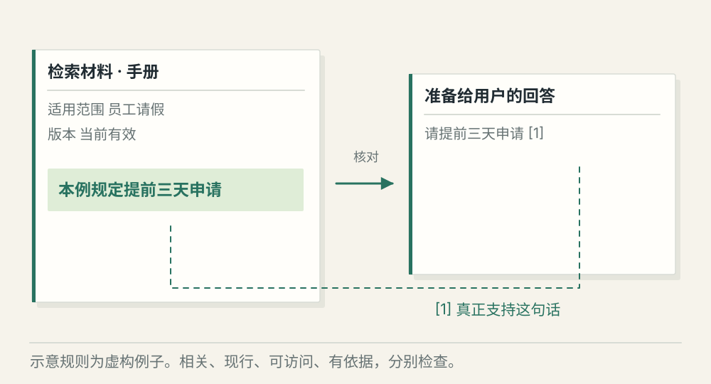
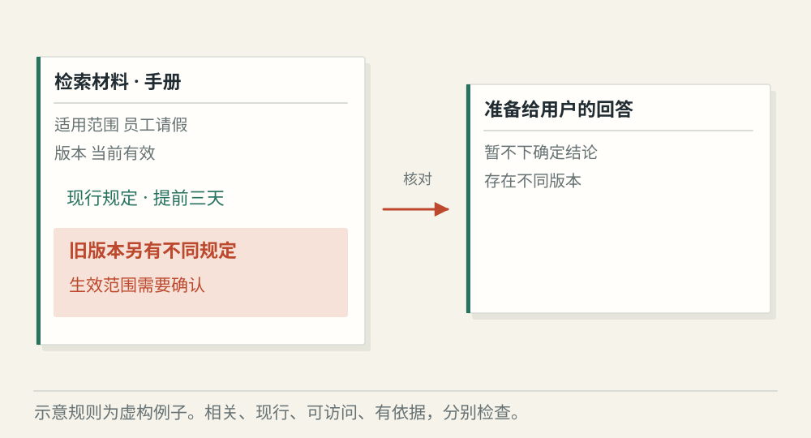
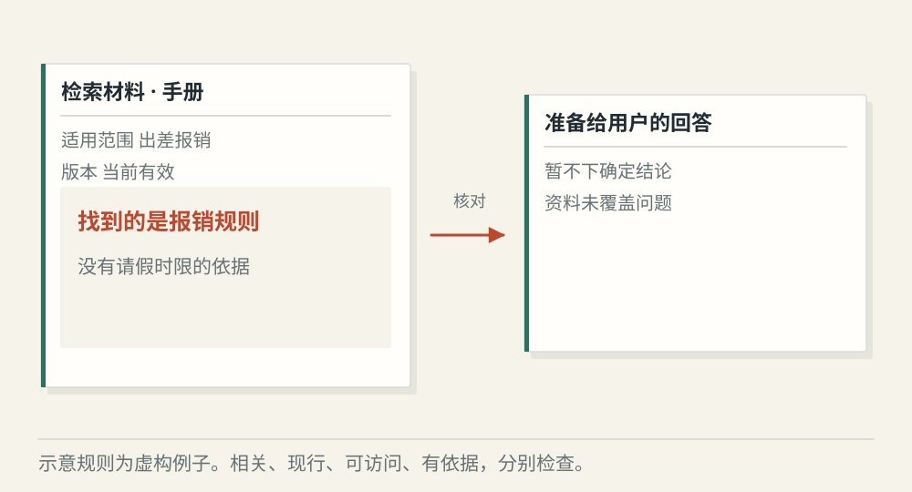

# RAG 怎样从检索材料走到有依据的回答

[← 图解目录](../README.md#09) · [工程文章](../../rag-evidence-and-answers.md)

**找到一段话，够不够证明答案？**

用户问请假需要提前多久申请。系统搜到了两份手册，一份新、一份旧。RAG 的难处就在这里——搜到相关文字之后，还要判断能用哪一段。

> 像开卷答题。先找书页，再看版本和上下文，最后写出这页真正支持的结论。

## 有效材料

**依据成立**。经过权限与版本筛选，使用现行规则。答案里的结论能够对应到引用片段。

## 版本冲突

**暂停结论**。新旧文件给出不同天数。先确认生效范围；无法确认时说明冲突，不能把两段拼成一个新规则。

## 只有相似内容

**依据不足**。检索到出差报销说明，语义上与审批接近，却没有回答请假期限。相关分数高也不能补出缺失规定。

## 先把材料变成可找的片段

RAG 是检索增强生成。文档经过解析与切分，片段保留来源、页码、版本和权限。片段太短可能切断定义，太长又混入无关内容，切分需要结合文档结构检查。

## 关键词和向量各有用处

关键词适合精确编号、术语和名字；向量帮助找到表达不同但意思接近的内容。两者可以组合，再筛选排序。相似度是检索信号，无法代替版本、权限或事实判断。

## 逐句对照引用

生成后检查答案的关键结论是否由材料支持。引用页真实存在，不代表页里有这条结论。评测也分开看材料能否被找回、排位如何，以及最终回答有没有歪曲依据。

## RAG 能保证不编造吗？

不能。检索和生成都有失败点，资料不足时需要明确保留未知或拒绝给出确定结论。

## 停一下，自己判断

答案附了有效链接，就证明结论正确了吗？

- A. 是，有引用就够了
- B. 否，还要核对引用是否支持这句话

查看解释

答案为 B。来源存在与结论有依据，是两项不同检查。

[阅读工程文章](../../rag-evidence-and-answers.md) · [返回图解目录](../README.md#09)

> 图片、例子与结果均为教学示意，不代表真实服务运行或性能测试。
