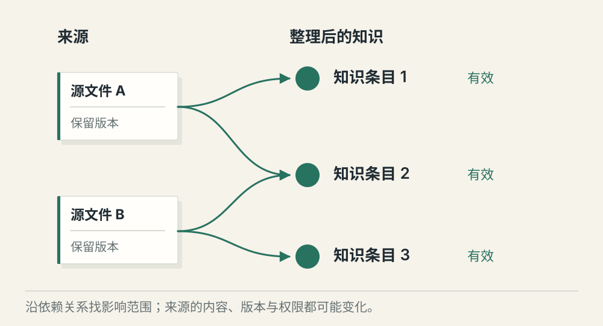
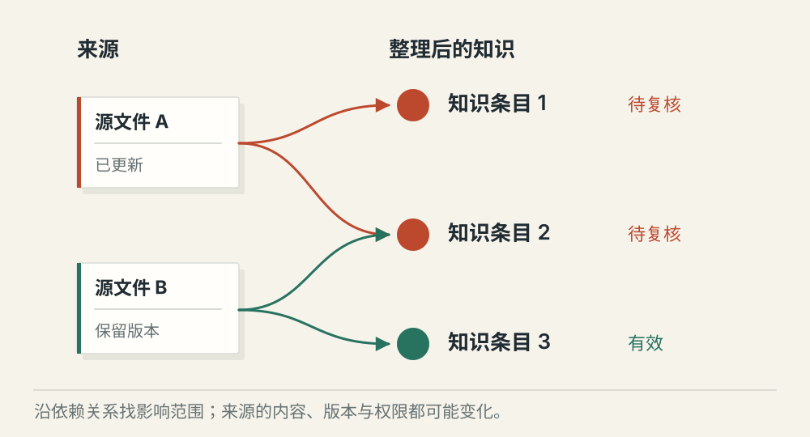

# Wiki 式知识编译与增量维护

[← 图解目录](../README.md#10) · [工程文章](../../../enterprise-ai-platform/knowledge-engineering/wiki-knowledge-maintenance.md)

**原文改了，哪些知识也要改？**

三份制度文件被整理成一页操作指南。后来其中一份制度失效，如果只更新原文，那一页指南仍可能把旧做法教给别人。

> 像做一张有出处的读书笔记。书页改版时，要知道哪些笔记引用过它。

## 编译条目

**知识有出处**。从源材料整理一页知识，保存每项结论的来源、版本与引用关系。

## 来源更新

**定向修订**。一份源文件改动，沿依赖关系找到受影响的条目，标记待复核。没有依赖的条目不必全部重写。

## 来源下架

**传播失效状态**。原文失效或权限收紧后，下游条目也要检查可用性。不能继续通过整理稿暴露已不允许读取的内容。

## 整理一次，持续维护

Wiki 式知识编译把分散材料变成可阅读的主题条目。它可以服务检索和人工阅读，减少每次从零拼装。代价是多出一份需要维护的内容，必须知道它依据了什么。

## 依赖关系比更新日期更有用

一个条目可能引用多份源文件，一份源文件也可能影响多个条目。记录这张关系网，才能在变化后缩小复核范围。自动检测负责找候选，含义冲突仍需要规则或人员确认。

## 修订也要经过发布

草稿、待审核、有效和已下架要分清。修订保留差异与来源，验证后再替换阅读版本。引用权限、生效范围和下游缓存也要一起处理，避免正文更新了，用户仍读到旧结论。

## 这和 RAG 重复吗？

知识编译处理材料长期怎样组织与维护；RAG 处理一次问题怎样找到并使用材料。编译后的条目可以成为 RAG 的来源。

## 停一下，自己判断

来源失效，只删检索索引里的原文就够了吗？

- A. 够了，原文已找不到
- B. 不够，还要检查引用它的整理条目

查看解释

答案为 B。下游内容可能继续携带同一条失效结论。

[阅读工程文章](../../../enterprise-ai-platform/knowledge-engineering/wiki-knowledge-maintenance.md) · [返回图解目录](../README.md#10)

> 图片、例子与结果均为教学示意，不代表真实服务运行或性能测试。
