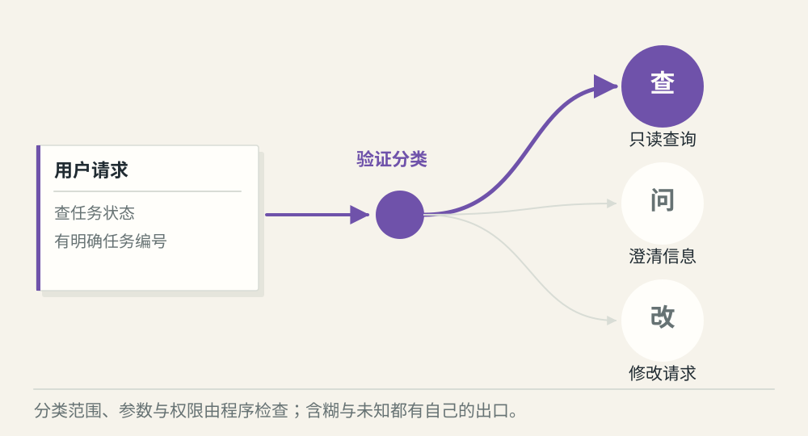
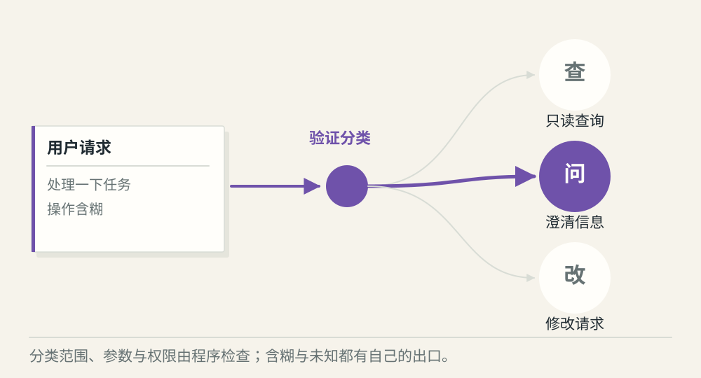
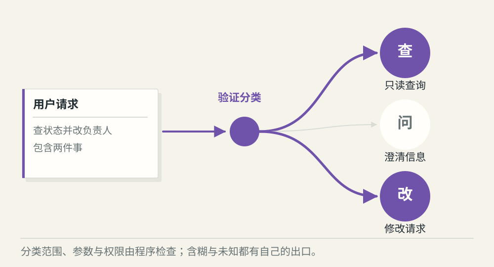

# 意图识别怎样进入请求路由

[← 图解目录](../README.md#11) · [工程文章](../../intent-routing.md)

**该查资料，还是先问清楚？**

“帮我看看那个任务”到底要查状态，还是要改负责人？路由先识别请求要去哪里，但识别结果仍需要程序验证。

> 像车站的道岔。目的地明确才切换轨道；看不清车票时，先问一句。

## 明确查询

**进入查询**。请求带着任务编号，意图是查询状态，参数也齐全。可以进入只读查询分支。

## 表达含糊

**请求补充**。“处理一下这个任务”没有说明操作。先澄清，避免把模糊表达自动升级为修改权限。

## 多个要求

**拆分任务**。“查一下，再把负责人改掉”包含查询和修改。拆开处理，并对修改单独检查权限与确认。

## 先画出产品支持的范围

列出可处理的意图、必要字段和未知类别。分类器可以由规则、模型或二者组合实现；简单按钮入口也可以直接选择分支。不要求每个 Agent 都额外跑一轮意图模型。

## 分类是建议，程序决定去向

模型输出的标签要属于允许集合，参数要符合要求，还要检查当前身份。分类正确也不等于已授权，不能让一个“删除”标签直接触发高风险工具。

## 不知道也是有效结果

对未知请求、多个意图和缺少信息准备明确出口。模型给出的分数不天然等于可靠概率，要用实际样本检查阈值，比较误分和过度澄清的代价。

## 路由会精准匹配所有工具吗？

不会天然做到。描述、候选范围和上下文都会影响选择；程序需要兜住未知与错误分类。

## 停一下，自己判断

模型把一句话分到“修改任务”，程序能立即执行吗？

- A. 能，分类已经完成
- B. 不能，还要校验参数、权限和所需确认

查看解释

答案为 B。分类回答“想做什么”，授权回答“允许做什么”。

[阅读工程文章](../../intent-routing.md) · [返回图解目录](../README.md#11)

> 图片、例子与结果均为教学示意，不代表真实服务运行或性能测试。
