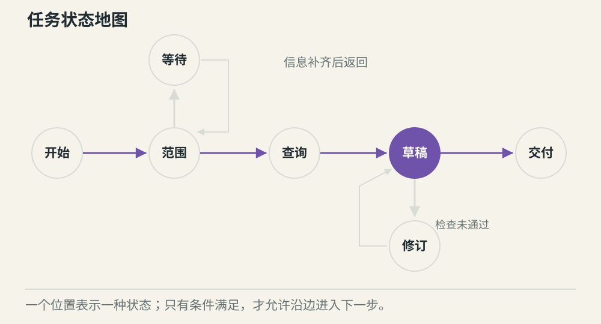
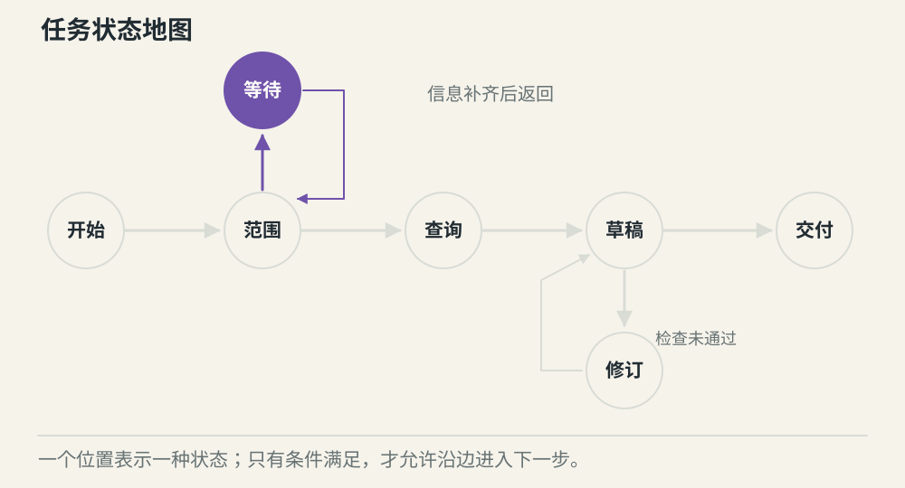
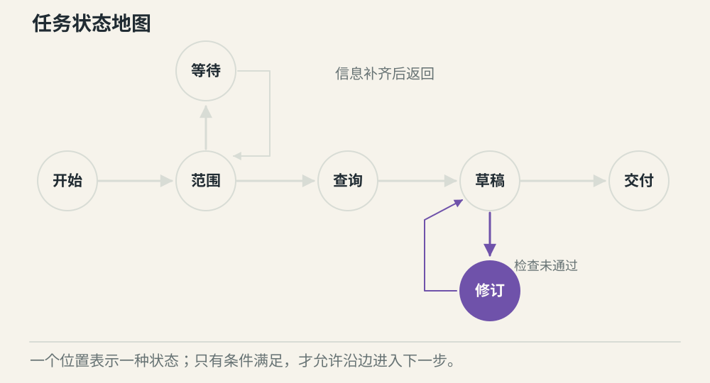

# 工作流状态机怎样控制任务推进

[← 图解目录](../README.md#12) · [工程文章](../../workflow-state-machine.md)

**这件事，现在走到哪一步？**

周报已经生成，但审核还没完成。此时系统能否进入发送节点？状态机把当前状态与允许的下一步写清楚，避免靠聊天内容猜进度。

> 像棋盘上的格子。当前位置决定下一步能走到哪里，不能跳过尚未通过的关卡。

## 正常推进

**逐项推进**。范围已确认，查询完成，进入草稿状态。每次转移都带着需要的结果。

## 缺少信息

**保存等待位置**。开始时缺少日期范围，进入等待状态。补充有效信息后才继续查询。

## 校验没过

**回到可修正节点**。草稿缺少查询证据，转回修订。不能仅因为模型说完成，就跳到交付。

## 状态说明现在，边说明条件

节点代表当前阶段，边代表允许的转移。例如查询成功可以生成草稿，查询失败则进入错误分支。状态中保存范围、结果引用和版本，下一步不用从整段对话里重新猜。

## 固定与动态可以一起用

权限检查和最终校验可以固定。整理内容时需要先查哪项信息，可以让模型在允许范围内判断。动态选择也要返回受控状态，不能绕过程序规定的必要节点。

## 暂停后从保存的位置继续

等待用户时持久化任务和版本，恢复时校验答复是否属于当前等待。并发回复或旧结果到达时，只允许符合当前状态的转移，避免一个任务被推进两次。

## 画了流程图就能恢复吗？

图只说明规则。恢复还需要可靠存储、版本校验和外部操作记录，后面的事件记录篇会继续展开。

## 停一下，自己判断

模型说“已完成”，但证据检查没过，应进入哪里？

- A. 直接结束
- B. 失败或修订分支

查看解释

答案为 B。结束条件由应用规则和实际证据共同确认。

[阅读工程文章](../../workflow-state-machine.md) · [返回图解目录](../README.md#12)

> 图片、例子与结果均为教学示意，不代表真实服务运行或性能测试。
