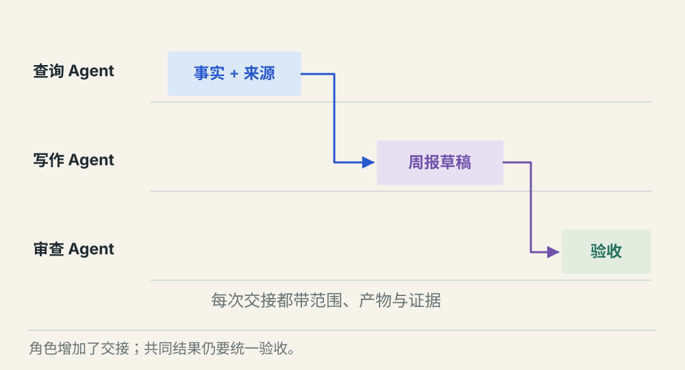
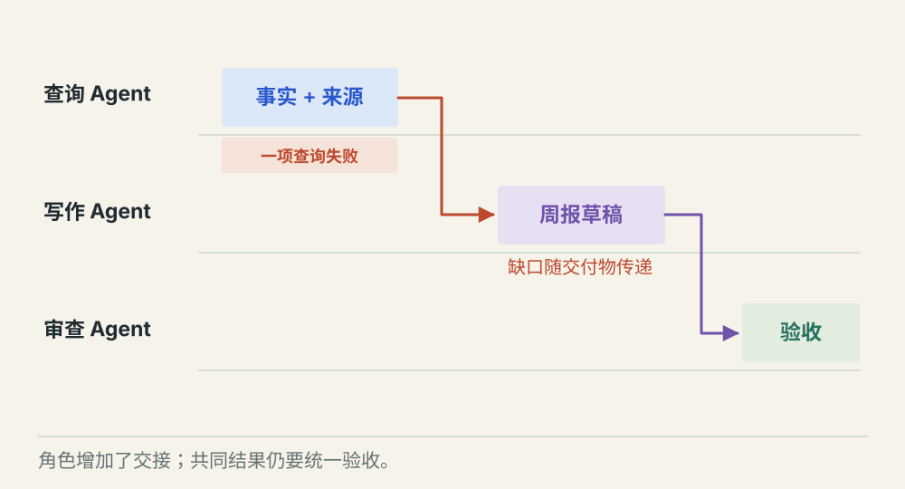
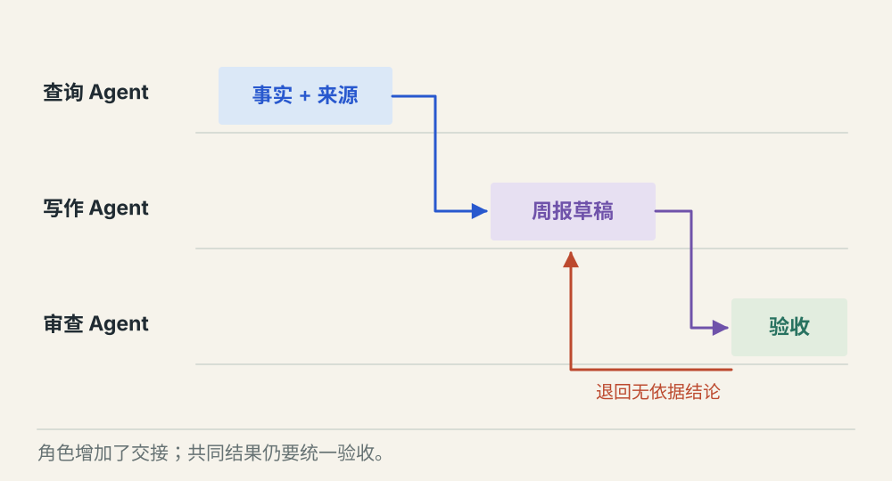

# 多 Agent 怎样分工并交付共同结果

[← 图解目录](../README.md#13) · [工程文章](../../multi-agent-collaboration.md)

**三个 Agent，怎样交出一份结果？**

一个 Agent 查任务，一个整理草稿，一个检查依据。分成三个人之后，工作还要能重新拼起来，否则只会得到三份互不相干的回答。

> 像小组作业。有人收集材料，有人写稿，有人核对，每个人都要知道交什么、交给谁。

## 分工明确

**按契约协作**。查询者交付事实与来源，写作者交付草稿，审查者检查结论。每次交接都有明确产物。

## 一项查询失败

**显式保留缺口**。某部分没有证据，保留缺口。允许部分交付时标明范围，否则停在验收前。

## 审查发现问题

**有依据地退回**。审查者指出具体无依据结论，交给写作者修订。审查也是检查过程，不保证自动正确。

## 先定义共同的完成条件

最终要的是一份有依据的周报，不是三个 Agent 各自说成功。每个子任务明确输入、范围、输出格式和检查方式，协调者负责汇总并对整体结果验收。

## 传递能检查的交付物

结构化消息可以携带任务编号、来源引用、已完成项和未解决项。JSON 有助于验证格式，不能保证内容真实。下游不能把另一个 Agent 的自述直接当成权威事实。

## 并行只给独立工作加速

两个不相关的只读查询可以并行，写稿依赖查询结果，不能抢跑。增加角色会增加调用、延迟和协调成本，需要用任务成功率和成本比较单 Agent 与多 Agent 方案。

## 多一个审查者就更可靠吗？

可能有帮助，也可能共享同样的错误。审查要有独立证据和明确标准，重要限制仍由程序保证。

## 停一下，自己判断

查询 Agent 没拿到一部分数据，写稿 Agent 应该怎么办？

- A. 根据常识把空缺补齐
- B. 标明缺口，按交付规则决定是否继续

查看解释

答案为 B。增加角色没有消除证据缺失。

[阅读工程文章](../../multi-agent-collaboration.md) · [返回图解目录](../README.md#13)

> 图片、例子与结果均为教学示意，不代表真实服务运行或性能测试。
