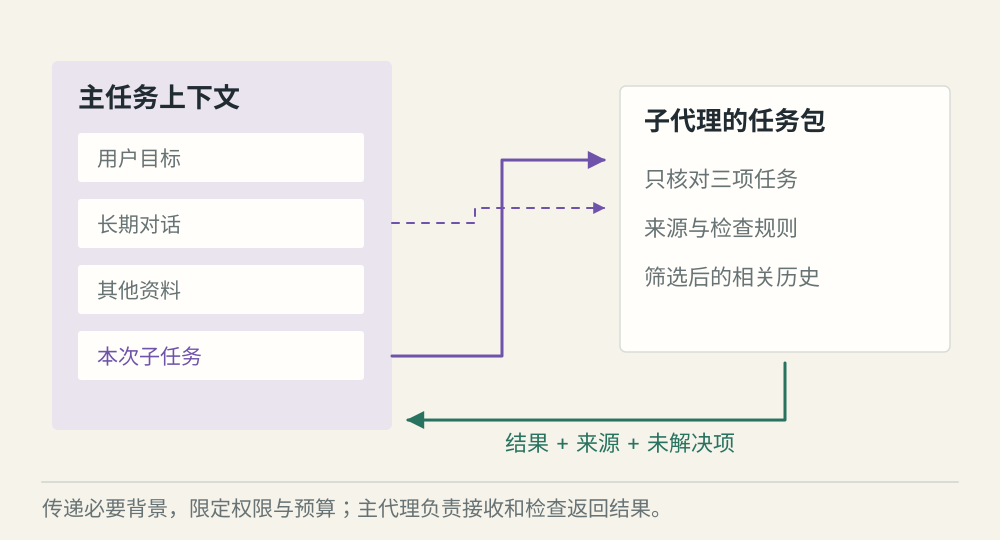
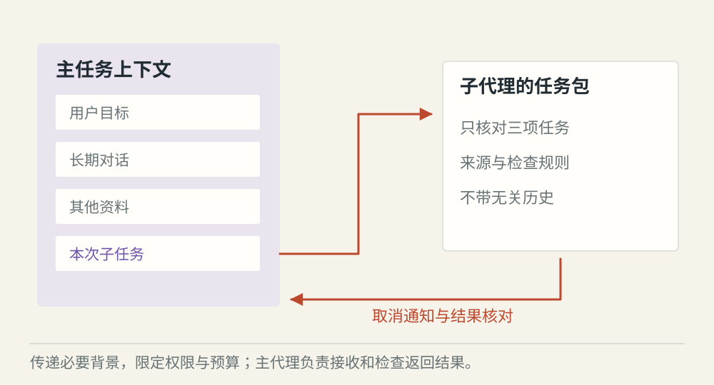

# 子代理怎样接受委派并返回结果

[← 图解目录](../README.md#14) · [工程文章](../../subagent-delegation.md)

**派一个帮手，要给它多少背景？**

主 Agent 正在写周报，想让子代理核对三项任务。整段对话都交出去，可能带入无关材料；只给一句“检查一下”，又缺少判断依据。

> 像请同学核对作业的一页。给这一页、检查规则和截止时间，比把整个书包交过去更清楚。

## 全新上下文

**从任务包开始**。子代理只拿明确子任务、必要材料和权限范围。适合独立查询，减少无关历史。

## 继承部分背景

**有选择地继承**。相关工作需要前面的约定时，提供经过筛选的历史或快照。继承背景不代表拥有父任务全部权限。

## 取消与回收

**收回生命周期**。主任务取消后停止新委派，并通知子代理。已经发出的远程动作仍要核对状态。

## 子任务要小到可以验收

委派内容写清目标、可用来源、输出结构、时间和调用预算。例如只核对三项任务状态，不能顺便修改负责人或再无限派出更多帮手。

## 隔离背景，也隔离责任

新上下文与继承上下文是两种常见选择，框架细节可能不同。无论哪种，都要限制实际工具权限，并明确哪些数据可以传递。复制文本本身不能建立安全边界。

## 返回以后还要有人接住

子代理返回结论、来源与失败情况，主代理检查后采用。主代理还需管理并发、超时和迟到结果，避免已经取消的工作又悄悄改变最终交付。

## 子代理就是远程 Agent 吗？

不一定。委派描述任务关系与上下文安排；它可以在同一进程或不同服务中实现。

## 停一下，自己判断

把父会话复制给子代理，是否自动继承全部操作权限？

- A. 是，背景里已有权限说明
- B. 否，执行权限需要单独控制

查看解释

答案为 B。背景材料与可信授权不是同一份东西。

[阅读工程文章](../../subagent-delegation.md) · [返回图解目录](../README.md#14)

> 图片、例子与结果均为教学示意，不代表真实服务运行或性能测试。
