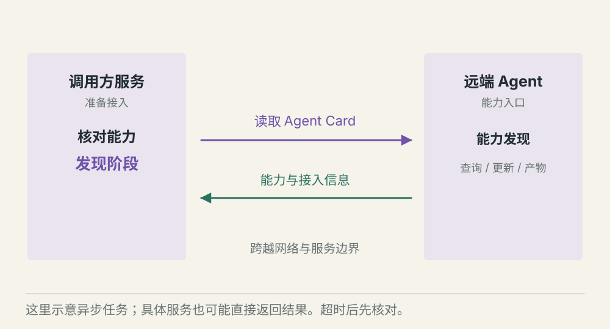
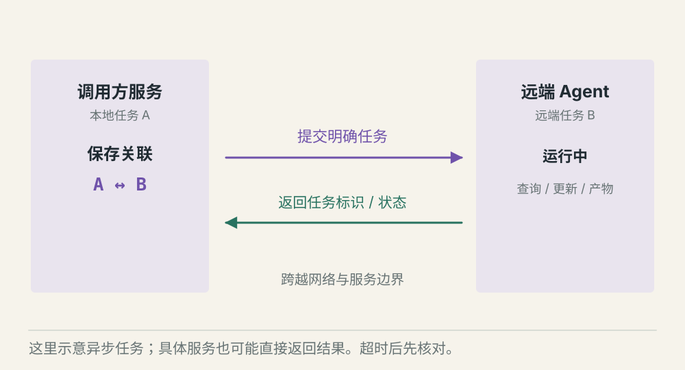
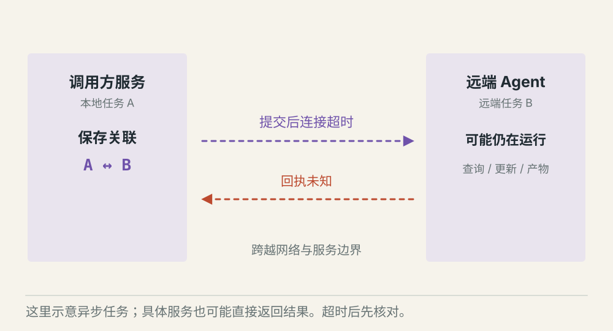

# A2A 怎样连接不同服务中的 Agent

[← 图解目录](../README.md#15) · [工程文章](../../a2a-agent-cooperation.md)

**对方收到任务，不代表已经做完。**

你的 Agent 请求另一个服务生成分析报告。网络马上回了成功，但报告可能还在排队。跨服务协作需要能追踪的任务状态。

> 像寄出一个需要加工的订单。收件回执证明对方收到，成品交付才证明工作结束。

## 发现能力

**知道对方能做什么**。Agent Card 提供能力和接入信息。调用方仍要核对身份、支持的版本与授权。

## 任务处理中

**接收不等于完成**。服务返回任务标识和处理中状态。调用方保存关联，再查询状态或按支持方式接收更新。

## 连接超时

**结果需要核对**。本地没收到回执，对方可能已经创建任务。先按约定查询或去重，避免不加判断地再提交。

## 协议解决服务之间怎样对话

A2A 面向 Agent 间的能力发现和任务协作。本文展示一种异步任务路径；协议与实现也可能直接返回消息或结果，不应假设每次都必须创建长任务。

## 任务有自己的身份与状态

跨服务保存远端任务标识、本地任务关联、当前状态和产物引用。需要补充信息、失败、取消和完成要分别处理。身份认证成功，也不代表对方有权访问所有业务资源。

## 通信失败留下不确定性

超时只说明本地没有及时得到结果。远端可能仍在执行，取消请求也可能与完成同时发生。恢复时检查实际状态，幂等与重复提交规则要在双方约定中写清楚。

## A2A 和多 Agent 分工是什么关系？

分工是任务设计，A2A 是跨服务通信的一种方式。单个应用内的协作不必为了形式强行引入远程协议。

## 停一下，自己判断

收到“任务已接收”，可以向用户展示“报告完成”吗？

- A. 可以，HTTP 请求成功了
- B. 不可以，还要等任务完成并验收产物

查看解释

答案为 B。通信状态与业务任务状态需要分开。

[阅读工程文章](../../a2a-agent-cooperation.md) · [返回图解目录](../README.md#15)

> 图片、例子与结果均为教学示意，不代表真实服务运行或性能测试。
