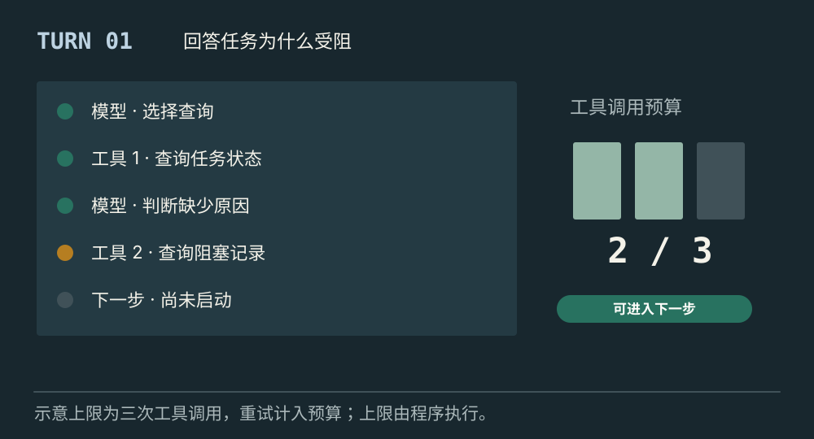
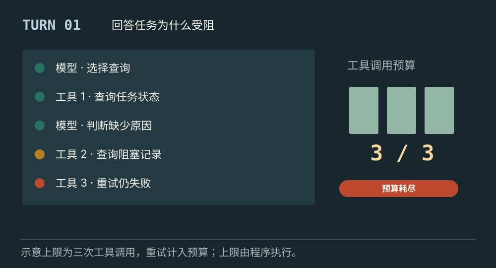
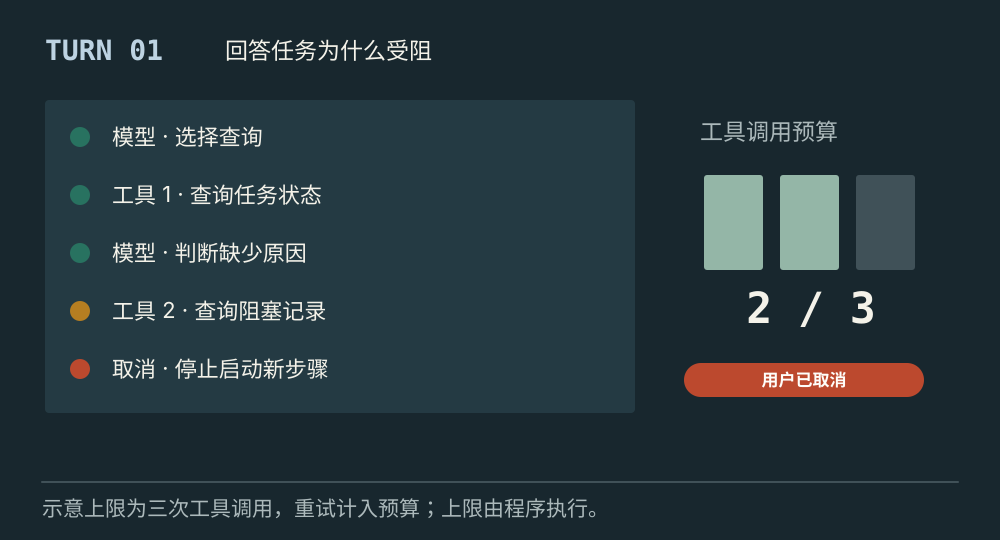

# 受控运行时怎样管理回合与执行步骤

[← 图解目录](../README.md#16) · [工程文章](../../controlled-agent-runtime.md)

**循环能继续，但应该继续吗？**

Agent 还想再查一次，可时间和调用次数已经用完。运行时要能说停，并准确记录是完成了、缺信息，还是耗尽了预算。

> 像一次有时间限制的探险。每走一步都消耗补给，领队需要知道何时返程。

## 预算充足

**继续当前回合**。一次用户请求称为本例的 Turn，其中模型调用与工具执行分别记为 Step。下一步开始前检查预算。

## 次数耗尽

**不能再启动一步**。演示上限是三次工具调用，重试也计入。达到上限后保留已知结果，记录预算耗尽。

## 用户取消

**取消待核对**。停止启动新步骤，对已发出的远程调用请求取消或核对结果。不能仅凭本地停止就宣称外部也已停止。

## 回合包着步骤

Turn 和 Step 在不同框架中定义可能不同。本例用 Turn 表示一次请求的处理，Step 表示一次模型调用或工具执行。运行时负责组织这些步骤，保存输入、结果和执行状态。

## 预算由程序计数

限制可以包含调用次数、时间、Token 和成本。Token 是模型处理文本时使用的小单位，不一定对应一个汉字或词。模型的“再试最后一次”不应改写上限；压缩历史也不能抹掉计数或任务约束。

## 结束原因就是交付的一部分

正常完成、等待信息、权限拒绝、工具失败、用户取消与预算耗尽，需要不同解释。模型说“完成”后仍要检查任务证据。写操作结果未知时，先对账，再决定是否允许重试。

## ReAct 和运行时重复吗？

ReAct 描述根据观察继续行动的方式；运行时承载它，并控制预算、取消、校验与结束。

## 停一下，自己判断

用户取消时，远程请求已经发出，应怎样表述？

- A. 所有动作都已停止
- B. 已停止新步骤，远程执行结果还需确认

查看解释

答案为 B。取消是一项请求，外部操作是否终止还需要证据。

[阅读工程文章](../../controlled-agent-runtime.md) · [返回图解目录](../README.md#16)

> 图片、例子与结果均为教学示意，不代表真实服务运行或性能测试。
