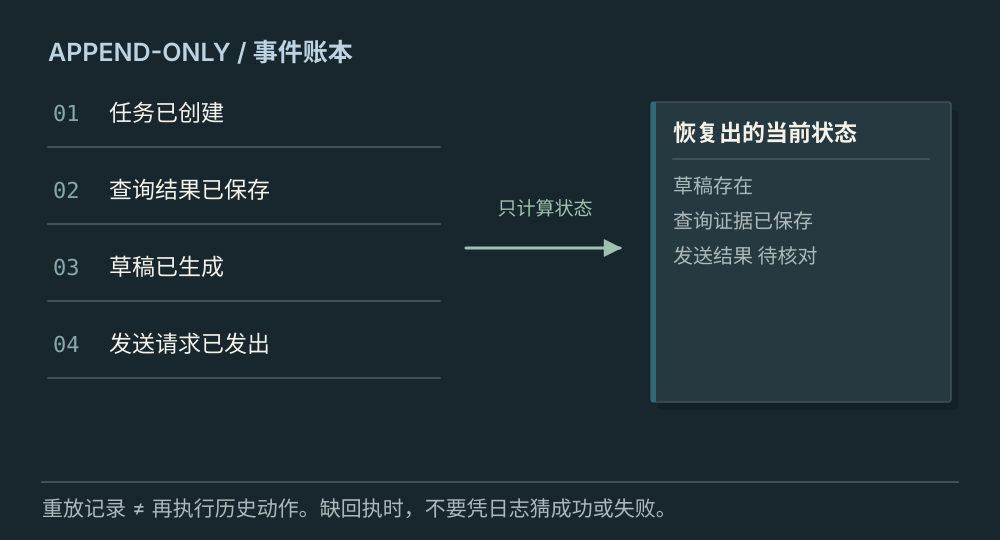
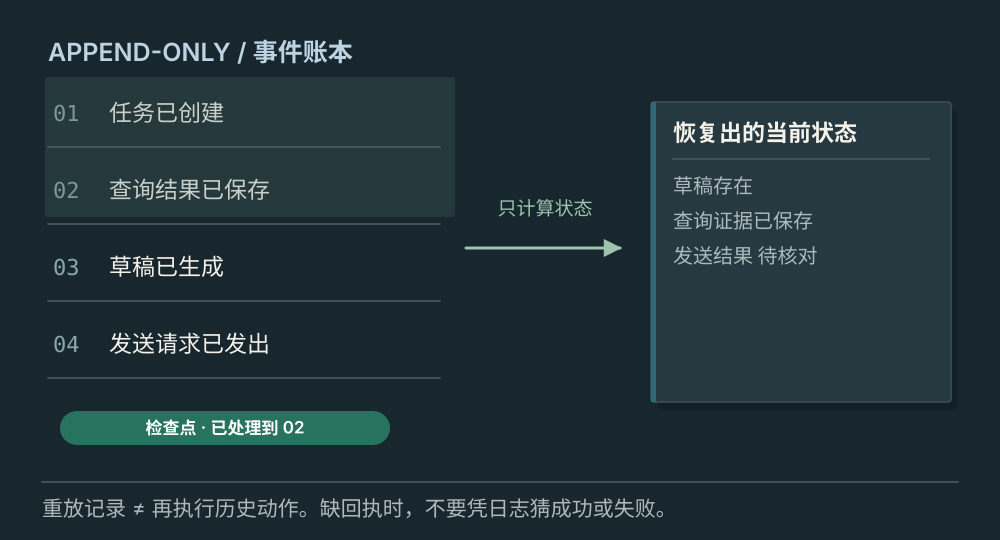
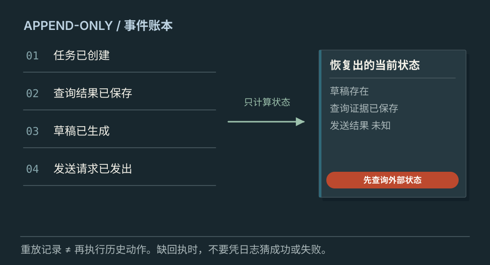

# 事件记录怎样支持状态恢复

[← 图解目录](../README.md#17) · [工程文章](../../event-state-recovery.md)

**重启以后，别把昨天再做一遍。**

周报发送成功后，服务来不及记下结果就崩溃了。重启时日志只剩“发送已请求”。把整段流程再跑一遍，可能会发送第二封。

> 像根据流水账重建余额。重新算账不应该把每笔转账再转一次。

## 重建状态

**回放已有事实**。读取已保存事件，计算当前进度。这个投影过程只恢复状态，不自动重发历史工具请求。

## 从检查点继续

**缩短恢复路径**。检查点保存已处理到的位置与状态，再应用后续事件。示意中的序号只属于同一任务。

## 发送结果未知

**先核对外部结果**。只有请求事件，没有成功回执。先用业务标识查询外部状态；无法确认时保留未知。

## 事件是发生过什么

任务创建、查询完成、草稿保存都可以成为事件。投影把这些事实按规则组合成当前状态。事件需要稳定标识和受控顺序，重复到达时应去重，不能只按不同机器的时间戳猜顺序。

## 检查点是一张带位置的快照

快照记录当时状态以及处理到第几条事件。恢复时验证快照与版本，再接着处理后续事件。快照损坏或不兼容时，需要能回到可靠记录重新构建。

## 外部副作用单独对账

发邮件、付款、创建工单可能已经发生，但回执丢失。稳定业务标识帮助查询和核对；接收方支持的幂等机制用于避免同一请求重复生效。没有这些能力时，不能承诺完全避免重复，恢复流程要保留不确定状态。

## 存了 JSONL 就能可靠恢复？

文件格式只解决记录形式。持久性、并发顺序、去重、检查点一致性和外部状态核对，都需要明确实现。

## 停一下，自己判断

重放一条“发送请求已发出”事件，要再次发邮件吗？

- A. 要，重放就是重做
- B. 不要，先重建未知状态并查询外部结果

查看解释

答案为 B。重建状态与执行副作用是两个不同过程。

[阅读工程文章](../../event-state-recovery.md) · [返回图解目录](../README.md#17)

> 图片、例子与结果均为教学示意，不代表真实服务运行或性能测试。
