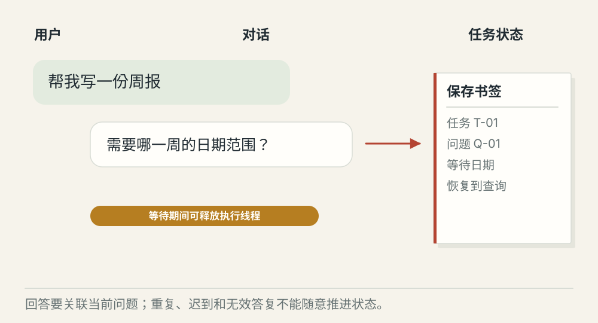
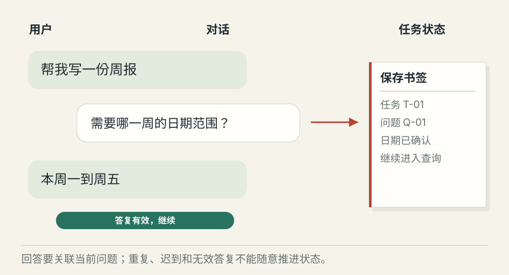
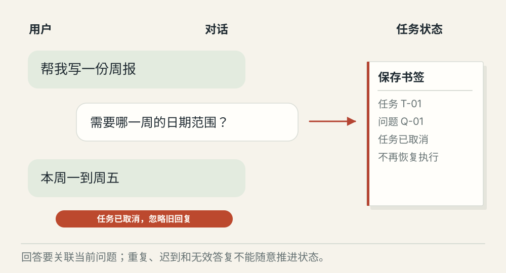

# 澄清提问怎样挂起并恢复任务

[← 图解目录](../README.md#18) · [工程文章](../../clarification-and-resume.md)

**缺一句回答，任务先停在哪里？**

用户让 Agent 写周报，却没说哪一周。Agent 需要发问，同时保存已经完成的工作，让回答到达后能够接着做。

> 像把书签夹在没读完的那一页。回来时先确认书和页码，再继续读。

## 等待日期

**WAITING_INPUT**。保存问题标识、任务版本和等待位置。进程不必一直占着线程等，等待状态可以持久化。

## 有效答复

**恢复当前任务**。收到明确日期范围，检查对应问题和当前状态后写入，再从查询阶段继续。

## 旧答复到达

**忽略过期回复**。用户已取消或问题已被替换，旧回复不能重新推动任务。重复回复也不能让查询执行两次。

## 问一个能改变下一步的问题

缺少日期，就问日期；不要用一长串问题把本来能做的工作都推回给用户。问题可以提供选项，但回答仍需要验证，用户说“随便”未必能形成有效范围。

## 等待也是正式状态

保存任务标识、问题、允许的答案结构、过期时间和恢复位置。答复到达后，程序检查它是否属于当前等待，再以受控状态转移恢复任务。

## 等待期间世界会变化

权限可能撤销，任务可能取消，所选时间范围也可能不再有效。恢复时重新检查条件，不能把昨天通过的校验无限期带到今天。

## 回答问题等于批准操作吗？

不等于。补充日期只解决信息不足；发送草稿仍需要相应授权。

## 停一下，自己判断

已取消的任务收到迟到答复，应自动继续吗？

- A. 应该，用户终于回答了
- B. 不应该，先核对任务当前状态

查看解释

答案为 B。答复只对它所属的有效等待生效。

[阅读工程文章](../../clarification-and-resume.md) · [返回图解目录](../README.md#18)

> 图片、例子与结果均为教学示意，不代表真实服务运行或性能测试。
