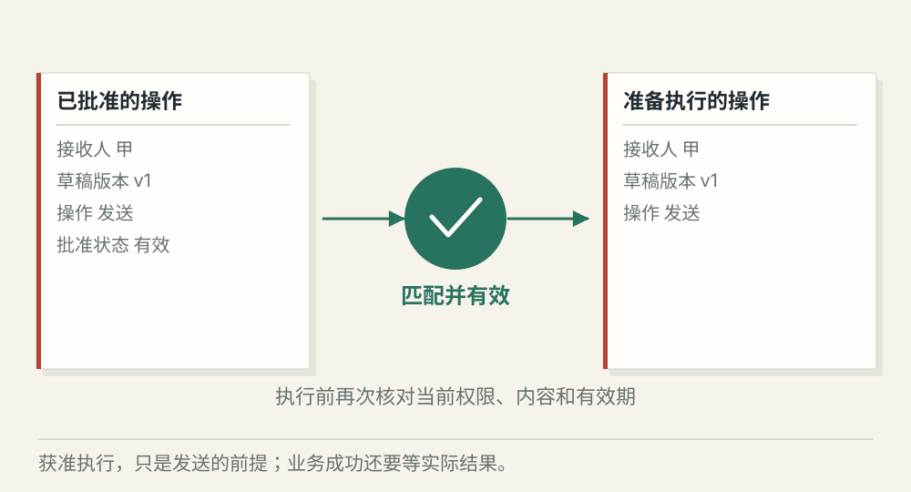
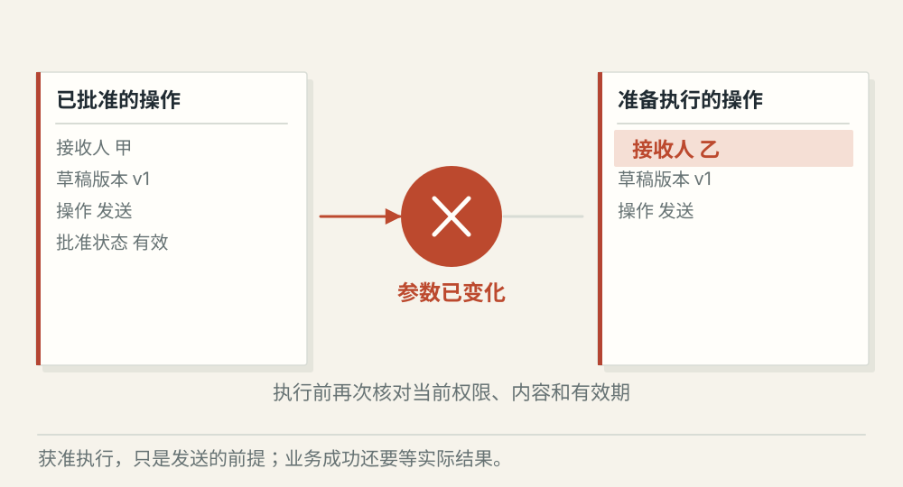
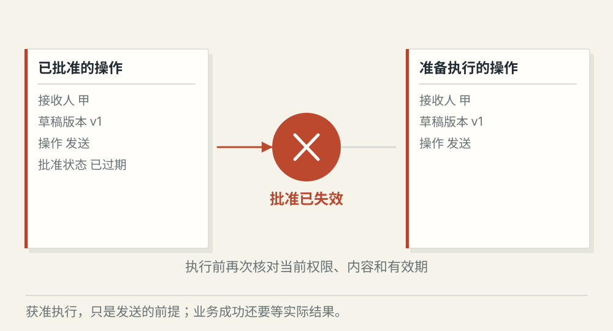

# 审批门禁怎样约束高风险工具

[← 图解目录](../README.md#19) · [工程文章](../../approval-gates.md)

**同意发给甲，就能改发给乙吗？**

草稿已经写好，用户批准发送给甲。等待执行时，接收人被改成乙。那个“同意”还能继续使用吗？

> 像签收一张写明物品和地址的寄件单。地址变了，原来的签字不能不加检查地套过去。

## 内容一致

**允许本次操作**。批准绑定草稿版本和接收人。执行前确认权限、有效期和参数仍一致，才可尝试发送。

## 接收人改变

**原批准不适用**。原批准针对甲，当前却准备发给乙。实质参数已经变化，停止执行并重新请求审批。

## 拒绝或过期

**停在门前**。没有有效批准，就不能继续发送。失败出口保留原因，也不会转成默认放行。

## 先让人看见具体操作

审批页展示发送对象、内容版本、影响范围和有效期限。用户批准的是这项具体动作，不能延伸成未来所有发送或任意资源的通行证。

## 执行前重新核对

检查审批人身份、任务状态、当前权限、接收人和草稿版本。参数摘要能帮助比较变化，不能替代授权。批准和取消同时发生时，执行入口需要核对最终有效状态。

## 获准与成功分开记录

批准只代表可以尝试执行。发送服务仍可能报错或超时，必须分别保存审批结果和实际执行结果。超时以后先查询外部状态，再按幂等规则处理重试。

## 所有操作都要人工批准？

由风险、资源和产品规则决定。关键是让需要审批的操作真正受门禁约束，避免无意义的频繁弹窗。

## 停一下，自己判断

审批通过后，发送接口超时，可以显示“已发送”吗？

- A. 可以，用户已经批准了
- B. 不可以，实际发送结果仍未知

查看解释

答案为 B。同意执行与执行成功是两条独立事实。

[阅读工程文章](../../approval-gates.md) · [返回图解目录](../README.md#19)

> 图片、例子与结果均为教学示意，不代表真实服务运行或性能测试。
