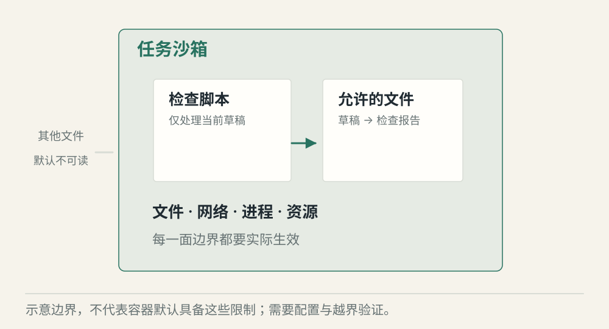
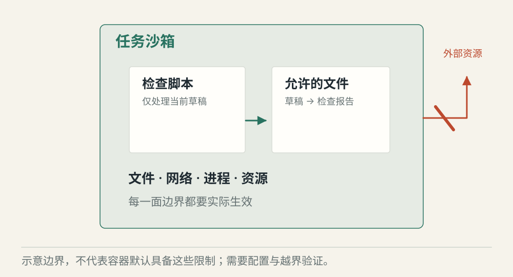
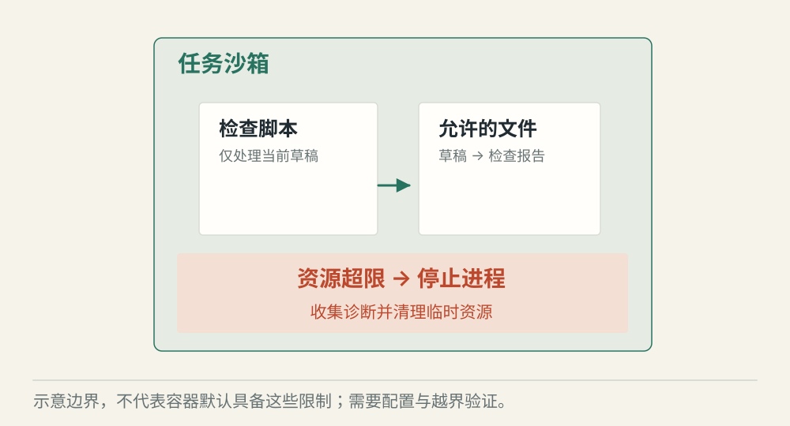

# 沙箱怎样隔离 Agent 的执行

[← 图解目录](../README.md#20) · [工程文章](../../agent-sandbox-isolation.md)

**脚本能跑，不等于哪儿都能去。**

Agent 只需要运行脚本检查一份草稿。它应该能读草稿和写报告，却不需要查看电脑上的其他文件，也不需要随意联网。

> 像一间给实验准备的房间。带进必要器材，规定出口和容量，再让实验开始。

## 允许的文件

**范围内执行**。脚本读取受控目录里的草稿，将检查结果写到指定输出位置。

## 越界访问

**边界拦截**。脚本试图读其他目录或访问未允许的网络目标，由执行环境限制。只在命令文本里做检查并不够。

## 资源超限

**停止并清理**。脚本超过本例时限，执行服务终止并回收相关进程，保存受控的诊断结果。

## 围栏有好几面

文件、网络、进程、凭证、CPU、内存与执行时间都有各自边界。容器或虚拟机可以承载限制，具体效果取决于配置和运行环境，名字叫沙箱并不自动保证安全。

## 文本检查补不了环境漏洞

禁止某几个命令，仍可能存在其他表达方式。检查路径字符串，也可能漏掉符号链接或路径变化。应用校验与执行环境限制应配合使用，并用实际越界尝试验证。

## 结束以后把房间收好

收集需要的输出和日志，清理进程与临时文件，撤销临时凭证。失败任务同样需要回收；界面显示完成，不代表后台进程已经退出。

## 有沙箱就不怕模型做错？

沙箱限制影响范围，不能保证答案正确，也不替业务服务验证资源权限。

## 停一下，自己判断

只用命令黑名单，就能替代文件与网络隔离吗？

- A. 能，危险命令已经禁止
- B. 不能，还存在其他访问路径

查看解释

答案为 B。环境边界要在实际执行时生效，而不是只约束一种输入写法。

[阅读工程文章](../../agent-sandbox-isolation.md) · [返回图解目录](../README.md#20)

> 图片、例子与结果均为教学示意，不代表真实服务运行或性能测试。
