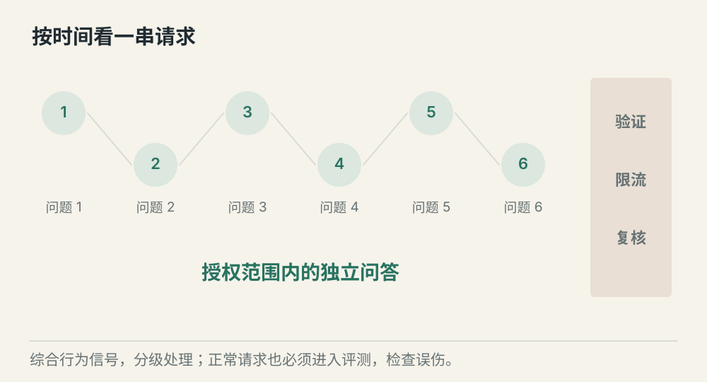
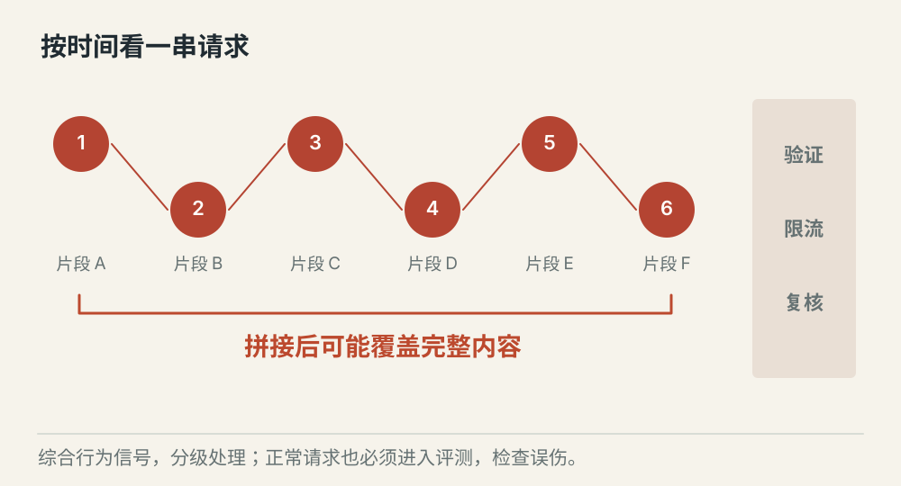
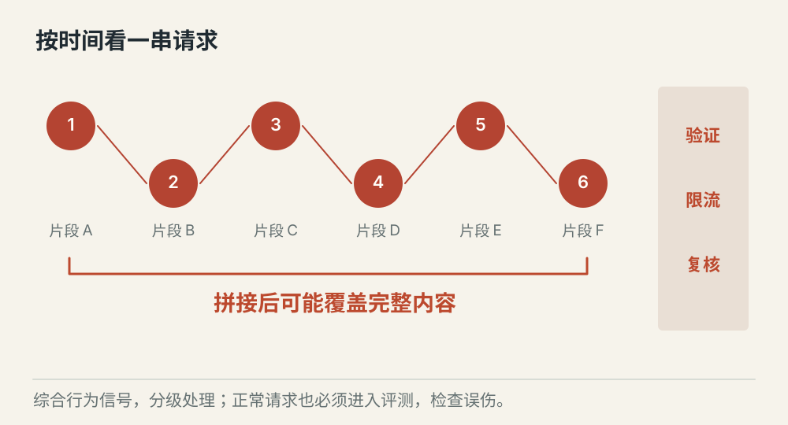

# Agent 服务怎样防止能力被批量提取

[← 图解目录](../README.md#21) · [工程文章](../../agent-service-security.md)

**每次只拿一点，会不会拿走整本书？**

一个请求只问一小段内部资料，看起来不起眼。但跨多个会话持续拼接，可能逐渐提取完整内容。防御需要同时看单次行为和一段时间的模式。

> 像图书馆借阅。单次借书与长期批量复制，是两种不同的观察尺度。

## 正常问答

**保持正常可用**。用户在授权范围内询问具体问题。提供完成任务所需的信息，同时保护内部规则与不必要的原文。

## 跨会话拼接

**关注连续模式**。多个请求持续索取相邻片段。结合账号、资源与时间窗口的行为信号识别异常，避免只盯一句话。

## 分级处置

**平衡误伤与风险**。按规则限制输出、增加验证或暂缓访问，并保留复核渠道。检测有误差，不能把所有长问题都视为攻击。

## 先说清要保护什么

系统提示词、Skill 方法、受限知识和付费服务能力有不同边界。服务端决定哪些内容进入上下文、哪些结果可以返回；前端隐藏文本并不能保护服务器已经泄露的内容。

## 一次请求看目的，长期行为看模式

输入与输出检测、资源级权限和访问频率可以互相补充。跨会话分析只收集必要信号，并设置保留期限和访问控制，不应无限保存全部对话。

## 用正常问题一起测

安全评测既放攻击样本，也放合理的长文、批量工作和研究请求。检查拦截效果以及正常任务能否完成，再调整限制强度。

## 完全防住提取有保证吗？

没有单一措施能给出这种保证。减少暴露、执行权限、行为监测与处置需要持续配合。

## 停一下，自己判断

每次请求都不大，就不用检查跨会话行为吗？

- A. 对，小请求没有风险
- B. 不对，小请求也可能被拼成大规模提取

查看解释

答案为 B。单次大小无法完整描述连续行为。

[阅读工程文章](../../agent-service-security.md) · [返回图解目录](../README.md#21)

> 图片、例子与结果均为教学示意，不代表真实服务运行或性能测试。
