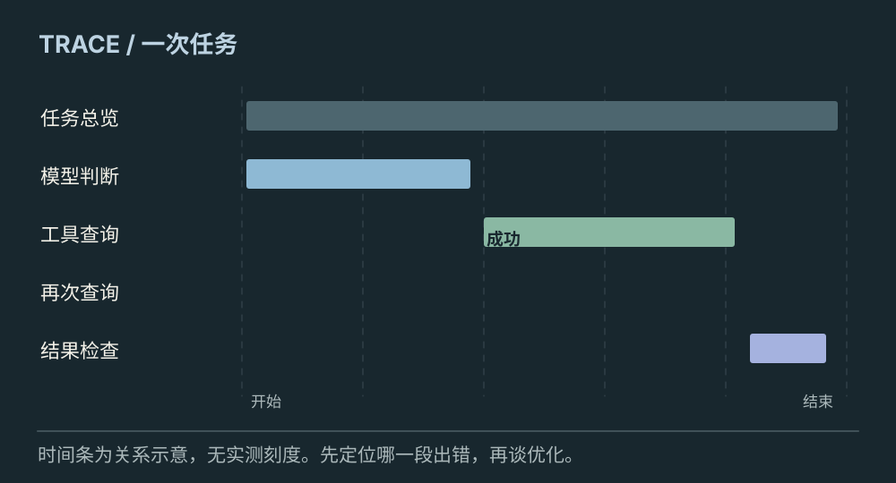
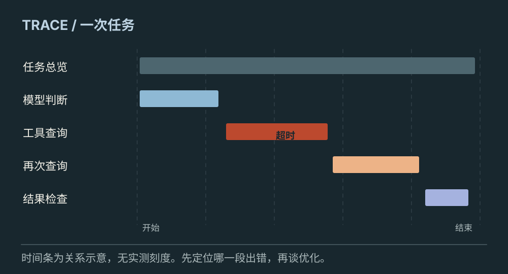
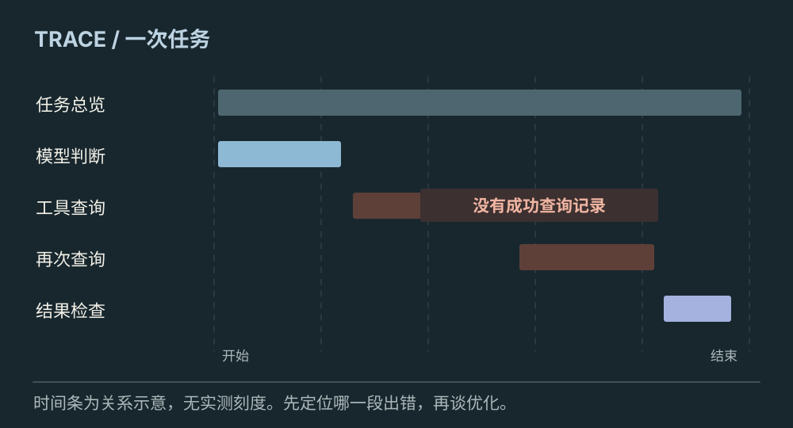

# 怎样看清一次 Agent 执行

[← 图解目录](../README.md#22) · [工程文章](../../../ai-native/agent-observability-and-evaluation.md)

**慢在模型，还是慢在工具？**

同样一句“正在处理”，背后可能是模型生成、网络重试，也可能是工具排队。执行轨迹把这些等待拆开，让问题有地方可找。

> 像给一趟旅程标出每一段耗时。知道堵在哪条路，才知道该修哪里。

## 正常轨迹

**看见完整路径**。同一任务下关联模型调用、工具调用和最终校验。示意长度用来说明先后与包含关系，不代表实测性能。

## 工具重试

**定位额外等待**。第二次查询是因为第一次超时。轨迹保留尝试编号和错误，避免把所有等待都算到模型头上。

## 证据缺失

**完成需要证据**。页面宣称完成，但没有对应成功查询记录。可观测数据帮助发现交付与执行不一致。

## 一个任务串起多条记录

Trace 是一次执行的关联轨迹，Span 可以表示其中一段操作。用稳定标识把任务、步骤、模型请求和工具记录连接起来，才能沿着一次用户请求追查。

## 记录状态，也记录原因

除了耗时，还要知道输入版本、结果类型、结束原因和重试关系。查询失败后换了一条路径，记录应反映真实分支，不要只留最终一句回答。

## 可追查不等于全部保存

凭证、个人信息和完整材料不应无差别进入日志。按诊断需要保存摘要或引用，限制权限和保留期限。观测告诉我们发生了什么，是否做得好仍需评测标准。

## 有 Trace 就能自动判定正确？

轨迹是证据。任务是否完成、权限是否合规和答案是否有依据，需要在证据之上逐项判断。

## 停一下，自己判断

一个请求很慢，可以直接认定模型很慢吗？

- A. 可以，总时长就是模型耗时
- B. 不可以，要拆开模型、工具、等待与重试

查看解释

答案为 B。总耗时包含多段不同操作。

[阅读工程文章](../../../ai-native/agent-observability-and-evaluation.md) · [返回图解目录](../README.md#22)

> 图片、例子与结果均为教学示意，不代表真实服务运行或性能测试。
