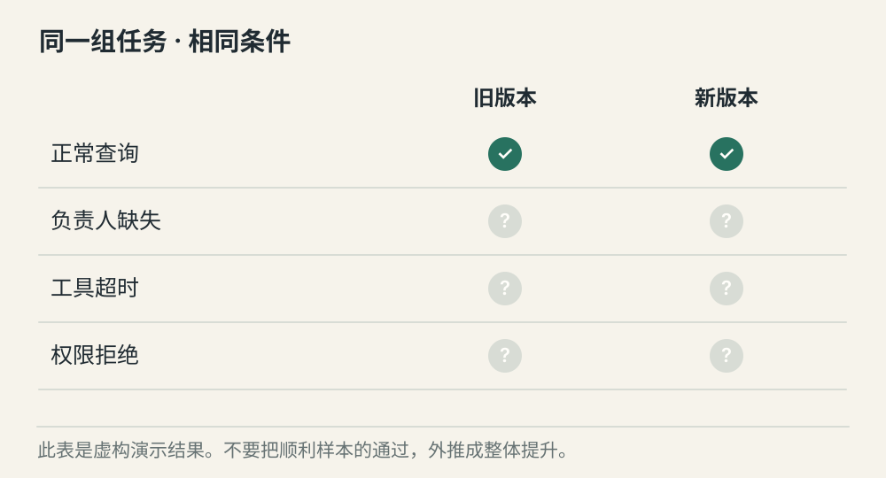
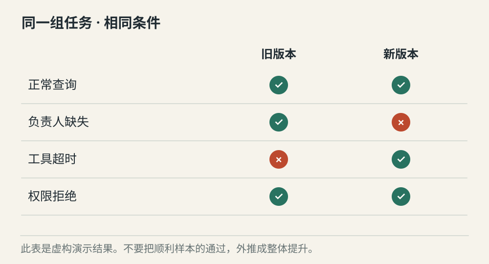
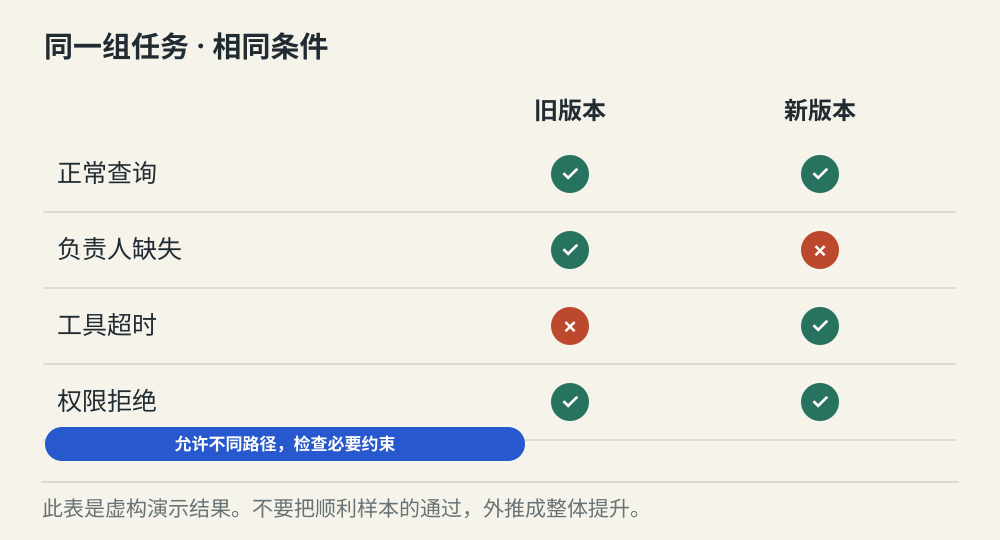

# Agent 评测怎样判断一次修改有没有真的变好

[← 图解目录](../README.md#23) · [工程文章](../../agent-evaluation.md)

**更会说了，真的变好了吗？**

改完提示词，新版本的回答更顺畅。但它会不会把缺失信息补成事实，或在权限失败时仍宣称成功？用同一组任务对照，才能看见退步。

> 像改了一种解题方法。拿同样的题再做一次，检查每道题，而不只看字写得漂亮。

## 只看顺利案例

**样本不够**。正常查询都通过，看不出对未知信息和错误分支的处理差异。演示结果是虚构的。

## 加入失败案例

**看见行为变化**。在同样材料与工具条件下，对比缺字段、权限拒绝和工具超时。新版本可能在某些任务上退步。

## 检查必要约束

**避免死背一条轨迹**。路径可以不同，但不能跳过权限检查，不能把未知结果写成成功。评测重点是必要约束与任务结果。

## 把完成标准写下来

一项查询可以要求结果对应正确任务、使用成功的工具证据、没有越权访问。能够直接检查的字段交给程序；开放性表达可以用人工或模型评分，但评分器本身也要核验。

## 比较时尽量固定条件

同一组任务、资料版本、工具返回和预算，让差异更容易归因。真实模型有随机性，需要结合重复运行和误差理解结果，不能凭一次演示宣传提升。

## 失败案例进入长期回归

线上问题脱敏后可以整理为新案例，加入期望行为和判定依据。评测集也会过时，应更新材料并保留独立检查，避免系统只适应熟悉的题目。

## 工具顺序和标准路径不同就失败？

未必。独立查询的顺序可以变化；审批必须先于发送这类关键约束，才需要严格检查。

## 停一下，自己判断

新版本只在正常样本上通过，能说整体更好吗？

- A. 可以，正常路径最重要
- B. 还不能，需要看失败分支和回归结果

查看解释

答案为 B。一次局部改善可能同时引入其他任务退化。

[阅读工程文章](../../agent-evaluation.md) · [返回图解目录](../README.md#23)

> 图片、例子与结果均为教学示意，不代表真实服务运行或性能测试。
