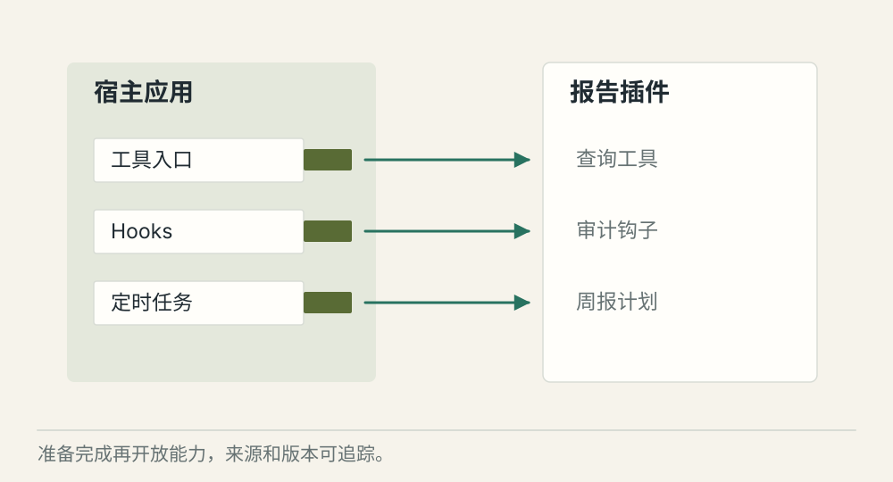
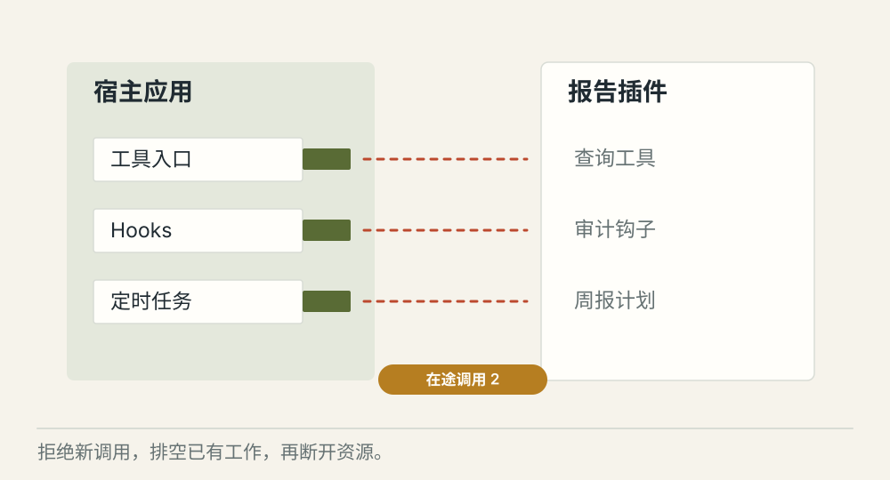
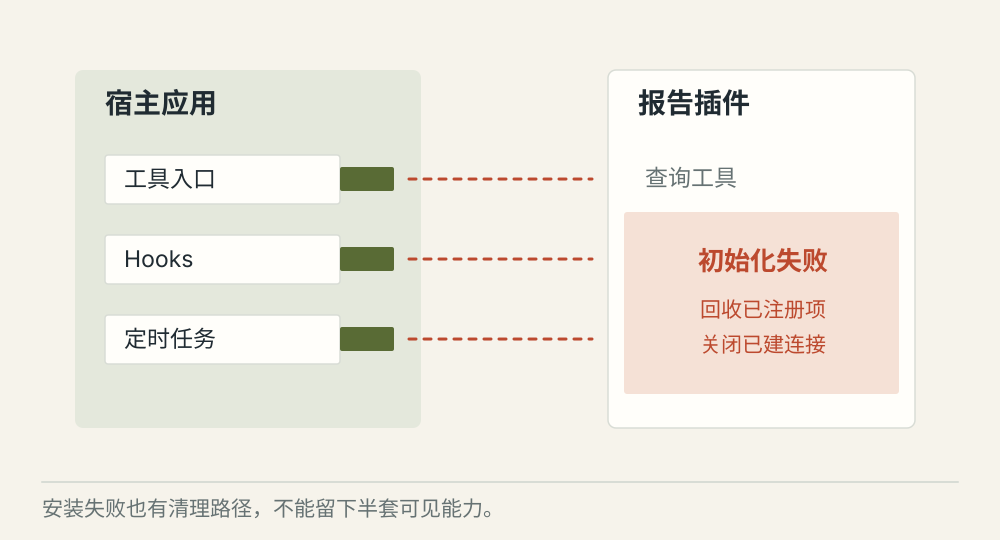

# 插件怎样安装、卸载并释放资源

[← 图解目录](../README.md#24) · [工程文章](../../plugin-lifecycle.md)

**插件能安装，也要能干净地离开。**

一个插件带来三个工具、一个后台任务和一条连接。用户点卸载时，只把三个工具名字删掉，后台工作可能还在继续。

> 像拆一台接了电和水的设备。先停止使用、处理正在进行的工作，再断开管线。

## 装载完成

**能力可用**。检查兼容性，初始化资源，注册能力。只有全部就绪，才对外提供新工具。

## 卸载中

**先排空**。停止接收新调用，处理在途任务，再撤下工具、钩子和定时器。

## 安装失败

**回滚部分结果**。初始化中途失败，回收已经创建的资源与注册项，避免半个插件残留。

## 插件约定要覆盖整个生命周期

安装、初始化、注册、运行、停用与释放都有明确行为。能力来源和版本应可追踪，多个工具的批量注册失败时要知道哪些已经生效。

## 卸载与调用可能撞在一起

插件开始停用后，新调用应被拒绝；已有调用按规则完成或取消。远端操作不能仅凭本地卸载就认为已撤回，需要记录与核对。

## 加载隔离有自己的边界

独立加载器可以帮助隔离名称与依赖，不能等同于文件、进程和网络安全隔离。不可信代码需要相应的执行环境约束。

## 热卸载一定要支持吗？

不一定。简单产品可以要求重启，但要明确支持范围和资源回收方式，避免承诺做不到的动态卸载。

## 停一下，自己判断

从注册表删掉插件工具，卸载就完成了吗？

- A. 是，工具已经找不到
- B. 否，还要处理调用、连接、任务和资源

查看解释

答案为 B。可见入口消失不代表运行资源已经回收。

[阅读工程文章](../../plugin-lifecycle.md) · [返回图解目录](../README.md#24)

> 图片、例子与结果均为教学示意，不代表真实服务运行或性能测试。
