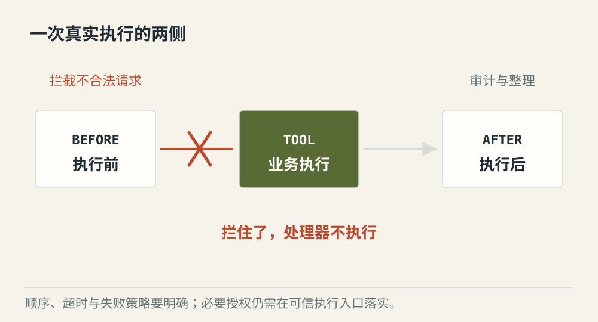
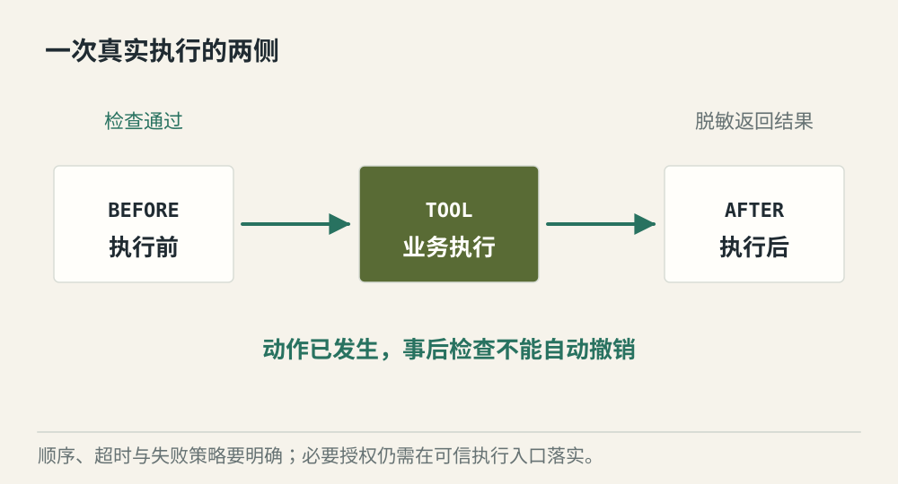
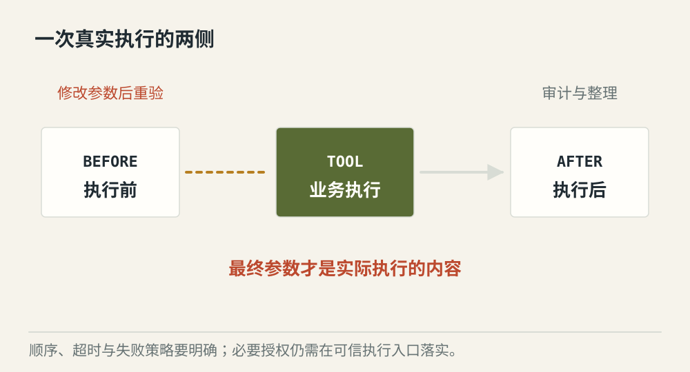

# Hooks 怎样介入工具执行前后

[← 图解目录](../README.md#25) · [工程文章](../../hooks-tool-execution.md)

**门口的检查，和出口的检查。**

发送工具执行前，可以拦截不合法参数；结果返回后，可以隐藏敏感字段。把检查放错位置，可能等发现问题时操作已经发生。

> 像寄件前核对地址，寄件后整理回执。回执上的检查无法撤回已经寄出的包裹。

## 执行前拦截

**阻止副作用**。before 钩子发现接收人不在允许范围，停止调用，业务处理器没有运行。

## 执行后脱敏

**限制结果暴露**。after 钩子处理返回结果中的敏感内容，再提供给上层。原始操作已经执行过。

## 钩子改了参数

**检查最终动作**。执行前钩子修改了目标，需要对最终参数重新做必要校验，不能沿用只针对原参数的批准。

## 钩子是在约定位置插入处理

Hooks 可以做参数检查、结果整理、审计和脱敏。它们需要明确执行顺序，前一个钩子的修改可能影响后一个钩子的判断。

## 失败时的行为要事先规定

必要权限检查失败应停止操作；非关键统计失败则可以按策略记录后继续。钩子需要时间上限，不能让一个审计扩展无限卡住业务。

## 别把强制边界放在可绕过的位置

业务服务仍需校验资源权限。日志不能代替授权，执行后告警也不能当作执行前拦截。钩子是扩展机制，它是否强制生效取决于运行路径设计。

## after 钩子发现误发，能撤销吗？

通常不能仅靠钩子撤销。外部系统若支持撤回，需要单独操作与确认；很多副作用不可逆。

## 停一下，自己判断

必须防止的发送，应在哪一侧检查？

- A. 实际发送之前
- B. 拿到发送回执之后

查看解释

答案为 A。事后记录有助于诊断，无法替代事前阻止。

[阅读工程文章](../../hooks-tool-execution.md) · [返回图解目录](../README.md#25)

> 图片、例子与结果均为教学示意，不代表真实服务运行或性能测试。
