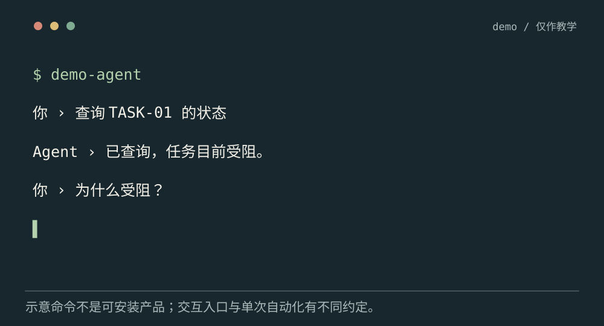
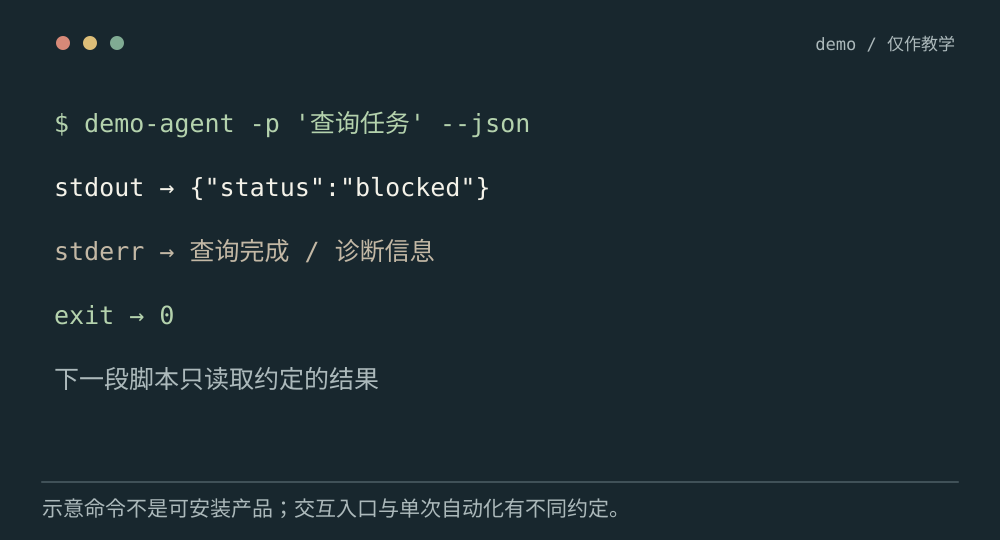
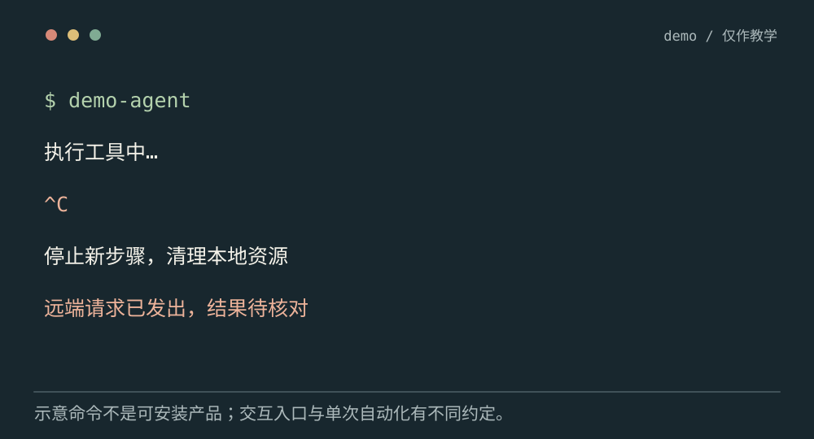

# CLI Agent 怎样进入终端工作流

[← 图解目录](../README.md#26) · [工程文章](../../cli-agent-workflow.md)

**人来对话，程序来接结果。**

你在终端里询问任务状态，也可能让自动化脚本调用同一个 Agent。这两个入口需要不同的交互方式，不能把聊天界面原样搬过去。

> 像同一台机器有手动面板和流水线接口。人可以继续问，流水线需要明确输入、输出与结束信号。

## 交互模式

**人可以接着问**。保留会话，接收后续输入，需要信息时等待用户。演示命令仅用于解释，并非可安装产品。

## 单次模式

**结果可被程序消费**。读入一个请求，标准输出只写约定结果，诊断写标准错误，退出码表示执行状态。

## 取消运行

**有记录地退出**。接收中断信号，停止新步骤、清理本地资源，再核对已发出的外部请求。

## 先确定从哪里工作

工作目录决定相对路径指向哪里，但不等于安全边界。读写范围、工具权限和凭证都要显式控制。来自管道的文本属于输入材料，不能自动变成 shell 命令。

## 不要把日志混进结果

单次模式可能输出 JSON 供后续脚本解析，调试信息应走单独通道。生成了一段文本不保证任务成功，退出码与结构化状态要反映真实结果。

## 无人值守时也有等待问题

需要澄清或审批时，脚本不能假装用户同意。可以返回待处理状态，或使用产品支持的异步交互机制。凭证不要出现在命令参数、终端日志和提交产物里。

## 有命令行入口就是安全执行器？

命令行只是入口。文件、网络和进程隔离需要由执行服务和环境落实。

## 停一下，自己判断

标准输出要给程序读 JSON，调试日志应该放哪？

- A. 混在 JSON 前后
- B. 独立诊断通道，如标准错误

查看解释

答案为 B。混入日志会破坏下游解析约定。

[阅读工程文章](../../cli-agent-workflow.md) · [返回图解目录](../README.md#26)

> 图片、例子与结果均为教学示意，不代表真实服务运行或性能测试。
