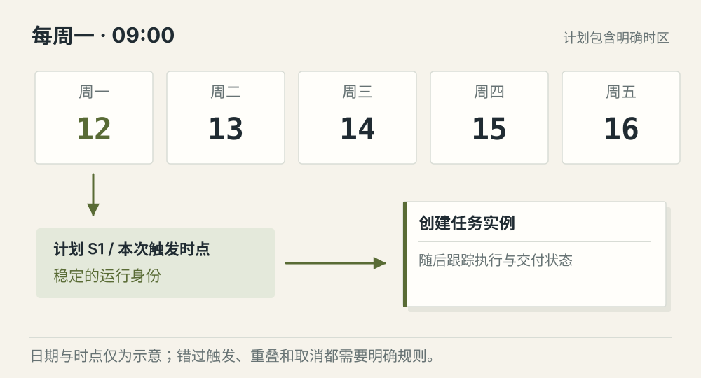
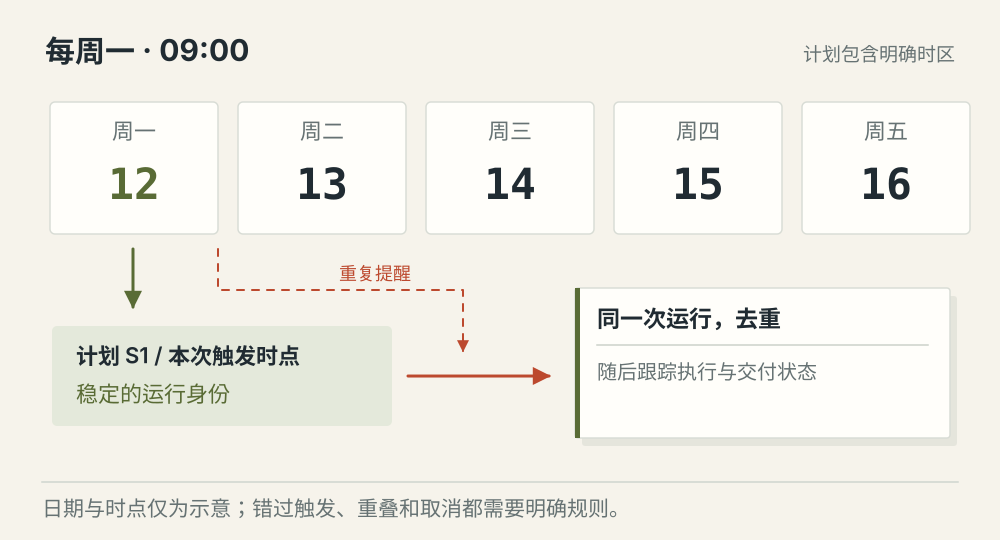
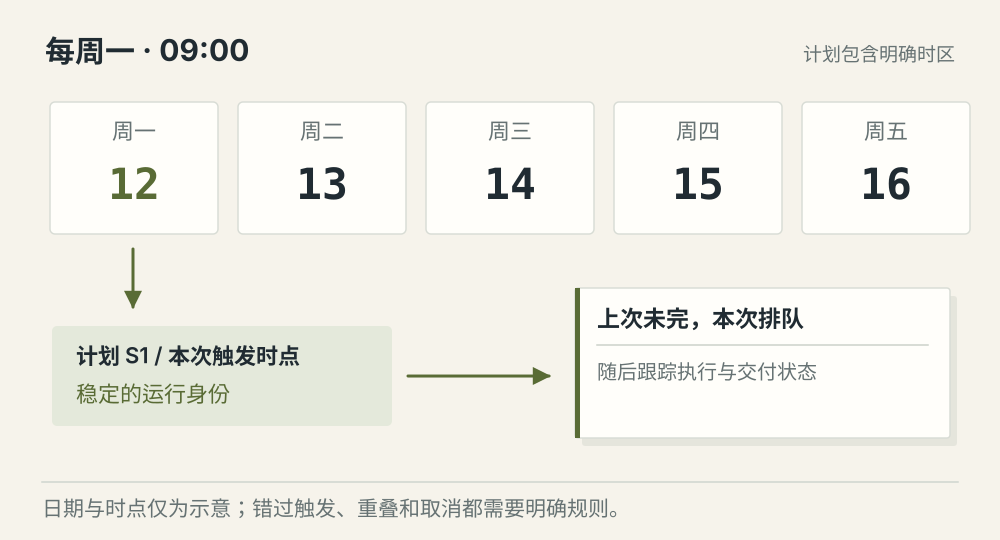

# 定时任务怎样可靠触发 Agent

[← 图解目录](../README.md#27) · [工程文章](../../scheduled-agent-tasks.md)

**到了点，为什么还会跑两次？**

每周一生成周报。调度服务重启，消息又重复投递，同一个周一可能收到两个触发。只看“时间到了”不足以保证任务可靠。

> 像每周一次的值日安排。提醒可能收到两遍，但这周的任务仍然是同一项。

## 正常触发

**本次运行有身份**。计划带着时区与预定时间，触发记录映射到一次任务实例。

## 重复通知

**不重复创建运行**。相同计划时点重复到达，按稳定运行标识去重。外部写操作仍需要业务自己的幂等规则。

## 上次还没结束

**明确重叠策略**。按产品规则选择跳过、排队或限制并发。示意采用排队，不能默认无限重叠。

## 日历规则与执行分开

计划说明何时运行；任务实例说明这一回的状态。一次性与周期任务都要保存时区、触发条件和取消状态。夏令时、停机错过时间等情况，需要明确补跑或跳过策略。

## 通知可以重复，处理要受控

调度与消息系统可能重复投递。用计划标识加预定触发时点等信息构造稳定运行身份，再用受控写入防止重复创建。一次通知只能说明该检查是否启动任务。

## 运行时重新检查授权

上周创建计划的用户，这周可能已无权查看数据。执行前检查当前权限和计划是否仍有效。取消与触发撞在一起时，还要管理已启动任务的停止与核对。

## 定时器触发成功就算任务完成？

触发、运行和交付各有状态。需要保存失败原因、产物引用和下一次计划，才能判断实际结果。

## 停一下，自己判断

一条触发消息来了两次，应该建两个任务吗？

- A. 应该，一条消息对应一次运行
- B. 不应该，先检查是否同一计划时点

查看解释

答案为 B。投递次数与业务上该运行的次数不同。

[阅读工程文章](../../scheduled-agent-tasks.md) · [返回图解目录](../README.md#27)

> 图片、例子与结果均为教学示意，不代表真实服务运行或性能测试。
