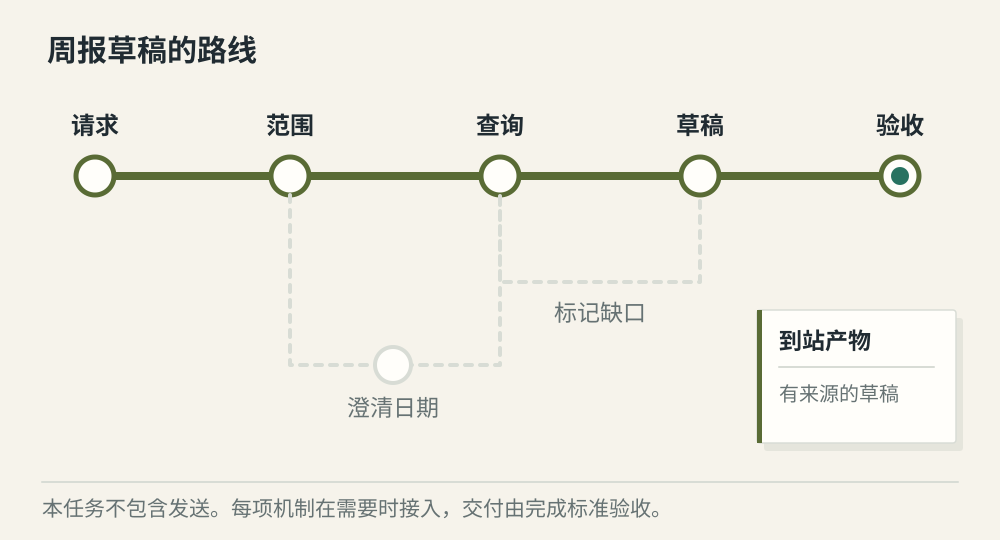
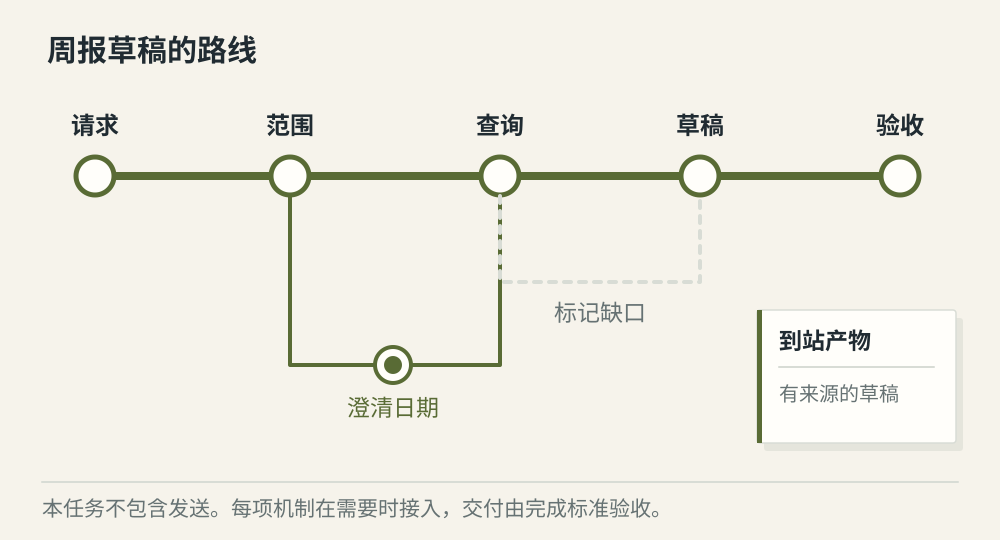
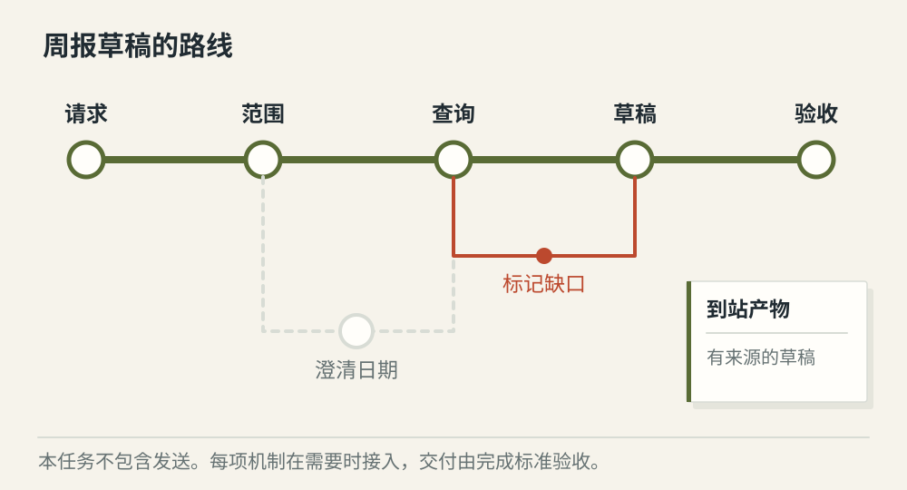

# 一个完整任务怎样串起 Agent 的各项机制

[← 图解目录](../README.md#28) · [工程文章](../../complete-agent-task.md)

**一份周报，经过哪些真正必要的站？**

我们只做一件有边界的事——查询授权范围内的任务，生成带来源的周报草稿。日期缺失就问，证据不足就说明，验收通过后交给用户。

> 像坐一条有换乘点的路线。每一站解决一个具体问题，不必为了展示能力把所有线路都坐一遍。

## 信息齐全

**最短可用路径**。识别请求，查询任务，按说明整理草稿，检查来源后交付。本例到草稿结束。

## 缺少日期

**按需加入等待**。先保存等待状态并澄清日期，再恢复查询。已有有效信息可以继续使用。

## 部分查询失败

**按证据交付**。保留已确认的事实与缺口，根据交付标准返回部分草稿或失败状态。不能把缺失写成零。

## 每种材料各有职责

长期偏好帮助安排表达；RAG 提供写作规则；工具提供当前任务事实；Skill 描述整理方法。它们都进入当前任务，但来源、更新节奏和可信范围并不相同。

## 运行时把步骤接住

上下文有预算，调用有上限，等待可以恢复，结果带着对应任务标识。所有分支都回到同一份正式状态，避免界面、模型和工具各自宣称不同进度。

## 完成条件写在交付之前

草稿包含时间范围、进展、阻塞和来源，未知项明确标记。生成草稿不等于自动发送。只有新增发送需求时，才加入相应权限、审批和业务幂等。

## 一定要用齐前面所有机制？

不需要。简单查询可以很短；多 Agent、插件和远程协作都按问题引入。完整意味着能完成并验证目标。

## 停一下，自己判断

用户只要周报草稿，最终是否必须调用发送工具？

- A. 必须，否则不算完整 Agent
- B. 不必，满足草稿交付条件即可

查看解释

答案为 B。范围明确的交付比堆齐所有能力更重要。

[阅读工程文章](../../complete-agent-task.md) · [返回图解目录](../README.md#28)

> 图片、例子与结果均为教学示意，不代表真实服务运行或性能测试。
