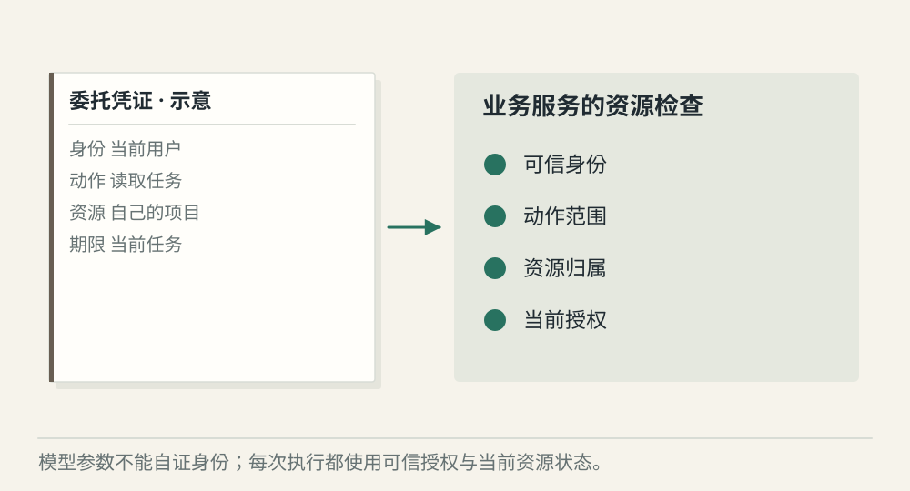
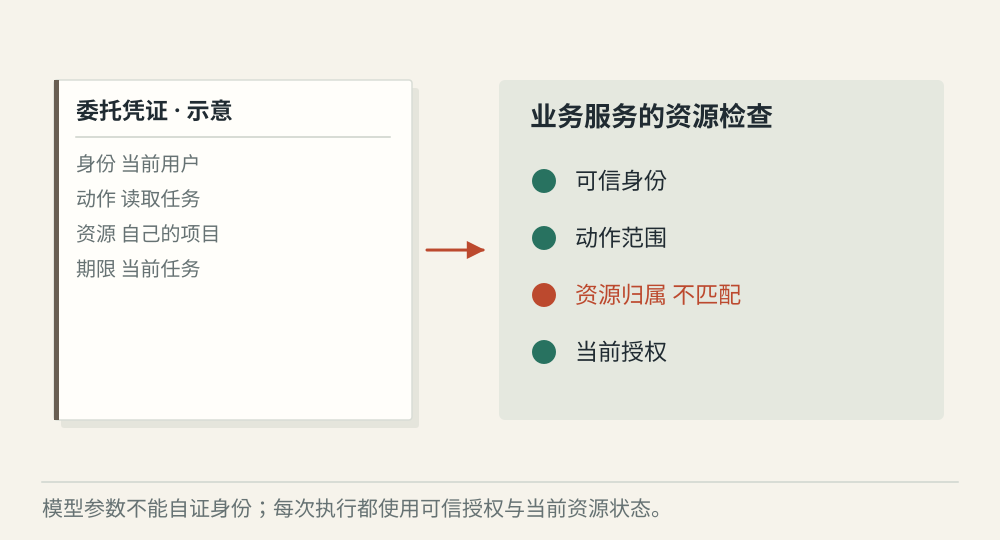
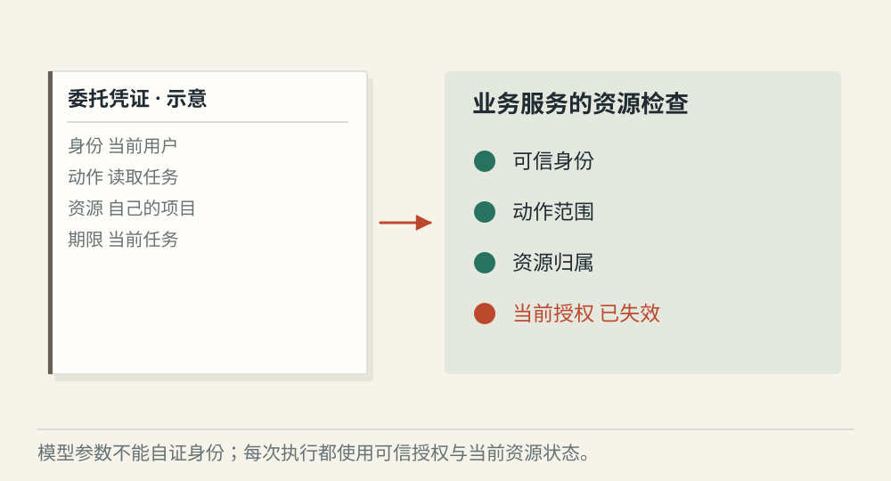

# 身份、权限和 Guardrail 怎样约束 Agent

[← 图解目录](../README.md#29) · [工程文章](../../../ai-native/agent-identity-policy-guardrail.md)

**模型说“可以”，谁来判断真的可以？**

用户让 Agent 查询一项任务。Agent 需要使用被委托的身份，但不能凭自己生成的 user_id 获得别人的资料。

> 像拿一张只通往指定房间的访客证。证上有持有人、可到区域和有效时间。

## 范围内查询

**按委托范围执行**。可信身份和资源授权匹配，工具可以访问指定任务。

## 扩大目标范围

**不能自行扩权**。模型把参数改成其他人的任务，即使格式正确，资源授权仍应拒绝。

## 权限被撤销

**采用当前权限**。任务等待期间授权失效，恢复执行时重新检查，旧上下文不构成通行证。

## 身份来自可信连接

用户、Agent 服务和下游系统之间需要明确委托关系。令牌的接收方、用途和有效期要匹配实际操作，不能把任意凭证直接透传给所有工具。

## 策略决定能做什么

工具允许列表只是第一层，业务服务还要检查具体对象。读取自己的一项任务和读取全部人的任务，可能是同一个工具名，却是不同权限范围。

## Guardrail 负责额外检查

Guardrail 可以理解为行为护栏，用来检查输入、行动或输出是否违反规则。它可能有误判，不能替代业务授权和执行环境限制。多层检查应各自承担明确职责。

## 模型生成的身份字段可信么？

它只是模型输出的数据。服务端要从可信会话或授权凭证确定真实操作者。

## 停一下，自己判断

请求里写 user_id=管理员，就能以管理员身份执行吗？

- A. 能，参数写得很明确
- B. 不能，身份不能由模型参数自证

查看解释

答案为 B。可信身份来自认证与委托链。

[阅读工程文章](../../../ai-native/agent-identity-policy-guardrail.md) · [返回图解目录](../README.md#29)

> 图片、例子与结果均为教学示意，不代表真实服务运行或性能测试。
