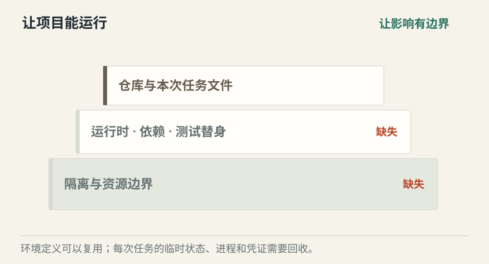
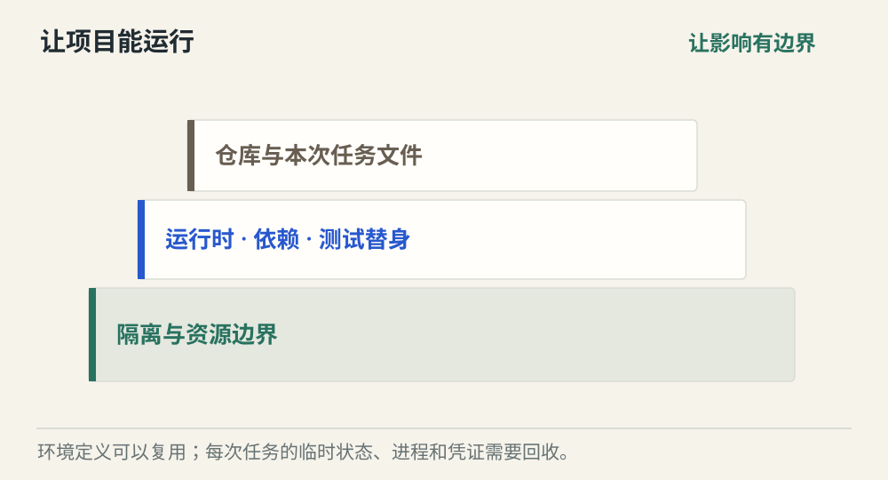
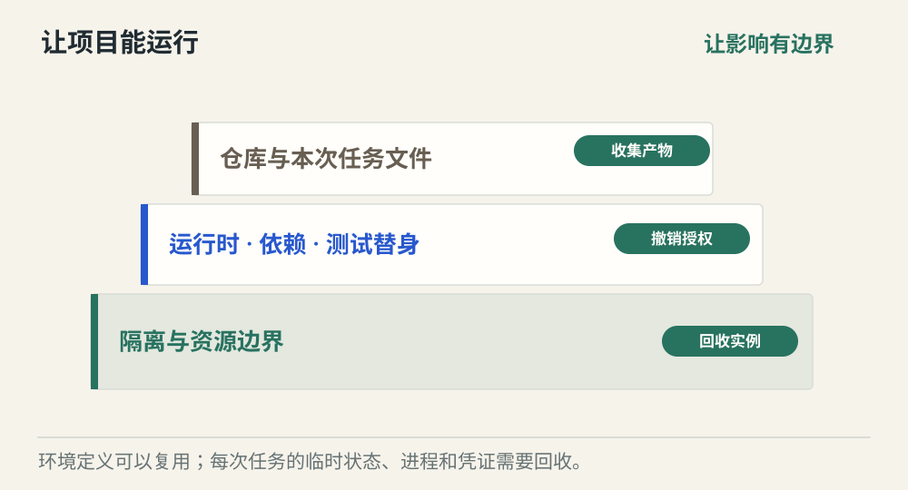

# Agent 在哪里运行

[← 图解目录](../README.md#30) · [工程文章](../../../ai-native/agent-runtime-environment.md)

**仓库给它了，为什么还是跑不起来？**

同一段代码在你的电脑能运行，到了 Agent 的新环境却缺依赖、缺测试数据。隔离之外，还需要一份能重建的项目环境。

> 像交付一个实验。不能只给实验说明，还得准备相同的器材、材料和检验办法。

## 只有代码

**条件不齐全**。仓库已经拉取，但缺运行时、依赖或配置。Agent 无法从源码猜出不存在的真实环境。

## 准备环境

**可运行且受控**。根据明确声明装入工具、依赖和测试替身，同时施加文件、网络与资源边界。

## 任务结束

**收集后回收**。收集差异、日志与测试报告，撤销临时授权，销毁本次实例。复用环境定义，不复用脏状态。

## 隔离与可运行各管一半

Sandbox 控制能去哪里、能用多少资源；Coding Environment 准备编译器、依赖、配置和测试命令。只有围栏却没有工具，任务仍然做不下去。

## 定义长期保存，实例按次创建

同一份经过维护的环境定义可以生成多次任务实例。每次临时文件、进程和授权彼此隔离，避免上一次任务残留影响下一次验证。容器、虚拟机等是可选实现。

## 失败也要有交付物

构建失败时保存需要的诊断信息，再清理资源。日志与快照可能带有敏感内容，按用途筛选保留。重新运行应依靠确定的基线和配置，而不是依赖一台长期堆积的机器。

## 本地、后台和托管要三套规则？

入口可以不同，项目环境声明、权限边界和验证标准应尽量一致，避免换入口就换隐含条件。

## 停一下，自己判断

为了下一次方便，任务凭证应一直保存在镜像里吗？

- A. 应该，省去重复配置
- B. 不应该，按任务提供受限授权并回收

查看解释

答案为 B。环境可以复用，长期凭证与临时状态不能随之无限继承。

[阅读工程文章](../../../ai-native/agent-runtime-environment.md) · [返回图解目录](../README.md#30)

> 图片、例子与结果均为教学示意，不代表真实服务运行或性能测试。
