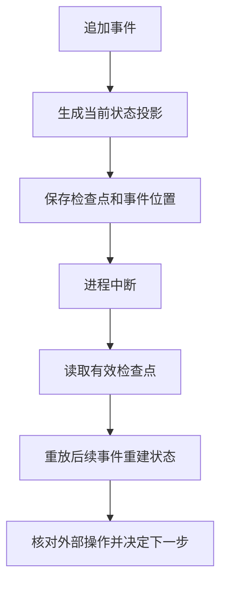

# 事件记录怎样支持状态恢复

[← AI Agent 学习路线](README.md)

Agent 查询任务后生成周报，进程在准备交付时突然退出。恢复以后，系统需要知道查询是否成功、草稿是否已经保存，以及有没有发出外部写请求。只保存最后一句模型回复，无法可靠回答这些问题。

事件记录可以保存任务执行中发生的事实。投影根据事件计算当前状态，检查点保存某个位置的状态快照。三者配合后，系统可以在重启时重新构建执行状态。本文使用虚构的任务周报示例。

## 事件与当前状态是什么关系

```text
1. 任务已创建
2. 时间范围已确认
3. 查询请求已发出
4. 查询结果已保存
5. 周报草稿已生成
```

这些是示例事件，不是固定协议。每条记录通常需要任务标识、事件标识、版本或序号、类型和必要内容。生成当前状态时，投影按规则处理这些事件，得到“草稿已生成，等待后续处理”。

事件记录应区分“请求已发出”和“服务已确认成功”。如果进程在外部服务成功以后、记录成功结果之前崩溃，日志里可能只有请求事件；恢复时状态是未知，不能假定失败。

## 检查点缩短恢复过程

事件很多时，可以定期保存检查点，记录状态及其对应的事件位置。恢复时读取检查点，再处理后续事件。检查点与事件的顺序、版本和一致性要能验证；损坏或不兼容时，需要回退到可用快照或重新构建。

事件顺序不能只依赖不同机器的本地时间。单任务可以使用受控版本或递增序号，通过条件写入防止并发覆盖。跨任务的全局顺序是否必要，要看业务约束。

例如检查点记录处理到第 100 条事件，进程恢复时可以从第 101 条继续构建投影。若第 101 条是“发送请求已发出”，后面没有结果事件，恢复出来的应是“结果未知”；系统需要使用业务标识查询外部状态，不能在投影重放时直接发送第二次。



重放这里指**根据已保存事件重建状态**。它不意味着把历史工具请求再次发送给外部系统。[Temporal 的事件历史说明](https://docs.temporal.io/encyclopedia/event-history)展示了通过持久事件恢复工作流的一种实现，具体重放语义仍需按所用框架确认。

## 重复事件和外部副作用

消息重复投递可能让同一事件进入处理流程多次。投影可以按事件标识去重，并检查预期版本；异步投影还要考虑乱序、失败重试和对账。

向外部系统创建任务时，应为确认过的业务意图生成稳定幂等键，并让接收方支持去重。若结果未知，恢复时先按业务标识查询或对账；外部系统不支持查询与幂等时，应保留未知状态，不能承诺完全避免重复。

事件、业务状态和对外通知如何原子提交取决于系统边界。单个数据库事务内可以同时写入业务状态与待发送记录；跨服务还需重试和对账，不能声称一次本地事务就让所有系统同步完成。

## 日志也有边界

事件可能包含用户输入、工具参数和外部结果，应按用途最小化保存，并限制读取权限、保留期限和敏感信息。审计日志与可回放事件可以关联，但不一定保存完全相同的内容。

验收应覆盖重复事件、旧事件晚到、检查点损坏、崩溃发生在外部写操作前后、投影重建与用户删除请求。对照实际外部状态检查恢复结果，不能只验证事件数量相等。澄清和审批的等待状态可继续看后面的两篇。
