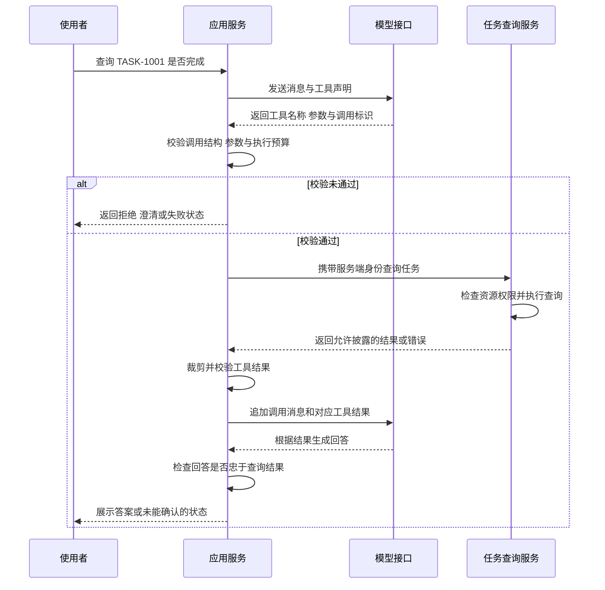

# Function Calling 怎样完成一次工具调用

[← AI Agent 学习路线](README.md)

前两篇让模型从会议记录中提取待办，再检查草稿是否符合约定。现在换一个问题，用户想知道任务系统里的某项工作是否完成。会议记录可能已经过时，模型需要取得当前系统中的结果，才能回答。

这里用示例任务 `TASK-1001` 说明一次只读查询。Function Calling 指模型按照工具声明返回结构化调用请求，再由应用执行工具并提供结果的过程。模型生成函数名称与参数，真正的查询仍由程序完成。[DeepSeek 的工具调用示例](https://api-docs.deepseek.com/guides/tool_calls/)也明确区分了这两项职责。

本文中的任务、消息和结果都是设计示例，不连接真实业务系统。先完成一次查询与结果回填，多步行动循环留到 ReAct 文章展开。

## 先告诉模型，工具能查什么

沿用[第一篇](model-calls-and-messages.md)的接口格式，在请求中加入 `tools`。下面的工具只按明确编号查询任务状态，不支持修改，也不接受模型指定查询身份。

```json
{
  "model": "YOUR_MODEL_ID",
  "thinking": {"type": "disabled"},
  "messages": [
    {
      "role": "system",
      "content": "需要当前任务状态时，使用查询工具。缺少明确任务编号时先询问，不猜编号。查询失败时说明未能确认，不编造结果。"
    },
    {
      "role": "user",
      "content": "查一下 TASK-1001 现在完成了吗？"
    }
  ],
  "tools": [
    {
      "type": "function",
      "function": {
        "name": "get_task_status",
        "description": "按明确任务编号查询当前用户有权访问的任务状态。只读，不创建或修改任务。",
        "parameters": {
          "type": "object",
          "properties": {
            "task_id": {
              "type": "string",
              "pattern": "^TASK-[1-9][0-9]{0,7}$",
              "description": "用户明确提供或当前已确认任务上下文中的编号"
            }
          },
          "required": ["task_id"],
          "additionalProperties": false
        }
      }
    }
  ],
  "tool_choice": "auto",
  "max_tokens": 512,
  "stream": false
}
```

`YOUR_MODEL_ID` 需要替换成实际可用的模型标识。示例关闭思考模式与流式输出，先观察完整调用消息。`pattern` 是这份示例的编号规则，不代表所有业务都采用这种编号。

工具描述要说明用途和限制，参数结构则约定程序能接收什么。`required` 与 `additionalProperties` 分别要求必填字段、限制额外字段，具体含义见 [JSON Schema 对象规则](https://json-schema.org/understanding-json-schema/reference/object)。工具描述里写了“当前用户”，程序仍需落实身份校验。

`tool_choice` 为 `auto` 时，模型可以返回调用请求，也可以直接回答或追问。它不会保证一定查询。工具选择方式与支持范围需要按[当前接口契约](https://api-docs.deepseek.com/api/create-chat-completion/)核对，不能只因为请求带了 `tools`，就认定回答已经使用最新数据。

## 返回的调用请求，需要程序接着处理

下面仅展示响应中 `choices[0].message` 的示意内容。对应候选的 `finish_reason` 为 `tool_calls`，表示本轮生成交出了工具调用请求，查询尚未发生。

```json
{
  "role": "assistant",
  "content": null,
  "tool_calls": [
    {
      "id": "call_demo_1",
      "type": "function",
      "function": {
        "name": "get_task_status",
        "arguments": "{\"task_id\":\"TASK-1001\"}"
      }
    }
  ]
}
```

这里的 `arguments` 是一段包含 JSON 的字符串，应用还要解析并校验，不能直接当作已经可信的参数对象。`content` 为空也不表示接口故障，这轮的主要产物是 `tool_calls`。

工具名称只能映射到应用允许的处理器。即使模型返回一个看起来像内部方法的名称，也不能据此做任意反射调用，更不能执行模型拼出来的代码。第一版可以用固定映射连接 `get_task_status` 与查询方法，工具注册表的扩展设计后面再讲。

本例只支持一条工具调用。若收到多条，先作为不支持的批次停止处理，不执行第一条后再忽略其余部分。缺少任务编号时应进入澄清分支，不能让模型编一个编号来满足必填项。

## 参数合规以后，还要检查资源权限

调用前至少经过下面几项检查。前面的结构约定可以复用[提示词文章中的校验方法](prompt-task-contracts.md)，资源权限则由业务接口判断。

| 检查位置 | 要确认的内容 | 未通过时的处理 |
|---|---|---|
| 调用消息 | 消息完整，调用数量受支持，标识存在且不冲突 | 不进入工具执行 |
| 工具选择 | 名称属于本次请求允许的工具，服务端也有对应处理器 | 拒绝未知或未授权工具 |
| 参数结构 | JSON 可解析，编号格式正确，没有额外字段 | 返回参数错误或要求补充 |
| 资源授权 | 当前身份可以访问这个具体任务 | 不返回越权任务的数据 |
| 执行预算 | 尚未取消，未超时，并发与次数仍在上限内 | 停止或返回明确的失败状态 |

格式正确的 `TASK-1001`，仍可能属于另一个用户或组织。身份与组织范围从后端已经验证的会话取得，不接受模型在参数里额外补一个 `user_id` 或 `is_admin` 来扩大访问范围。

查询接口也要执行资源级授权，不能只在提示词里限制。向用户说明无权访问或资源不可用时，还应按业务规则控制是否暴露该任务存在。[OWASP 的 Agent 工具防护建议](https://cheatsheetseries.owasp.org/cheatsheets/LLM_Prompt_Injection_Prevention_Cheat_Sheet.html#agent-specific-defenses)同样要求在工具边界验证参数、权限与会话上下文。



图中校验通过，只允许发起受控查询。任务服务仍可能拒绝授权或返回错误，不能因为走到了调用节点，就把任务状态写成已确认。

## 结果通过调用标识回到原请求

假设查询成功，业务工具返回下面的结果。`ok` 与 `data` 是这个工具自己约定的业务结构，不是所有模型接口都会自动提供的字段。

```json
{
  "ok": true,
  "data": {
    "task_id": "TASK-1001",
    "title": "整理接口清单",
    "status": "in_progress"
  }
}
```

工具适配层先检查结果结构与字段范围，确认返回的 `task_id` 与请求一致，再交给模型。这里的 `in_progress` 按任务服务的状态定义表示进行中。回答可以说明查询时尚未完成，不能替用户把任务改成完成。若需要展示更新时间，应使用工具实际提供的值，不让模型自行生成一个查询时间。

下一次模型请求需要同时保留原来的 assistant 调用消息，并追加 `role` 为 `tool` 的结果。`tool_call_id` 必须对应原调用的 `id`。下面用 Python 形式的示意代码表达装配顺序，`request`、`assistant_message` 与 `tool_result` 都是前面已经取得并检查的对象。

```python
import json

call = assistant_message["tool_calls"][0]
tool_message = {
    "role": "tool",
    "tool_call_id": call["id"],
    "content": json.dumps(tool_result, ensure_ascii=False),
}

next_request = {
    **request,
    "messages": request["messages"] + [assistant_message, tool_message],
    "tool_choice": "none",
}
```

调用模型时继续使用 `next_request`。它继承第一次请求的模型与生成配置，并在原有消息后保留调用和结果。本例第二次设置 `tool_choice` 为 `none`，只让模型组织回答，不再发起新工具请求。

调用标识解决的是消息对应关系，不代表一次业务操作只能执行一次。两次工具都叫 `get_task_status`，也不能把结果只按函数名称存到一个位置，否则容易覆盖或配错。多条调用需要分别管理标识与结果，本例先不实现并行调度。

工具返回的文本也可能带有不可信内容，例如任务标题里包含改变系统规则的要求。保持它作为工具数据传入，裁剪无关字段，不把它升级为系统指令。模型完成第二轮回答以后，还要核对是否误读了状态；查询错误时只能说明未能确认，不能根据历史印象补出结果。

## 错误、重复与多次调用要分别处理

工具失败可以使用稳定的错误结构，提供程序能识别的原因和是否适合重试的提示。原始堆栈、连接信息和凭证不进入返回给模型的内容。

```json
{
  "ok": false,
  "error": {
    "code": "TEMPORARY_UNAVAILABLE",
    "retryable": true
  }
}
```

`retryable` 只提供业务服务的判断依据，是否再执行仍由应用结合总时限、取消状态与剩余次数决定。参数错误不应原样重试，越权请求也不能换几个编号继续试。若应用决定把错误回填给模型，仍需使用原调用标识，并限制后续行为。

非流式示例可以先拿到完整的 `arguments`。接入流式工具调用后，名称和参数可能分段到达，需要按接口规则累积，确认调用完整再解析。不能一收到半段参数，就开始执行有副作用的动作。

对重复收到的调用，应用可以按任务、回合与调用标识记录处理状态，防止同一条消息在自己的处理流程中重复执行。新一轮生成可能产生新的调用标识，因此这套记录不能替代业务幂等。

如果以后把只读查询扩展成创建或关闭任务，还要增加审批、业务幂等键与结果对账。幂等表示对同一业务意图的重复请求不产生额外副作用。键由应用围绕已确认的操作生成和保存，不能每次重试都换一个，也不能仅凭模型的调用标识认定它是新操作。[AWS 对幂等 API 的说明](https://aws.amazon.com/builders-library/making-retries-safe-with-idempotent-APIs/)讨论了超时后结果不确定、重复请求与业务意图之间的关系。

业务已经成功、但第二次模型调用失败时，应保留已取得的工具结果，不能因为答案没生成就自动重做写操作。审批与持久化恢复的完整设计另有专篇，这里先把协议标识和业务执行状态分开。

## 验证时观察工具实际执行了什么

第一版可以用固定消息和假的查询服务检查协议处理，记录处理器是否真的被调用，再接真实模型评估它是否选对了工具与编号。

| 测试情况 | 应检查的行为 |
|---|---|
| 用户给出明确编号且有权查询 | 查询正确资源，结果对应原调用标识 |
| 用户没有说明查哪项任务 | 先澄清，不通过虚构编号执行查询 |
| 参数不是合法 JSON，或缺少 `task_id` | 在查询前拦住，业务处理器没有被调用 |
| 额外传入身份字段，或改用未知工具 | 拒绝该调用，不扩大工具范围 |
| 编号格式正确但没有资源权限 | 不披露任务详情，不把错误说成查询成功 |
| 同一条调用消息重复到达 | 按应用的处理记录去重，不重复执行 |
| 工具超时，或结果标识与请求不符 | 不将不确定结果采用为当前任务状态 |
| 一次响应包含多条调用 | 按支持能力整体处理或停止，不遗漏其中的结果 |
| 工具返回成功，第二次模型请求失败 | 保留工具结果，不无条件重新执行工具 |

这些是设计预期，固定样例通过不能证明真实模型始终正确。最终回复、工具调用和业务结果怎样一起判断，继续复用 [Agent 评测](agent-evaluation.md)的方法。

本篇只让工具查询一次，再生成回答。拿到结果后继续判断是否需要其他工具，会进入下一篇 ReAct 的讨论；允许调用多少次、怎样暂停与恢复，再交给后续的受控运行时设计。
