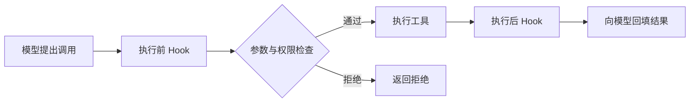

# Hooks 怎样介入工具执行前后

[← AI Agent 学习路线](README.md)

Agent 要调用任务查询工具时，应用可能需要检查参数、记录审计信息，并在结果交给模型前去掉不应暴露的字段。把这些公共处理分别写进每个工具，容易重复和遗漏。

Hook 是在某个明确执行位置调用的扩展逻辑。执行前 Hook 可以检查或修改参数，执行后 Hook 可以处理结果和记录事件。本文用虚构的任务查询工具说明设计，不绑定具体框架。

## 前后钩子分别能做什么

执行前 Hook 可以为参数补充经过服务端确认的默认范围、检查输入或拒绝调用。修改参数后，应用必须重新做结构校验和资源权限检查，不能把 Hook 当成可以绕过验证的通道。

执行后 Hook 可以裁剪返回字段、记录耗时或构造脱敏后的模型结果。工具返回中包含的第三方文本仍是不可信数据。审计记录与模型可见结果可以使用不同格式，不能把凭证或原始错误堆栈直接交给模型。

例如模型请求查询 `TASK-1002`，前置 Hook 先检查编号格式，应用再核对当前用户是否有权查询。工具成功后，后置 Hook 可以只保留状态和业务允许展示的原因。若工具返回权限错误，后置 Hook 不应把错误改写成“任务不存在”，除非这是业务明确采用的对外错误策略。

## 失败、顺序和时限

多个 Hook 同时存在时，应定义执行顺序、可修改字段与冲突规则。每个 Hook 都要有时间预算；安全检查失败或超时如何处理，要按操作风险事先定义。对发送、删除等高风险动作，无法完成必要检查时应停止执行。

执行后 Hook 失败时，工具可能已经产生副作用。不能把“后处理失败”当作“工具没有执行”，然后直接重试写操作。应保留工具执行状态，必要时根据业务标识对账。

例如周报已经由外部服务接收，但审计写入超时，系统应分别记录“发送结果”和“审计记录待补”。后续可以重试审计，不能为了补一条审计记录再次发送周报。若产品要求审计失败时禁止执行，则需要把必需的检查或记录放到执行前，并处理跨系统状态不一致。

## 钩子不能代替强制边界

Hook 可以提供扩展点，但权限校验、身份和执行隔离需要由应用及资源服务落实。若某个调用路径绕过 Hook，强制检查仍要生效。插件安装的 Hook 被卸载时，也应停止新任务引用，并处理在途调用。

验证需要覆盖前置拒绝、参数被修改、多个 Hook 冲突、超时、工具已成功但后置失败，以及无权访问资源等情况。记录触发顺序和结果，便于定位哪一层拒绝或修改了调用。
