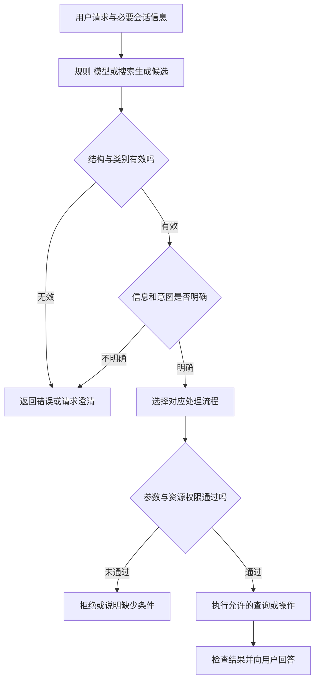

# 意图识别怎样进入请求路由

[← AI Agent 学习路线](README.md)

用户说“查一下 `TASK-1002` 的状态”，Agent 应用需要决定接下来做什么。它可以直接让模型在允许的工具中选择，也可以先由程序判断这是任务查询，再把请求交给相应处理流程。

这个判断过程常被称为意图识别。路由则负责根据已识别的需求、当前状态和业务规则，把请求交给合适的处理路径。意图识别只是选择路径的一种输入，工具调用能否执行仍需经过参数与权限检查。

意图识别不一定需要独立模型。工具少、边界清晰时，固定代码或由模型直接选择工具可能足够；场景多、工具集合大时，单独设计路由可以帮助控制候选范围。本文使用虚构的任务查询与日历安排场景，不代表某个产品实际采用的路由实现。

## 先明确系统能够处理什么

假设应用支持以下几类请求。

| 类别 | 示例请求 | 后续处理 |
|---|---|---|
| 任务查询 | 查一下 `TASK-1002` 的状态 | 检查编号和权限，查询任务服务 |
| 日历查询 | 看看明天下午有没有空 | 确认用户身份、时区和时间范围 |
| 创建日程 | 帮我约一个讨论会 | 检查时间、参与人和执行授权 |
| 闲聊 | 你好 | 使用对话流程，不访问业务数据 |
| 未知或无法判断 | 帮我处理一下 | 请求补充，或进入产品允许的其他路径 |

这些类别属于本应用的业务约定。定义边界时要同时准备正例、容易混淆的例子和不属于任何类别的请求；若没有“未知”出口，分类器可能为了满足格式而强行选一个不合适的类别。

“帮我看看今天的安排”可能既指任务也指日历，不能只靠相似词决定。若缺少决定性信息，先问用户希望查看哪一种。分类器给出的高分也不能保证它真的理解了用户。

## 一个请求可能包含多个意图

用户说“查一下任务状态，顺便看看明天下午有没有空”，同时涉及任务和日历。应用可以返回多个候选意图，再依据请求范围安排对应查询。

假设分类环节返回下面的示意结构。

```json
{
  "intents": ["task_query", "calendar_query"],
  "needs_clarification": false
}
```

这只是示例输出，不代表模型已经访问任何系统。程序应检查 `intents` 是否属于允许的枚举值、是否重复、数组是否过大，以及其他字段类型是否正确。[JSON Schema 的枚举约束](https://json-schema.org/understanding-json-schema/reference/enum)可用于限制字段的候选值。

结构合法以后还要核对业务条件。上面的日历查询需要明确时间范围与时区；若当前上下文不足，应补充询问，不能因为分类结果写了 `needs_clarification: false` 就直接猜。任务编号也要从用户消息或已经确认的上下文取得，不能由分类器编造。

路由结果表示“可能需要哪些处理”，不代表用户允许 Agent 执行所有操作。查询日历和创建日程是不同动作；创建操作还需要满足具体业务的授权与确认规则。

## 路由可以有不同实现

固定入口、关键词规则和模型判断都能参与路由。选择前先看请求规模与业务复杂度。

| 方式 | 适合的情况 | 需要留意 |
|---|---|---|
| 固定入口 | 用户点击“查询任务”等明确功能 | 一次请求跨多个功能时仍需协调 |
| 规则或关键词 | 编号、命令或业务字段很明确 | 同义表达、否定句和上下文容易漏掉 |
| 模型直接选工具 | 可用工具较少，描述清晰 | 模型可能误选，也可能直接回答 |
| 单独分类或工具搜索 | 场景多，希望先缩小候选范围 | 多一步调用或搜索，需要评估漏召回与延迟 |

同一产品可以组合几种方式。明确的任务编号可以先经程序校验，难以区分的自然语言再交给模型判断。模型直接选工具也是根据请求作判断，并不意味着程序一定额外调用了一个独立分类器。

对 MCP 工具，也可以先在应用的工具清单中查找候选，再按需提供完整定义。工具清单可以在连接后获取或按需发现，具体时机由应用决定。用户明确指定某项可用工具时，应结合授权和当前任务优先处理；不存在或不可用时要说明，不能声称已经调用成功。[MCP 工具规范](https://modelcontextprotocol.io/specification/2025-11-25/server/tools)规定了工具发现与调用，具体怎样选择候选由应用实现。

## 从分类结果走到受控执行



对多意图请求，应用需要为每一项分别检查所需参数和权限。任务查询成功、日历查询失败时，应分别报告结果，不把前一项成功当作整次请求完成。

中途可能出现新的信息。用户补充“我说的是下周”，应用需要更新当前请求的时间范围；用户又说“顺便帮我查任务”，则需要重新判断新增需求。路由可以按回合更新，不必把会话第一句的分类永久固定。

## 分数与阈值怎样用

有些分类器会输出置信度或概率，便于设置自动处理和澄清的分支。它们的数值不一定经过校准，`0.9` 不能直接解释成线上九成正确。不同类别、不同输入和多意图请求可能有不同误差，需要用实际标注数据检验。

阈值可以从业务代价出发试验。把一条任务查询分到闲聊可能造成漏处理；把闲聊误分成写操作则可能产生更高风险。高风险动作不能只靠分类分数放行，仍需要工具和业务系统的授权检查。

## 怎样评估是否值得加路由

准备覆盖真实表达方式的样本，标注应走的处理路径及所需参数。按类别观察准确率、召回率、未知请求处理和多意图覆盖，再结合最终任务是否完成评估，而不是只看分类格式是否正确。

| 样本 | 应检查的行为 |
|---|---|
| 明确任务编号的查询 | 找到任务查询路径，保留用户提供的编号 |
| “它现在怎么样” | 利用已确认的会话对象；没有对象时澄清 |
| 任务查询加日历查询 | 两项都被识别，分别检查参数和权限 |
| “不要创建日程，只看看时间” | 保留否定条件，不执行创建 |
| 闲聊中提到“任务” | 不仅凭关键词访问业务系统 |
| 分类结果包含未知类别或格式错误 | 拒绝该结果，按错误处理或澄清 |
| 用户请求访问无权查看的任务 | 业务服务拒绝访问，不泄露资源内容 |

对同一批样本比较“模型直接选工具”和“先路由再选工具”，记录最终任务完成情况、误选与漏选、延迟和 Token 消耗。路由增加了调用，也可能减少后续工具说明；具体是否划算，要根据实际任务测量，不能只凭组件数量判断。
