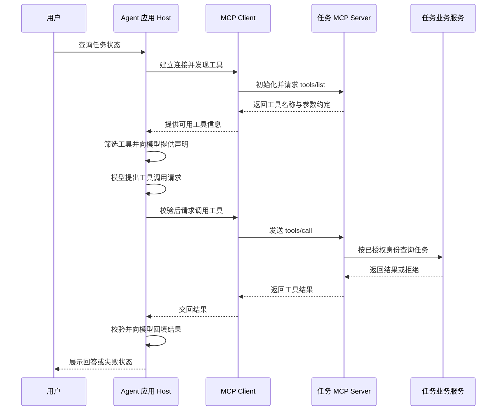

# MCP 怎样接入外部工具

[← AI Agent 学习路线](README.md)

[前面的工具调用](function-calling.md)由应用直接连接任务查询服务。工具少的时候，可以在应用里维护固定的名称和处理器。随着日历、文档、任务系统都要接入，不同服务的发现方式、参数格式和调用方式可能各不相同。

MCP 全称 Model Context Protocol，是用于 AI 应用与外部能力交换信息的协议。服务端可以通过统一的协议形式提供工具、资源和提示模板。应用连接服务以后，仍需决定向模型开放哪些能力，以及哪些调用可以执行。[MCP 官方架构说明](https://modelcontextprotocol.io/docs/2025-11-25/learn/architecture)把协议范围限定在上下文交换，并不规定应用如何使用模型或组织 Agent 循环。

本文沿用虚构任务查询服务，按照 MCP `2025-11-25` 版本说明接入过程。示例中的工具与数据都是教学用结构，不连接真实服务；实际接入时以双方协商的版本和对应规范为准。

## 先分清应用、客户端与服务端

在 MCP 中，Host 是承载用户交互和模型调用的应用。Host 可以创建 MCP Client，客户端负责与对应的 MCP Server 建立连接。Server 提供能力，本例中的 Server 将任务查询封装为工具，再连接后面的业务服务。



图中将初始化和发现合并表示。Host 也可能预先连接 Server，发现工具后多次复用；每次调用仍需检查当前用户和资源权限。

模型一般不直接持有 MCP 连接。在这个示例中，Host 将 MCP 工具的信息适配成模型接口接受的工具声明。模型返回工具请求后，Host 才通过 Client 请求 Server 执行。模型接口的 Function Calling 与 MCP 连接因此处在两段不同的通信过程中。

## 连接后先发现工具

客户端与服务端先完成初始化，协商支持的协议版本和能力，再进入正常请求阶段。若双方无法使用共同版本，连接应结束。初始化结束后，客户端通过 `tools/list` 获取工具定义。相关顺序见 [MCP 生命周期规范](https://modelcontextprotocol.io/specification/2025-11-25/basic/lifecycle)。

下面是 `tools/list` 的简化响应，省略初始化过程。`id` 对应这一次 JSON-RPC 请求，`inputSchema` 使用 JSON Schema 描述工具参数。JSON-RPC 是一种用方法名、参数和请求标识组织消息的协议。

```json
{
  "jsonrpc": "2.0",
  "id": 1,
  "result": {
    "tools": [
      {
        "name": "get_task_status",
        "description": "查询当前用户有权访问的任务状态",
        "inputSchema": {
          "type": "object",
          "properties": {
            "task_id": {"type": "string"}
          },
          "required": ["task_id"],
          "additionalProperties": false
        }
      }
    ]
  }
}
```

发现工具并不等于自动向所有用户开放。Host 可以按服务来源、用户权限和当前任务筛选，再将名称、描述与参数结构转换为模型接口要求的格式。不同 Server 可能提供同名工具，应用需要维护本地唯一名称与 Server 的映射，不能仅凭名字把调用发到任意连接。

工具列表可能分页，支持变更通知的 Server 也可能在运行时更新列表。客户端应按实际协商的能力处理分页和刷新；刷新后的工具仍需重新经过允许列表与权限检查。[工具规范](https://modelcontextprotocol.io/specification/2025-11-25/server/tools)定义了 `tools/list`、`tools/call` 和列表变更通知。

## 一次调用跨过了两种接口

假设模型请求 `get_task_status`，参数为 `TASK-1002`。Host 检查工具来源、参数、权限与剩余预算后，让 MCP Client 发出请求。

```json
{
  "jsonrpc": "2.0",
  "id": 2,
  "method": "tools/call",
  "params": {
    "name": "get_task_status",
    "arguments": {"task_id": "TASK-1002"}
  }
}
```

假设查询成功，Server 返回以下内容。`content` 是 MCP 工具结果的内容列表，里面的 `text` 在本例中承载序列化后的业务数据。外层的 `isError` 表示这次工具执行报告成功或失败。

```json
{
  "jsonrpc": "2.0",
  "id": 2,
  "result": {
    "content": [
      {"type": "text", "text": "{\"task_id\":\"TASK-1002\",\"status\":\"blocked\"}"}
    ],
    "isError": false
  }
}
```

这次 MCP 请求的 `id` 用于匹配 MCP 响应。模型接口返回的工具调用也有自己的标识，应用必须分别保存两者的关联，不能假设它们相同。Host 检查返回内容和任务编号后，再按模型接口的要求，把结果作为对应的工具消息回填。

协议请求本身可能失败，例如请求格式错误或方法不存在；调用成功到达工具后，业务查询也可能失败，例如任务服务暂时不可用。前者可能表现为 JSON-RPC 的 `error`，后者可以通过工具结果中的 `isError` 表达。连接中断或超时还可能导致结果未知，不能把任何一种情况都当作查到了任务状态。

## 选择连接方式，也要落实权限

本地集成常用 stdio，客户端启动 Server 子进程，通过标准输入和标准输出交换协议消息。标准输出需要留给协议消息，日志通常写到标准错误。启动脚本、可执行文件和继承的环境变量都需要检查，给本地进程的文件与网络权限也要控制。

远程服务可以使用 Streamable HTTP。客户端和 Server 通过 HTTP 交换消息，服务端可按协议使用 SSE 传递流式消息。SSE 即服务端通过 HTTP 持续发送事件的方式。实际接入时要处理连接认证、网络加密和超时。[传输规范](https://modelcontextprotocol.io/specification/2025-11-25/basic/transports)要求 Server 在收到 Origin 请求头时检查其有效性，并建议本地 HTTP 服务绑定回环地址，防止不必要的暴露。

无论使用哪种方式，工具描述和参数结构都不能代替授权。应用按用户、任务与工具制定允许范围；任务服务根据可信身份检查具体资源。模型生成的 `user_id` 或工具描述里的“只读”都不能作为授权证明。涉及写入或外部发送时，应按照实际风险设置确认与审批。

远程 Server 的访问令牌需要按接收方和授权范围管理，不能把客户端拿到的任意令牌直接转发给下游。外部工具的描述与返回内容也可能携带恶意指令，应当视为不可信数据。[MCP 安全建议](https://modelcontextprotocol.io/specification/2025-11-25/basic/security_best_practices)讨论了令牌透传、远程服务和本地 Server 等风险。

## 除了工具，还能提供什么

MCP Server 还可以提供 Resources 和 Prompts。Resources 是可供应用读取的上下文资源，例如任务系统的字段说明；Prompts 是供应用使用的交互模板。它们与 Tools 的侧重点不同，应用应根据实际需要选择读取和使用方式，具体支持情况以双方协商的能力为准。

MCP Prompt 与本仓库后续要讲的 Skill 也不能直接画等号。Skill 可能包含一组说明、资源和执行约定，MCP 则负责应用与服务之间的协议交互。它们可以组合，Skill 的具体加载与执行会在后续文章展开。

## 接入完成后怎么验证

先用可控的测试 Server 检查连接、工具发现和调用，再连接实际业务服务，验证身份和数据边界。下面是应覆盖的情况，不代表仅靠示例就完成了真实环境测试。

| 测试情况 | 应检查的行为 |
|---|---|
| 版本不兼容或初始化失败 | 不继续调用工具，返回明确连接错误 |
| 工具列表分页或发生变化 | 正确获取并刷新，重新应用开放策略 |
| 两个 Server 提供同名工具 | 调用被路由到预期 Server |
| 参数缺失或多出未允许字段 | 拒绝执行或返回校验错误 |
| 用户没有任务访问权限 | 不泄露任务数据，业务服务执行资源级鉴权 |
| Server 返回 `isError` 或连接超时 | 保留失败状态，不把错误包装成查询成功 |
| 返回内容含有越权操作指令 | 作为不可信数据处理，工具权限不因此改变 |

MCP 让应用能够按照统一协议接入工具服务。至于一次任务要查几次、何时停止，仍由应用的执行流程控制。把它放回 [ReAct 循环](react-observation-loop.md)中，MCP 负责承接受控的工具调用，循环则根据每次观察决定是否继续。
