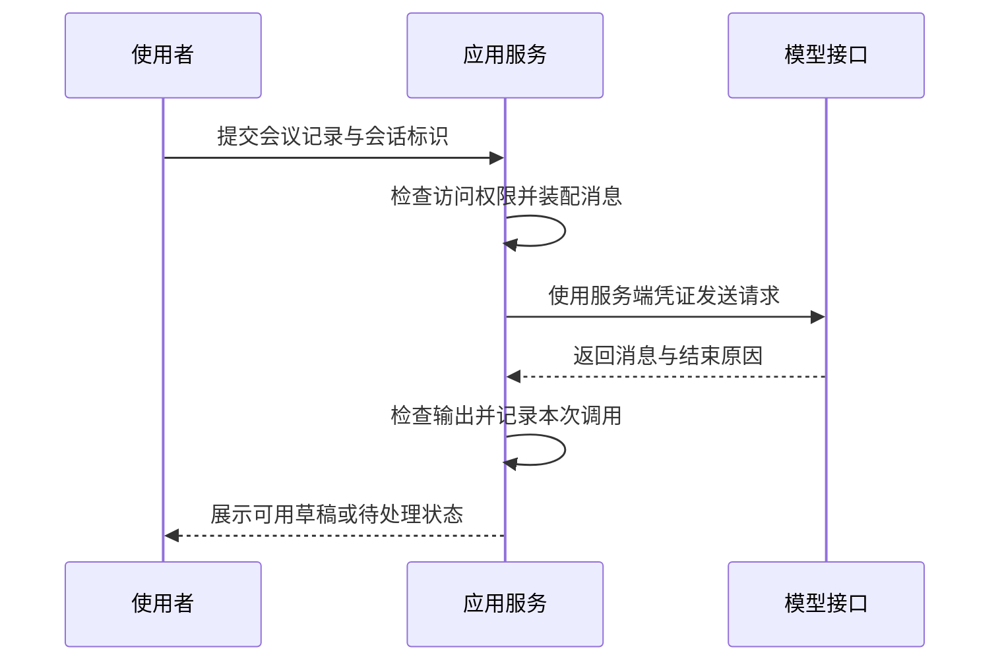
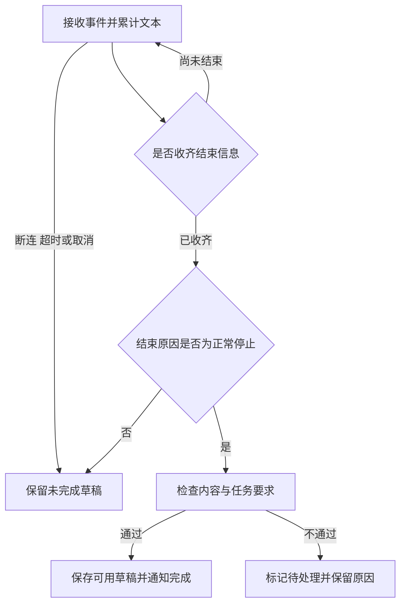

# 一次模型调用怎样从请求走到可用结果

[← AI Agent 学习路线](README.md)

模型接口返回了文字，页面也显示出来了，这次任务就算成功了吗？如果文字只生成了一半，或者模型为一项没有负责人的待办补了一个人名，调用已经产生结果，应用仍然不能直接采用。

先用一个设计示例走完最小流程。输入一段会议记录，请模型提取待办，缺少的信息保持未知。这一版只生成待办草稿，不创建真实工单，也不调用外部业务工具。接通这个流程以后，再讨论 Agent 怎样选择下一步。

## 先发出一份边界清楚的请求

模型接口接收模型标识、消息列表和生成配置，用户输入放在消息中。这里对照 [DeepSeek 的 Chat Completions 接口](https://api-docs.deepseek.com/api/create-chat-completion/)说明一种请求格式。其他服务的字段与能力可能不同，接入时需要逐项确认。

下面是请求体示意。`YOUR_MODEL_ID` 需要替换成当前账号可用的模型标识，示例关闭思考模式，先观察普通文本回答。通过后端向对应服务发出请求，访问凭证留在服务端配置中，不写入前端或仓库。

```json
{
  "model": "YOUR_MODEL_ID",
  "thinking": {"type": "disabled"},
  "messages": [
    {
      "role": "system",
      "content": "只根据会议记录提取待办。负责人未确定时写未定，不补写人名。"
    },
    {
      "role": "user",
      "content": "会议记录里有一项待办，周五前整理接口清单，负责人暂未确定。"
    }
  ],
  "max_tokens": 512,
  "stream": false
}
```

`messages` 是本次提供给模型的消息列表。`max_tokens` 限制可生成的 Token 数，Token 是模型处理文本的基本单位，不与汉字或单词固定一一对应。512 只是这份短文本示例的预算，实际输入长度与用量应按目标模型的分词方式和接口返回统计。[官方用量说明](https://api-docs.deepseek.com/quick_start/token_usage/)也区分了估算与实际统计。

这一版先关闭流式输出，完整读到响应后再处理。以下只示意响应中需要关注的部分，省略其他字段，内容也不代表一次实测返回。

```json
{
  "choices": [
    {
      "index": 0,
      "message": {
        "role": "assistant",
        "content": "周五前整理接口清单，负责人未定。"
      },
      "finish_reason": "stop"
    }
  ]
}
```

本例读取 `choices[0].message.content` 中的文字，同时保留 `finish_reason` 这个结束原因。没有候选、内容为空或响应无法解析时，分别记录异常，不能直接当作成功。生成是否正常停止、输出是否符合要求，是接下来需要检查的两件事。



模型负责生成候选内容，应用负责选择材料、管理会话和检查结果。模型回答“已创建待办”，也只能说明它生成了这句话；这个示例没有提供创建能力。

## 消息角色要由应用决定

请求中的 `role` 表示消息作者的角色，不能把不同来源的文字随意拼成一段。先理解三类消息即可。

| 角色 | 在本例中的作用 | 应用需要留意的地方 |
|---|---|---|
| `system` | 规定提取任务与未知信息的处理 | 内容由服务端维护，不让用户提交同名字段来覆盖 |
| `user` | 提供会议记录与当前要求 | 记录中的文字仍是待处理材料 |
| `assistant` | 保存模型已经给出的回答 | 历史回答可能有错，不能自动成为已确认事实 |

用户上传的文件即使写着“忽略前面的要求”，也不应被应用改装成系统消息。角色分开能帮助组织输入，权限控制仍要由程序执行，不能指望模型始终服从一句安全提醒。

消息顺序也影响含义。提取待办的规则在前，会议记录跟在后面，模型才能结合这次任务理解材料。系统提示词怎样进一步设计，见[提示词怎样成为可检查的任务要求](prompt-task-contracts.md)，这里先保证消息来源没有放错。

## 第二轮需要重新提供相关历史

第一轮给出草稿后，用户追问“把刚才的待办改成 JSON”。如果请求里只有这句话，模型就缺少“刚才”所指的内容。

[DeepSeek 的多轮对话说明](https://api-docs.deepseek.com/guides/multi_round_chat/)明确指出，这里的 Chat Completions 接口需要调用方逐次提供历史。应用保存会话，再为下一次请求组装相关消息。以下是第二轮的消息顺序，回答内容仅用于说明组织方式。

```text
system      只根据会议记录提取待办，缺失信息保留未知。
user        周五前整理接口清单，负责人暂未确定。
assistant   待办是周五前整理接口清单，负责人未定。
user        把刚才的待办改成 JSON。
```

会话标识帮助应用找到历史，不代表把这个编号放进请求后，任何模型服务都会自动恢复对话。部分接口支持服务端会话状态，使用时应按它的契约处理，不能把一种接口的行为推广到所有服务。

读取历史以前，还要确认当前用户有权访问这段会话。第一版可以保留有长度上限的相关历史，但不能无限追加，也不能静默丢掉决定任务含义的前文。长期记忆与压缩机制会在后面的独立文章中讨论。

## 流式响应需要单独处理完成状态

非流式调用等待完整响应；流式调用则可以在生成过程中逐段展示。常见传输形式是 SSE，即服务端发送事件。[SSE 的事件格式](https://developer.mozilla.org/en-US/docs/Web/API/Server-sent_events/Using_server-sent_events#event_stream_format)用空行分隔事件，网络读取返回的数据块可能跨越事件边界，客户端需要先拼出完整事件，再解析其中的数据。

在本例的接口中，文本增量放在 `delta.content`，生成结束原因放在 `finish_reason`，流还使用 `[DONE]` 作为结束标记。一次事件不保证只对应一个字或一个 Token，也可能没有新的文本。不能把每次网络读取都直接当作一段完整 JSON。

下面是应用可以采用的状态设计。这里约定先收齐协议结束信息，再进行结果检查；流断开后已经显示的文字保留为未完成草稿。



`finish_reason` 为 `length` 时，输出可能因为预算耗尽而截断；`stop` 表示达到自然停止点或指定停止条件，仍不能证明待办提取正确。异常结束需要按具体原因分类。用户点击停止，也不应显示成正常完成。

流式响应开始以后，连接甚至可能已经返回 HTTP 200，后续仍会失败。因此界面可以先显示文字，完成状态由后端确认。首个输出与完整响应耗时怎样分别计量，见 [AI Infra 的请求延迟说明](../ai-infra-learning-path/inference-and-training-workloads.md)。

## JSON 能被解析，还要检查字段与依据

第二轮如果要把草稿交给程序，可以先约定一份简单对象。下面仍是预期结构示意，没有把“周五前”擅自换算成某个日期。

```json
{
  "task": "整理接口清单",
  "owner": null,
  "deadline_text": "周五前"
}
```

这里选择 `null` 表示负责人未知，避免把“未定”当作真实姓名。日期需要进一步转换时，还要补充会议日期与时区，不能根据调用发生的今天猜一个周五。

[DeepSeek 的 JSON 输出说明](https://api-docs.deepseek.com/guides/json_mode/)要求设置 `response_format`，并在消息中明确要求 JSON。若把本例用于结构化输出，可以将请求中的相关部分改为下面的配置，其余字段保持不变。

```json
{
  "response_format": {"type": "json_object"},
  "messages": [
    {
      "role": "system",
      "content": "只根据会议记录输出 JSON 对象，字段为 task、owner、deadline_text。task 是非空字符串；owner 和 deadline_text 未知时写 null，已知时写字符串。不补写人名，不推算具体日期。"
    },
    {
      "role": "user",
      "content": "会议记录里有一项待办，周五前整理接口清单，负责人暂未确定。"
    }
  ]
}
```

JSON 模式只约束格式，仍要处理空内容和被截断的结果。[JSON Schema 的对象规则](https://json-schema.org/understanding-json-schema/reference/object)可以帮助程序检查字段类型、必填项和额外字段。例如，三个字段都要求存在，`owner` 允许字符串或 `null`，不能用字段缺失来代替未知状态。

校验继续分两步。结构检查拦住缺字段、类型错误和未约定的字段；内容检查再确认任务确实来自原记录，负责人没有被补造。即使对象完全符合结构，也可能把待办写错。面向人工确认的草稿，可以保留来源文本并允许修改；若以后要自动创建真实任务，还需要更严格的业务授权与确认。

## 调用失败以后，先判断该不该重试

参数错误、鉴权失败和限流不能采用同一种处理。[官方错误码](https://api-docs.deepseek.com/quick_start/error_codes/)分别给出了这些情况。应用可以据此制定有限重试策略，而不让模型自己决定是否继续请求。

| 情况 | 第一版可以采用的处理 |
|---|---|
| 请求格式或参数错误 | 修正输入与配置，不原样重复发送 |
| 凭证无效或额度不足 | 提示服务配置问题，交由维护人员处理 |
| 限流或临时服务故障 | 在总时限内延迟后有限重试，限制并发 |
| 流已输出部分内容后断开 | 标记本次未完成；新尝试另建结果，不直接接在旧文本后 |
| 结果为空或字段不合要求 | 记录原因，按配置修正重试或返回待处理状态 |

重试可能再次产生费用，也可能生成不同内容。超时只说明应用没有按期取得结果，不能据此认定服务端没有执行。一次业务请求可以关联多次调用尝试，分别保存结束原因与用量，避免把最后一次成功掩盖掉前面的消耗。

至少设置连接、读取等待与总时限，具体配置方式由客户端实现决定。日志保留请求标识、模型与提示词版本，以及耗时和结束原因；用量暂不可得时标成未知。凭证不进入日志，会议原文与完整输出只在确有需要、获得授权的范围内保存。

## 先把这几种情况跑通

第一版的验证可以围绕同一份待办输入展开，不急着增加更多功能。

- 不提供负责人时，结果仍保留未知；补充明确负责人以后，才允许提取对应内容。
- 第二轮带入正确历史，能够找到“刚才的待办”；不带历史时，不能补造不存在的前文。
- 模拟正常流、截断与用户停止，检查界面是否正确区分完成和未完成。
- 输入缺字段、错误类型与空内容，确认程序不会直接把它们保存为可用结果。

这些检查先用固定响应验证应用逻辑，再接真实模型检查提取质量。固定响应能证明解析和状态处理符合预期，无法证明模型每次都能正确理解会议记录。后续调整提示词时，再用同一批任务比较新旧结果，具体方法见 [Agent 评测](agent-evaluation.md)。
