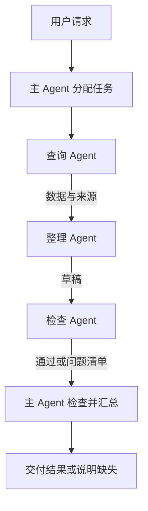

# 多 Agent 怎样分工并交付共同结果

[← AI Agent 学习路线](README.md)

一份任务周报需要查询数据、整理内容和核对来源。这些工作可以由一个 Agent 完成，也可以拆给多个 Agent。分工后，每个参与者负责的任务更窄，但系统必须处理交接、超时和结果冲突。

本文用虚构的任务周报说明一种协作设计，不代表真实团队或实际运行结果。

## 先确定每个人交付什么

假设主 Agent 将任务拆为三项。

| 角色 | 输入 | 输出 | 不负责什么 |
|---|---|---|---|
| 查询 Agent | 已确认的时间范围与用户授权 | 任务数据和来源 | 修改任务 |
| 整理 Agent | 已授权的数据和报告要求 | 带来源标识的草稿 | 扩大查询范围 |
| 检查 Agent | 草稿与查询结果 | 错误、遗漏和待确认项 | 自行发布周报 |

角色名是系统设计中的职责标签，不要求三个角色必须使用不同模型，也不意味着三个独立服务。一个进程内的多个受控执行单元同样可以承担这些任务。

拆分时先检查依赖。整理依赖查询结果，检查依赖草稿；这三步不能为了并行而无视顺序。对多个项目分别查询时，可以并行，但每项查询仍须独立校验授权。

## 交接要带上范围和证据

主 Agent 发给查询 Agent 的子任务应包含目标、时间范围、允许访问的资源和期望输出。任务标识用于关联结果，权限由执行环境和业务服务检查，不能只靠一段文本声明。

返回结果可以用结构化字段区分成功、部分成功和失败，并保留来源。结构化数据有利于程序验证字段，但不会自动保证事实正确。整理 Agent 不能把缺失的查询结果补成“没有受阻任务”。

检查 Agent 应该能看到支持判断的证据。只把草稿交给另一个模型，让它说“看起来没问题”，无法证明数据真实。权限不允许传递的内容不能因为要复核就绕过访问控制。

## 部分失败怎样处理

查询 Agent 超时后，主 Agent 可以在预算内重试只读查询，也可以交付明确标注缺失范围的草稿。不能把超时转换为零条结果。多个查询成功与失败混在一起时，结果中要保留各自状态，供汇总判断。

检查 Agent 发现数据冲突时，先核对来源版本和时间，再决定是否重新查询或请求用户澄清。若检查和整理反复循环，需要限制修改次数；审查意见相互矛盾时，不能让它们无限互评。

多 Agent 会增加模型调用、上下文复制和协调成本。用户需要简单查询时，单 Agent 加工具更容易验证。拆分值得做的条件通常是子任务确有独立边界、可以复用或需要不同权限，而不是角色越多越好。

## 并发、权限与验收

任务分派应为每个子任务记录标识、输入范围、剩余时限及取消状态。主任务取消以后，向子任务传播取消请求，但远端已开始的动作未必能立即终止，需要检查实际结果。子 Agent 不应继承超出任务所需的全部凭证。

评测时准备完整成功、一个子任务失败、两份结果冲突和用户中途取消等样本。检查每个交付是否有来源，子任务有没有越权，最终回答是否诚实说明缺失项。追踪跨组件调用可参考 [OpenTelemetry 的上下文传播](https://opentelemetry.io/docs/concepts/context-propagation/)，它帮助关联执行记录，不能代替业务验收。

子任务如何隔离上下文、接受委派和返回结果，继续看[子代理怎样接受委派并返回结果](subagent-delegation.md)。
