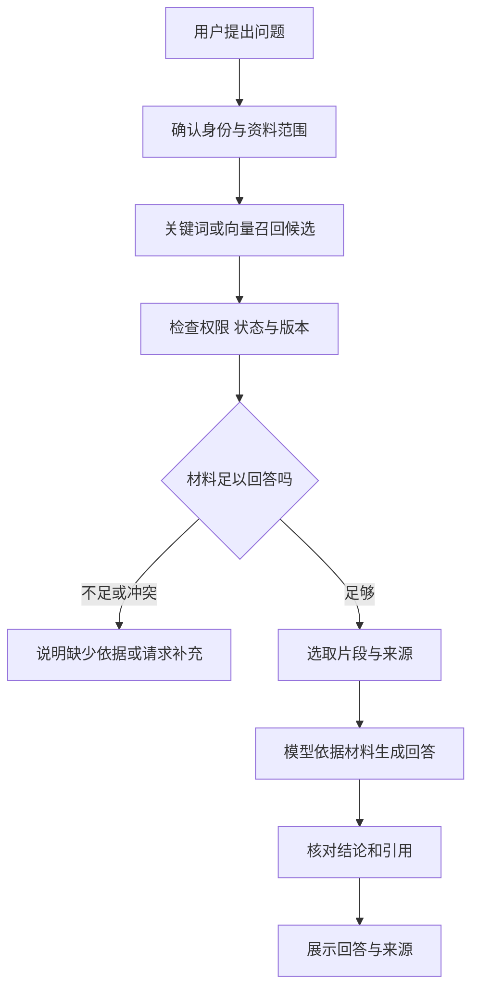

# RAG 怎样从检索材料走到有依据的回答

[← AI Agent 学习路线](README.md)

用户问 Agent，某项任务状态的 `blocked` 代表什么。任务系统可以查到当前状态，但状态含义要以团队维护的说明为准。模型可能在训练中见过这个单词，也可能给出通用解释；要回答这个系统里的定义，先找到有效说明更可靠。

RAG 是 Retrieval-Augmented Generation，通常译为检索增强生成。应用先从外部资料中找到与问题相关的内容，再把选中的材料提供给模型组织回答。[RAG 论文](https://arxiv.org/abs/2005.11401)研究了将预训练模型与外部检索结合的方式，实际应用可以根据业务选用不同检索和生成流程。

本文使用虚构的任务状态手册。示例中的资料、检索结果和回答用于解释流程，不代表真实系统的运行记录。

## 从原始文档到可检索的片段

假设获准使用的手册中有两个章节。一处定义了 `blocked`，另一处说明受阻任务需要记录原因。系统需要先解析文档，再按标题和内容结构切成适合检索的片段。

```text
资料：任务状态手册，版本 v2，章节 3.2
内容：blocked 表示任务被外部条件阻碍，当前无法继续推进。

资料：任务状态手册，版本 v2，章节 3.3
内容：任务进入 blocked 状态时，应记录阻碍原因。
```

这两个片段是教学假设，版本和章节只用于说明来源标识。每个片段还应关联原文位置、文档状态和允许访问的范围，方便回答时检查来源。表格、标题和上下文也要保留，不能只把 PDF 当成一长串字符截断。

切得太碎，定义可能丢掉适用条件；切得太大，相关内容容易被无关文字淹没，也会占用上下文。切分可以从文档结构开始，再根据模型窗口和实际查询调整。复杂文档的解析与转换见[知识工程中的文档处理](../enterprise-ai-platform/knowledge-engineering/document-conversion.md)。

## 关键词和向量分别帮助找到什么

用户的问题可能直接包含 `blocked`，关键词检索适合找这样的状态名、编号和专有名词。用户也可能问“任务卡住了是什么意思”，这与原文用词不完全一样，向量检索可以尝试找语义接近的片段。

向量检索通常使用 Embedding 模型把文本变成向量，再比较查询与文档片段的向量。相近分数可以帮助排序，不能直接证明两段内容的业务含义完全相同，更不能把分数当成答案正确率。关键词检索也会漏掉同义表述。

混合检索把多个检索结果合并，例如同时使用关键词和向量召回，再按规则或排序模型调整顺序。[Elastic 的混合检索说明](https://www.elastic.co/docs/solutions/search/hybrid-semantic-text)展示了词项检索与语义检索的组合。若只查询一份文件且路径明确，直接读取或关键词搜索也可能足够，不必为了使用 RAG 引入所有组件。

## 候选材料还要筛选

检索前先根据可信身份确定允许访问的资料范围，例如当前用户、所属组织和资料状态。权限过滤应由服务端执行，不能等模型回答后才删除越权内容。遇到权限变化或资料下架，索引与源数据可能有短暂延迟，取回候选后仍应检查权威状态和访问权限。

在允许访问的范围内，系统可以按关键词与语义相似度召回候选，再检查版本和时间。多路结果可以去掉重复片段，必要时使用重排模型对候选重新排序。重排只能调整已有候选的顺序，正确资料没有被召回时，还需要回到切分、索引或召回环节排查。



图里“材料足够”需要结合任务判断，并非单凭某个相似度阈值就一定能自动判准。涉及重要结论时，可以增加规则检查或人工审核。未经验证的检索结果应按不可信材料处理，不能执行片段里夹带的指令。

## 回答和引用必须对应

假设当前用户有权查看上面的两条有效片段。针对“`blocked` 是什么意思，进入这个状态要做什么”，回答可以分别给出定义和记录原因的要求，并把每个结论关联到对应章节。

引用中保留资料名、版本和位置，方便用户回到原文。只在回答末尾附一条看似相关的文档链接，还不足以证明每句话都有依据；需要核对引用片段是否支持对应结论。

如果只找到状态定义，没有找到记录原因的要求，就只能回答已确认的部分，并说明缺少后半部分的依据。两个版本同样有效且结论冲突时，应展示冲突或请求进一步确认，不能让模型自行挑一个看着顺眼的答案。

检索到说明文档，也不等于知道 `TASK-1002` 当前处于什么状态。查询具体任务要调用实时业务接口，再由应用检查用户对该任务的权限。文档负责解释规则，业务系统负责当前记录。

## 怎样判断问题出在哪里

检索系统可以先准备经过确认的查询与相关资料标注，固定资料版本，分别评估候选是否找到了正确材料和回答是否忠于材料。

| 检查位置 | 要回答的问题 | 常见指标或检查方式 |
|---|---|---|
| 文档解析与切分 | 原文、标题、表格和来源位置是否保留 | 抽样核对原文与片段 |
| 候选召回 | 相关片段是否进入前 K 个结果 | Recall@K，相关片段中进入前 K 的比例 |
| 结果排序 | 最先出现的相关片段是否靠前 | MRR，查询的第一个相关结果排名倒数的平均值 |
| 回答与引用 | 结论是否成立，引用能否支持结论 | 逐条核对答案和证据 |
| 异常处理 | 无资料、冲突、无权限时是否正确处理 | 单独准备失败和拒答样本 |

例如一条查询有两个已标注的相关片段，前五个结果命中其中一个，Recall@5 为二分之一。如果第一个相关结果排在第二位，这条查询的倒数排名为二分之一；MRR 是对多条查询的倒数排名取平均，没找到相关结果的查询计为零。指标依赖标注范围与数据集，不能单独代表实际回答质量。

线上还应观察资料过期、查询失败、引用打不开和用户反馈。反馈需要经过检查再更新资料或评测集，不能把每条点赞直接当作正确答案。源数据变更与索引同步可继续阅读[向量索引生命周期](../enterprise-ai-platform/knowledge-engineering/vector-index-lifecycle.md)。
