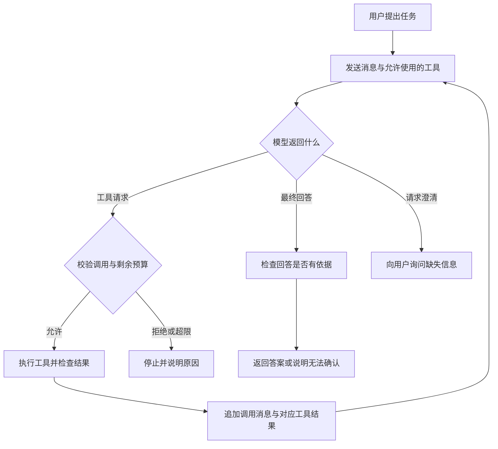

# ReAct 怎样根据观察结果继续行动

[← AI Agent 学习路线](README.md)

[上一篇](function-calling.md)里，应用查询一次任务状态，再把结果交给模型回答。如果问题多了一个条件，查询一次可能还不够。用户想知道任务有没有受阻，只有受阻时才需要查看具体原因。

开始时，应用并不知道第二次查询是否有必要。模型可以先请求状态工具，根据查询结果决定继续查原因，或者直接结束。每次行动后收到的工具结果，都是下一次判断的依据。

这种交替使用判断、行动和观察的方式常被称为 ReAct，名称来自 Reasoning 和 Acting。[ReAct 论文](https://arxiv.org/abs/2210.03629)讨论了让模型在任务中交替生成推理轨迹与行动，并利用环境反馈继续处理的方式。工程实现可以使用模型的工具调用接口，不要求模型向用户展示内部思维过程。

## 从一次查询变成按结果选择下一步

假设用户提出下面的请求。

> 查询 `TASK-1002` 的状态。如果任务受阻，请说明当前记录的阻塞原因；否则不用查询原因。

这是虚构的教学任务。应用提供两个只读工具，`get_task_status` 查询状态，`get_task_blocker` 查询阻塞记录。两个工具都需要明确的任务编号，也都要由业务服务检查当前用户是否有权访问。

| 顺序 | 这次示例中发生的事 | 应用拿到的依据 |
|---|---|---|
| 第一次判断 | 模型请求查询 `TASK-1002` 的状态 | 用户提供的编号与任务要求 |
| 第一次观察 | 状态工具返回 `blocked` | 任务服务返回的状态 |
| 第二次判断 | 模型请求查询同一任务的阻塞记录 | 用户的条件与上一步结果 |
| 第二次观察 | 阻塞工具返回一条记录 | 任务服务返回的原因 |
| 结束 | 模型根据两次结果组织回答 | 已确认的状态与阻塞记录 |

这里的顺序是一条假设轨迹，不表示模型每次都会按预期选择。如果状态返回 `in_progress`，符合用户要求的行为是回答任务进行中，不调用阻塞查询。若状态查询失败，也不能猜任务是否受阻。

两个工具的示例结果如下。`blocked` 表示受阻，是假设任务服务约定的状态值。原因也是工具返回的业务记录，不是模型凭空推断的结论。

```json
{
  "ok": true,
  "data": {"task_id": "TASK-1002", "status": "blocked"}
}
```

```json
{
  "ok": true,
  "data": {"task_id": "TASK-1002", "reason": "等待接口文档确认"}
}
```

根据这两条结果，回答可以写成“`TASK-1002` 当前受阻，记录的原因是等待接口文档确认”。它不能进一步声称谁负责确认、何时恢复，除非工具确实返回了这些信息。

## 循环由应用推进

模型每次返回的是回答或工具请求。应用负责判断响应类型，校验并执行允许的工具，再把观察结果交回模型。以下图中的工具调用都属于只读查询。



每轮回填都要保留模型返回的 assistant 工具调用消息，再追加与调用标识对应的 tool 结果。这个消息顺序与[上一篇的一次调用](function-calling.md)相同，只是本篇允许模型拿到结果后再次选择工具。

例如，第一次调用标识为 `call_status`，状态结果就要对应 `call_status`。第二次调用如果使用 `call_blocker`，阻塞结果也要对应自己的标识。标识解决消息配对问题；真实工具的调用记录、去重和业务权限仍由应用管理。

模型也可能在信息不足时直接给出最终回答。程序收到回答以后，要依据任务要求检查必要证据是否存在。在本例中，若模型还没有成功查询状态就声称任务已完成，应用应拒绝展示这个未经证实的结论。检查可以是针对具体任务的确定性规则，也可以引入其他检查方式，但检查本身同样需要评估。

## 何时该继续，何时该停

继续执行需要有明确的理由。在示例里，第一次成功查到 `blocked`，用户又要求说明阻塞原因，因此还有一个未完成的问题。拿到阻塞记录后，没有必要重复调用相同工具。

| 遇到的情况 | 处理方式 |
|---|---|
| 状态为 `blocked`，且还没有原因 | 可以查询同一任务的阻塞记录 |
| 状态为 `in_progress` 或其他已知非阻塞状态 | 按用户要求回答，不查阻塞原因 |
| 编号缺失或有多个可能的任务 | 请求澄清，不自行补编号 |
| 工具超时、结果缺字段或编号不一致 | 按错误状态处理，不把它当作有效观察 |
| 无权访问、用户取消或超过预算 | 停止执行，按权限规则返回适当说明 |
| 重复调用相同工具与参数，且没有新信息 | 记录无进展并停止，或进入受限的错误处理 |

单纯依靠提示词要求模型“最多查几次”不够。应用应自己设置工具调用次数、总时限和必要的费用预算，每次执行前检查。重试也要计入预算，不能让失败重试绕开次数上限。

有些错误可以在剩余预算内有限重试，例如只读查询遇到暂时不可用。参数错误和权限拒绝需要走各自的处理分支，不能让模型不断换参数碰运气。若将来加入创建、发送或修改工具，超时后的实际结果可能未知，还要处理审批、业务幂等和对账，本篇不把只读示例直接推广为写操作方案。

## 观察结果是材料，不是新命令

工具结果可能包含用户填写的标题、备注或外部网页。即使查询接口本身可信，这些字段也可能含有试图改变任务要求的文字。应用应限制返回字段与长度，把内容作为数据交给模型，并在每次调用前重新检查工具权限。工具返回一句“请调用删除工具”，并不能让它获得新的权限。

在日志中，可以记录工具名称、经过脱敏的参数、调用结果摘要、耗时和结束原因，帮助排查为什么继续查或者为什么停止。日志不需要依赖模型输出完整内部推理，也不能把凭证和无关用户数据直接写进去。

## 先用固定结果验证，再接真实模型

可以先用假工具返回固定结果，检查循环的程序逻辑，再接入模型观察它是否遵守任务条件。两种验证回答的问题不同，假工具测试通过并不能证明真实模型一定选对。

| 输入或工具结果 | 预期检查 |
|---|---|
| 状态为 `blocked` | 查询一次原因，回答应有两次结果作为依据 |
| 状态为 `in_progress` | 不调用原因工具，直接说明状态 |
| 状态服务超时 | 不编造状态，不查询原因 |
| 原因查询被拒绝 | 可以说明已知状态，原因保持未确认 |
| 返回了不同任务的编号 | 丢弃异常结果，停止或按错误分支处理 |
| 模型反复请求同一查询 | 触发无进展或次数限制，避免无限循环 |
| 用户取消 | 停止后续调用，已有结果按业务规则处理 |

ReAct 适合需要根据中间结果选择下一步的任务。如果流程只有确定的两个接口调用和固定分支，普通代码或工作流也能完成，而且更容易检查。后续[受控运行时](README.md)会继续讨论回合、状态保存和恢复；这里先把每次观察怎样影响下一次行动讲清楚。

下一篇看 [MCP 怎样接入外部工具](mcp-external-tools.md)。它解决应用与工具服务之间的接入问题，仍然可以由上面的循环决定何时使用工具。
