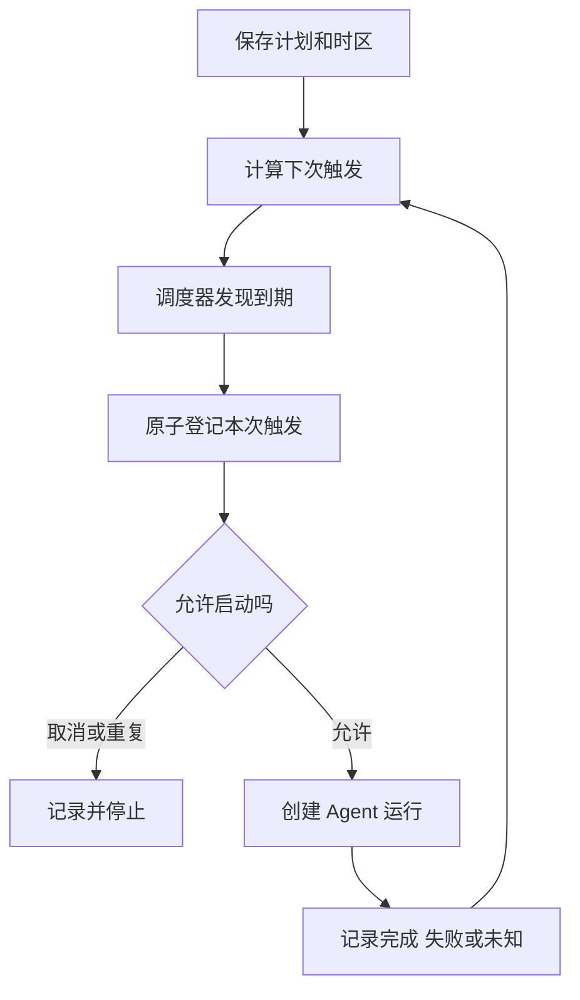

# 定时任务怎样可靠触发 Agent

[← AI Agent 学习路线](README.md)

用户希望每周一生成任务周报。系统需要记住触发时间，服务重启以后也能继续处理，并且不能因为调度器重复触发就发出两份周报。

定时触发与 Agent 的模型循环是两个职责。调度器负责什么时候创建任务，Agent 运行时负责一次任务如何执行。以下周报与时间均为设计示例。

## 一次性任务和周期任务

一次性任务保存预定时间及目标；周期任务还需要保存重复规则、时区、下次触发时间和启停状态。用户说“每周一上午九点”，必须知道使用哪个时区。夏令时切换可能出现某个当地时间不存在或出现两次，产品应定义跳过、顺延或去重策略。

例如一项计划固定为某城市当地上午九点，跨夏令时后对应的 UTC 时间可能改变。系统应保存时区标识和本地重复规则，再计算每次计划时刻；只保存当前的 UTC 偏移量，不能表达未来的时区变化。

定时请求应保存为可持久化记录，不能只依赖进程内计时器。运行环境关闭或调度器重启后，根据记录恢复下次触发，再按产品约定处理错过的时间点。

## 重复触发和任务重叠

图中展示的是一种等待本次运行结束后再推进下一次的串行安排。允许重叠的调度器可以在创建本次运行后独立计算后续触发，仍需要执行次数去重和并发控制。

可使用计划标识加计划触发时刻作为一次触发的稳定标识，并在权威存储中原子去重。创建运行和登记触发跨越不同服务时，仍要处理部分成功、重复投递和对账，不能只凭一把进程内锁保证全局唯一。

上一次任务还在运行时，可以选择跳过、排队或允许并行；若选择替换，也要考虑旧任务可能无法立即取消。具体规则取决于业务，不能让调度器在未声明时悄悄改变行为。[Kubernetes CronJob 文档](https://kubernetes.io/docs/concepts/workloads/controllers/cron-jobs/)描述了调度重叠和错过触发等实际问题，也要求任务处理可能发生的重复执行。

## 取消与授权需要重新确认

用户暂停或删除计划时，要阻止后续触发。取消与到期可能同时发生，应在同一权威状态上协调，并在启动与外部写操作前再次检查。已经发出的远程请求可能仍在进行，系统应记录最终结果。

周期任务运行时，用户权限、接收人或资料可能变化。每次执行都应按当前授权检查资源；过去创建计划时的权限不能无限期沿用。发出周报属于外部写操作，按产品规则处理授权、幂等和结果对账。

## 怎样验证

测试服务重启、错过触发、重复投递、时区和夏令时变化、任务重叠、取消竞争与权限撤销。区分计划触发成功、Agent 完成和通知发送成功。只有调度器创建了任务，不能说明周报已经生成或交付。
