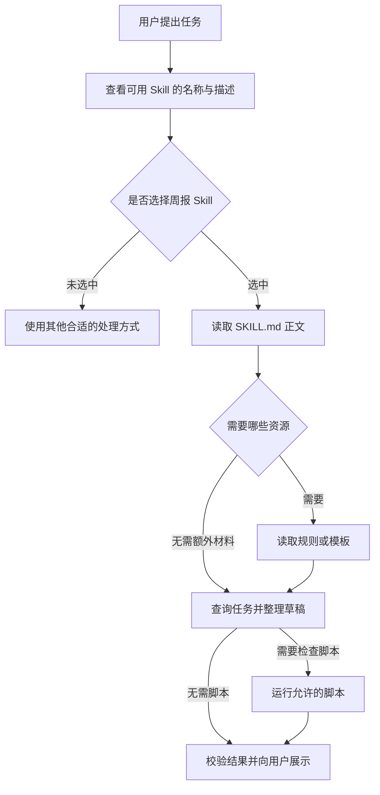

# Skill 怎样加载和参与执行

[← AI Agent 学习路线](README.md)

用户让 Agent 整理一份任务进展周报。Agent 能查询任务状态，却还需要知道周报应包含哪些内容、遇到缺失信息如何处理，以及哪些操作需要用户确认。下周再次做同样的事，用户不想重新解释一遍。

可以把这些做法整理成一个 Skill。Skill 是面向某类任务的可复用说明，通常包含任务要求和执行步骤，也可以附带参考文件、模板或脚本。它帮助 Agent 知道怎样组织工作；需要查询真实任务时，仍由应用调用工具。

本文使用虚构的任务周报说明加载过程，示例没有连接真实任务系统，也不代表已经安装了这个 Skill。

## 先看一个 Skill 的目录

假设团队为任务周报准备了一份 Skill，目录可以这样组织。

```text
task-weekly-report/
├── SKILL.md
├── references/
│   └── report-rules.md
├── assets/
│   └── report-template.md
└── scripts/
    └── check-report.py
```

`SKILL.md` 是入口。参考文件可以解释状态归类，模板规定周报结构，脚本用于检查报告是否包含必要章节。这些辅助目录都是可选的，不要求每个 Skill 都准备一套。

按照 [Agent Skills 公开规范](https://agentskills.io/specification)，入口文件包含 YAML 格式的元信息和 Markdown 正文。下面是一份简化示例。

```md
---
name: task-weekly-report
description: 整理任务进展周报时使用，查询任务状态并按约定结构生成草稿。
---

# 任务进展周报

1. 确认周报的时间范围；范围不明确时询问用户。
2. 查询当前用户有权查看的任务。
3. 阅读 references/report-rules.md，按规则整理状态。
4. 使用 assets/report-template.md 生成草稿。
5. 如有检查脚本，按运行环境要求检查报告结构。
6. 无法确认的信息标记为待确认，不自行补全。
7. 展示草稿；如用户要求发送，按应用规则确认后执行。
```

其中 `name` 和 `description` 帮助客户端识别这份 Skill。描述需要说明能力和适用情形，写得过于宽泛，可能导致模型误用；写得太窄，也可能在相关任务出现时漏选。

正文是工作说明。它可以告诉 Agent 查询任务和生成草稿，但它本身没有查询数据，也没有发送周报。

## 从被发现到参与任务

不同客户端对 Skill 的发现和加载方式不同。下面是一种常见设计，用户可以明确指定 Skill，应用也可以让模型结合名称、描述和请求判断是否使用。



图中读取参考文件和运行脚本只是可能的步骤，实际顺序由任务及 Skill 约定决定。文件缺失、工具不可用或用户没有权限时，应用应报告具体限制；不能因为 Skill 写了某个步骤，就声称它已经成功执行。

用户直接说“用任务周报 Skill”是一种明确触发方式。用户只说“帮我整理这周的任务”时，客户端也可能根据描述自动选择，但能否命中取决于产品实现、描述质量和任务上下文。不能把自动匹配当作必然结果。

## 渐进式加载节省了什么

如果安装了很多 Skill，一开始就把所有正文、参考材料和模板放进模型上下文，会占用不少空间。一个可行做法是先提供名称与简短描述，需要某项 Skill 时再读取正文，遇到具体步骤时再读取所需文件。

[Anthropic 的 Skill 说明](https://platform.claude.com/docs/en/agents-and-tools/agent-skills/overview)介绍了这种逐步披露方式。不同客户端可能提前加载一部分正文，也可能采用其他发现方式；具体行为应以所使用的产品为准。

运行脚本时，脚本可以在允许的环境中执行，再把结果交给 Agent。脚本源码是否进入模型上下文，要看 Agent 是否读取了文件以及客户端怎样处理输出；执行脚本并不要求模型先看完所有源码。

与之类似，[MCP 工具](mcp-external-tools.md)的完整定义也可以按需提供。Skill 常用于组织工作方法，MCP 提供应用与外部能力之间的通信方式，两者的加载策略都由客户端和应用决定。

## Skill 和工具怎样配合

任务周报 Skill 可能要求查询本周任务。应用通过工具查询后，会拿到状态、任务名称和其他授权范围内的数据。模型根据 Skill 的说明和查询结果整理草稿。

| 组件 | 在这个例子里承担的事 |
|---|---|
| 用户请求 | 说明要做什么，以及周报范围 |
| Skill | 说明整理步骤、缺失信息的处理和草稿要求 |
| 查询工具 | 从任务系统读取当前用户有权查看的任务 |
| 模板 | 约定周报的章节与格式 |
| 应用 | 控制加载、校验参数和权限，记录实际结果 |

如果查询返回错误，Skill 不能把它变成成功。Agent 应明确说明哪些信息没有取得。生成草稿和发送周报也是不同操作，后者要按用户授权、工具权限和产品规则处理。

Skill 正文、参考文件和模板都应来自可信来源。它们可能包含指令或代码，接入前要检查来源与版本。即使正文要求调用某个工具，应用仍需执行当前身份下的授权和参数检查；`allowed-tools` 在公开规范中属于实验字段，客户端的支持情况可能不同。

## 提示词、Skill 和固定工作流怎样选

一次性的自然语言要求可以直接写进提示词，例如“把今天的任务按状态列出来”。当团队反复遇到相似任务，并且需要维护步骤、示例和辅助资源时，Skill 有助于把这些说明放在一起。

有些步骤则适合固定在程序里。例如发送周报前检查用户权限、确认接收人和处理幂等，不能仅依赖 Skill 正文提醒模型。应用可以用固定工作流控制这些节点，让 Agent 在允许的范围内整理内容。

Skill 的文件不会改变模型参数，也不等于模型经过了新的训练。它通过被读取的说明和资源影响当前任务中的行为。

## 更新与验证

Skill 的说明和引用资源可能随业务规则更新。维护时可以为它们记录版本，让一次任务留下使用了哪份说明的证据。对于已经执行到一半的长任务，如果要切换版本，应重新检查已完成步骤与新规则是否冲突。不同客户端是否固定版本，需要根据实际实现确认。

测试这份周报 Skill 时，可以准备几类请求和环境。

| 场景 | 需要检查的行为 |
|---|---|
| 用户明确要求任务周报 | 能找到入口并读取适用说明 |
| 用户只问一个任务状态 | 不应因为提到任务就机械套用整份周报流程 |
| 时间范围缺失 | 提出澄清或按明确的产品默认值处理 |
| 查询工具不可用 | 说明无法取得的数据，不编造任务状态 |
| 引用的规则文件缺失 | 报告加载失败，不声称已依据规则整理 |
| 用户无权查看部分任务 | 查询工具和业务服务拒绝越权读取 |
| 用户要求发送草稿 | 按应用的授权与确认规则处理 |

这些是测试设计，并不表示已经对真实模型或业务系统完成测试。企业研发中如何把 Skill 与规则、知识、工具一起管理，可以继续阅读[企业知识和工具怎样交给 Agent](../ai-native/enterprise-context-and-tools.md)。
