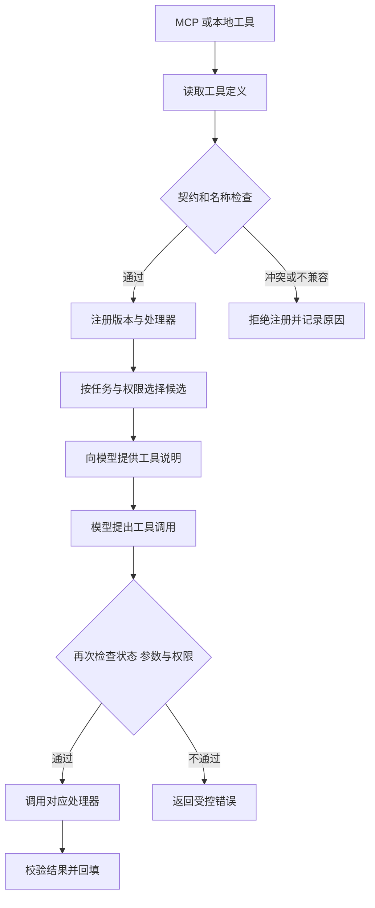

# 工具注册表怎样管理能力生命周期

[← AI Agent 学习路线](README.md)

[前面的 MCP 文章](mcp-external-tools.md)里，Agent 应用从任务服务发现了 `get_task_status`。当应用只有一个工具时，用固定名称对应一个处理函数就够了。接入任务、日历和文档服务后，工具可能改名、下线，也可能有不同服务提供同名工具。模型提出调用时，应用必须知道它指向哪一个服务和哪一份参数约定。

工具注册表可以保存这些信息，提供注册、查找和注销入口。它服务于 Agent 应用内部的工具管理，不要求每个项目都实现独立平台。下面使用虚构的任务查询工具说明设计，示例没有连接真实服务。

## 一条注册记录要保存什么

工具契约描述“怎样请求这项能力”。实际执行还需要知道从哪里调用，以及发生变化后如何识别。

| 信息 | 示例 | 用途 |
|---|---|---|
| 应用内标识 | `tasks.get_status` | 在当前应用中区分其他服务的同名工具 |
| 来源 | `tasks-mcp` | 找到对应的 MCP 连接与远端工具 |
| 远端名称 | `get_task_status` | 发起 MCP 调用时使用服务端名称 |
| 输入约定 | 必须提供任务编号 | 检查模型生成的参数 |
| 版本 | `v1` | 区分参数或行为发生变化的契约 |
| 调用属性 | 只读、超时限制 | 辅助应用选择执行与错误处理策略 |
| 状态 | 可用、停止接收、已注销 | 决定能否接收新调用 |

这里只列出设计所需的信息，不要求原始 MCP 工具定义自带所有字段。来源标识、应用内名称、版本和执行策略可以由应用配置或管理系统补充。像“只读”这样的声明仍需结合可信来源和真实权限检查，不能因为服务端写了只读就自动授予权限。

假设日历服务也提供了 `get_status`，应用可以分别注册成 `tasks.get_status` 和 `calendar.get_status`。对模型暴露的名称需要符合所用模型接口的规则；如果接口不接受这种写法，就使用合法别名并保存映射。不能在冲突时默默覆盖原工具。

## 从注册到执行经过哪些步骤

应用可以在启动时连接 MCP Server，通过 `tools/list` 获取定义，再转换为自己的注册记录。也可以按需连接，或者从经过审核的目录中发现工具。注册表保存的是可用能力与映射，工具定义实际何时提供给模型由应用决定。

候选选择可以通过固定配置、关键词搜索或其他方式完成。这里不假设一定需要额外的意图识别模型。[MCP 工具规范](https://modelcontextprotocol.io/specification/2025-11-25/server/tools)定义了服务端的工具发现和调用方式；注册表则是应用为了管理多种来源而采用的一种内部设计。

模型看到工具时，看到的主要是名称、描述和参数结构。真正执行时，应用先查注册表定位处理器，再检查工具当前是否可用、参数是否有效，以及用户能否访问具体资源。业务服务仍要检查资源权限。

## 改版本时不能只替换名字

任务服务将 `get_task_status` 的参数从 `task_id` 改成 `task_code`，旧对话里模型仍可能使用旧定义。如果应用悄悄覆盖注册记录，旧请求可能发给新处理器，导致调用失败，甚至查错资源。

更稳妥的做法是保留明确版本，为模型本轮看到的工具定义关联对应处理器。旧版本不再接收新任务之前，应用要确定已有任务如何结束。如果无法继续兼容旧契约，就返回明确的版本失效错误，重新发现工具并让模型基于新定义决策；不能擅自猜参数映射。

MCP Server 声明支持列表变更通知时，可以通知客户端重新读取工具列表。应用还要处理服务断线、分页或通知丢失导致的清单过期，通过重连刷新或周期核对补充。刷新结果需要经过冲突、版本和权限检查，不能直接覆盖所有本地配置。

## 注销时，已开始的调用怎么办

假设一个查询工具正在执行，管理员要求将它下线。注销至少有两个不同的动作。

1. 将工具设为停止接收新调用，并从后续发现结果中移除。
2. 处理已经接收的调用，等待结束、按规则取消，或在超时后标记结果待确认。

普通计划下线可以选择等待已有查询结束，再释放连接。对于明确的权限撤销或安全事件，应阻止新调用，并按业务风险尽快取消在途操作；已经提交到外部服务的请求未必能撤回，需要检查业务侧结果。

并发情况下，“检查工具可用”与“开始执行”之间可能发生注销。单进程可以用锁保护状态检查和取得执行引用。多实例则需要在共享权威状态中，以事务或其他原子操作将状态检查与取得执行资格绑定；仅在各实例读取一次状态，仍可能在检查后遇到注销。租约也需要处理过期执行者，必要时让业务服务校验版本令牌。对高风险写操作，业务服务还必须检查实时权限。

调用结束后释放引用；没有在途调用时再关闭相关资源。超时、进程崩溃或连接关闭以后，引用计数如何恢复，需要依实际存储和部署方式设计。取消动作也不等于外部写操作一定没有发生，重试前要结合业务幂等和结果对账。

## 缓存加快发现，权威状态决定能否执行

为了减少重复读取，应用可以缓存工具定义并建立名称或描述索引。缓存失效策略应覆盖注册、注销和版本更新，工具列表变更通知可以加快刷新。多个实例短时间内看到不同版本是可能的，调用前仍需校验当前可执行状态和权限。

搜索命中只说明“这个工具可能相关”。模型选择工具也不等于获得权限。调用前的规则、当前用户身份和资源服务的判断，才决定该请求能否继续。对工具描述或返回结果中的指令，要按不可信数据处理。

## 可以怎样验证

先用内存中的假处理器验证注册和查找，再接一个测试 MCP Server 检查连接。下面是预期检查点，不表示已经运行过真实服务。

| 场景 | 应检查的行为 |
|---|---|
| 两个服务注册同名工具 | 使用来源和应用内标识区分，冲突不被静默覆盖 |
| 模型调用未注册的工具 | 拒绝执行，不把名称当作任意代码运行 |
| 新旧契约同时存在 | 调用绑定到正确版本，不混用参数 |
| 工具停止接收新调用 | 新请求被拒绝，在途请求按下线策略处理 |
| 注销与调用同时发生 | 状态检查和取得执行资格之间没有未受控窗口 |
| 多实例持有旧缓存 | 过期实例不能绕过权威状态与业务权限 |
| Server 不可用或返回错误 | 返回明确失败，不把它当作查询成功 |

[插件生命周期](README.md)会进一步讨论一组工具如何随插件一起装载和释放。这里先把单个工具从注册到停止接收调用的规则讲清楚。
