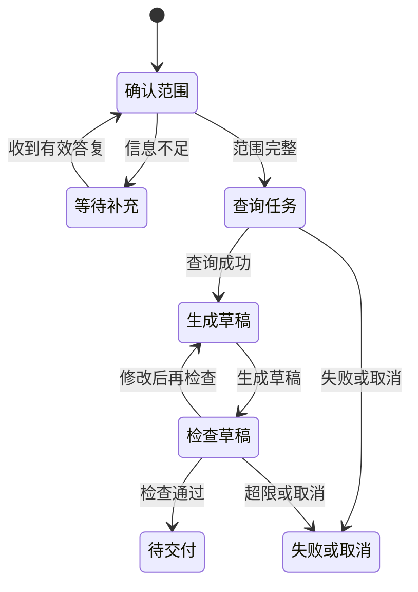

# 工作流状态机怎样控制任务推进

[← AI Agent 学习路线](README.md)

用户让 Agent 整理任务周报。应用需要先确认时间范围，再读取任务、生成草稿并进行检查。时间范围缺失时要等待用户补充；查询失败时不能跳到“已完成”。这些条件放在一段提示词里，任务执行到哪里、哪些步骤允许继续就很难检查。

工作流把任务拆成节点，状态机规定节点之间允许怎样转换。两者可以配合使用，让模型处理需要理解和组织语言的部分，让程序控制业务边界。本文的任务周报是虚构示例。

## 一份周报有哪些状态

应用可以保存任务编号、当前状态、时间范围、已查询的任务和草稿版本。状态是程序管理的业务记录，不应只存在模型的回答或对话摘要中。

| 当前状态 | 接收的结果 | 下一状态 |
|---|---|---|
| 待确认范围 | 范围完整 | 查询中 |
| 待确认范围 | 范围缺失 | 等待用户 |
| 查询中 | 返回有权限的任务数据 | 草稿生成中 |
| 查询中 | 查询失败 | 失败或受限重试 |
| 草稿生成中 | 草稿通过检查 | 待交付 |
| 等待用户 | 收到有效补充 | 待确认范围 |
| 任意可取消状态 | 用户取消 | 已取消 |

状态与节点名称由应用定义。进入“待交付”只代表草稿符合当前检查，不代表已经发送给其他人。

图里的返工边要设置次数和总时限。检查不通过后可以重试或修改，达到上限时应留下失败原因，不能无限循环。

## 状态怎样传给下一个节点

查询节点收到已确认的时间范围，返回带来源和状态的数据。草稿节点使用这份结果，不重新猜测任务列表。验证节点再检查必要章节、任务编号和草稿是否包含未授权信息。

并行节点同时更新状态时，需要规定哪些字段允许合并。例如任务查询和日历查询各写自己的结果区域；两个节点都修改同一个标题时，需要确定顺序、检测冲突或交给专门的汇总节点。不能简单地让最后写入者覆盖其他结果。

[LangGraph 的持久化说明](https://docs.langchain.com/oss/python/langgraph/persistence)展示了以检查点保存图状态的一种实现。具体字段、持久化位置和恢复方式由所用框架及应用决定，不是所有状态机都自动具备这些能力。

## 什么时候固定，什么时候让模型判断

权限、状态转换条件和是否允许发送周报，适合用程序明确约束。如何把已查询的任务写成易读的进展说明，可以由模型处理。

模型也可以提出“先查任务再整理”，但应用要验证它提出的行动是否属于当前允许节点。工具成功与业务完成不是一回事。草稿生成成功后，仍要看需要的任务是否查到、引用是否正确。

如果流程固定且不需要模型判断，普通程序也能实现。只有某一步确实需要理解自然语言或组织内容时，再把模型放进该节点即可。

## 暂停、恢复和验证

应用在等待用户、准备外部写操作和完成关键节点后，可以保存检查点。恢复前要重新确认任务状态、用户权限和时间范围是否仍有效。外部写操作已经发出但结果未知时，需要业务幂等与对账，不能因为重放节点就盲目再发一次。

检查样本可以覆盖缺少时间范围、查询超时、并行结果冲突、用户取消与重复答复。测试不仅看最后的文字，还要检查系统有没有经过允许的状态转换，以及失败后是否错误进入“待交付”。更具体的暂停和恢复分别见[澄清提问](clarification-and-resume.md)与[事件记录](event-state-recovery.md)。
